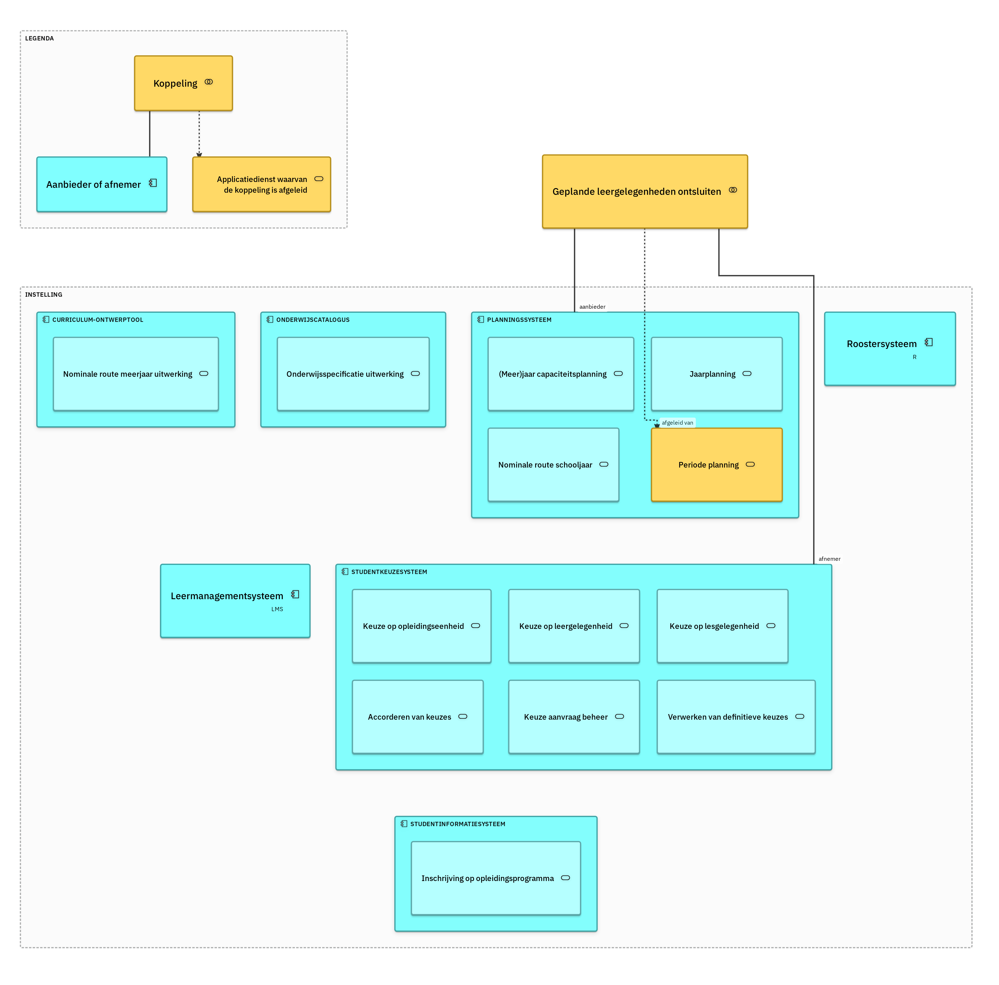

# Geplande leergelegenheden ontsluiten

Het studentkeuzesysteem kent de geplande leergelegenheden met hun capaciteit, zodat een student daaruit kan kiezen.

| Kenmerk | Waarde |
|---|---|
| Aanbieder | [Planningssysteem](../Applicatiecomponenten/planningssysteem.md) |
| Afnemer | [Studentkeuzesysteem](../Applicatiecomponenten/studentkeuzesysteem.md) |
| Afgeleid van | *Periode planning*, applicatiedienst van het planningssysteem |
| Versie | — |
| Vereist | [Afleverabonnement registreren](afleverabonnement-registreren.md), [Reconciliatie](reconciliatie.md) |
| OEAPI-profiel | `okx-geplande-leergelegenheden-ontsluiten` |

## Geplande leergelegenheden melden

Doel: het studentkeuzesysteem haalt de leergelegenheden van een periode op zodra die gepland zijn. Trigger: het planningssysteem stelt de leergelegenheden voor een periode vast. Initiator: Planningssysteem.

| Interactiepatronen | Koppelvlakdiensten |
|---|---|
| [Event Notification](../Interactiepatronen/event-notification.md) | [planbaar-onderwijsaanbod-aanbieder](../Koppelvlakdiensten/planbaar-onderwijsaanbod-aanbieder.md), [planbaar-onderwijsaanbod-afnemer](../Koppelvlakdiensten/planbaar-onderwijsaanbod-afnemer.md) |

Endpoints: nog niet vastgelegd.
