<!-- Gegenereerd door scripts/build-release.py uit release.json. Niet met de hand wijzigen: pas de bronnen aan en bouw opnieuw. -->

# Koppelvlakspecificatie

De specificaties waarmee een partij een koppelvlak kan bouwen op de standaarden die OKx uitbrengt.

Versie 0.0.1

Bouwt op [Informatie- en gegevensmodellen v0.1.0](https://github.com/Npuls-OKx/Public/tree/informatie-en-gegevensmodellen-v0.1.0)

<!-- pagina-einde -->

## 1 Inleiding

Dit document specificeert het koppelvlak van elk systeem dat deelneemt aan de uitwisseling van onderwijsspecificaties. Het beschrijft welke koppelvlakdiensten een systeem implementeert en welke endpoints daarbij horen, per koppeling welk berichtverkeer daaroverheen gaat en in welke volgorde, en welke payload er bij elke interactie hoort. De vorm van die payloads staat in de [informatie- en gegevensmodellen](https://github.com/Npuls-OKx/Public/blob/informatie-en-gegevensmodellen-v0.1.0/Informatie-en-gegevensmodellen/inleiding.md): het logisch gegevensmodel, de JSON Schema's en de regels die zo'n schema niet kan uitdrukken. Dat is een eigen releasepakket met een eigen versie, omdat de vorm van de gegevens en het berichtverkeer eromheen niet samen veranderen; deze specificatie bouwt op de versie die haar manifest noemt.

Waar de eisen vandaan komen staat in de [requirementsboom](#2-requirementsboom): van de opdracht via epics en features naar stories, en vandaar naar de berichtstroom in een koppeling die de story invult. Wat daarin vastligt en wat vrij is, leggen de [uitgangspunten](#8-uitgangspunten-voor-koppelingen) vast in U1: de bouwblokken zijn normatief, de keuze van koppelingen is aan de partijen. Daar staan ook de andere aannames die voor het hele pakket gelden. Elk document noemt zo'n uitgangspunt in één regel en verwijst erheen.

### 1.1 Kernbegrippen

- **Koppeling en koppelvlak** ([U2](#82-u2-koppeling-versus-koppelvlak)): een koppeling is één of meer endpoint-interacties met één doel, tussen een aanbieder en een afnemer; zij is afgeleid van een applicatiedienst uit de domeinarchitectuur en komt één op één overeen met een OEAPI-profiel. Het koppelvlak van een component is de verzameling koppelingen die dat component raken. De koppelvlakspecificatie van een component is daarmee de optelsom van zijn koppelingen.
- **Ankertabel, zes begrippenfamilies**: kader, beoogde leeruitkomst, specificatie, aanbod, verbintenis, resultaat. De leeruitkomst verbindt die families: specificaties verankeren erop en onderwijsresultaten worden erop behaald. De tabel staat voluit in het [kaderscenario leerroute 1](../Referentiemateriaal/kaderscenario's/leerroute-1-regulier.md#betrokken-informatie-bij-proces).
- **Event notification**: het patroon onder vrijwel elke uitwisseling in dit document. De bezitter meldt dun, de afnemer haalt op. Uitgewerkt bij [Event Notification](#61-event-notification), als keuze vastgelegd in [U4](#84-u4-event-notification).

De uitwerking volgt leerroute 1, de reguliere route, aan de hand van persona Jochem en de opleiding Apothekersassistent; leerroute 2 en 3 staan erbij als verschil daarop. Het [kaderscenario leerroute 1](../Referentiemateriaal/kaderscenario's/leerroute-1-regulier.md) draagt die route en die persona voluit.

### 1.2 Koppelvlak versus koppeling

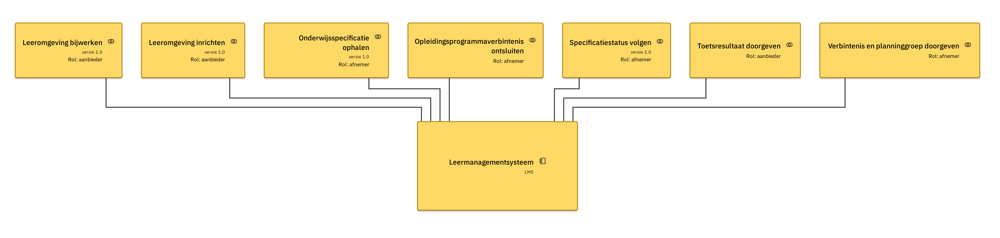

Een koppeling is één of meer endpoint-interacties met één doel; een koppelvlak is de optelsom van alle koppelingen die één component raken ([U2](#82-u2-koppeling-versus-koppelvlak)). Dit document volgt die knip: de koppelingen beschrijven per doel de berichtstromen en het berichtgedrag, en de applicatiecomponent-hoofdstukken tonen per component het koppelvlak met de endpoints en events die het serveert.

Elke interactie van een koppelvlak is te herleiden tot een informatiestroom op de informatiestromen-hoofdplaat:

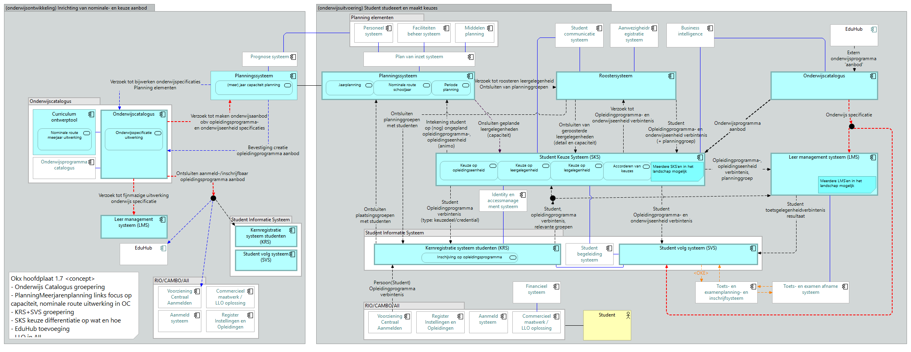

Die lijn loopt van scenario naar informatiestroom, naar koppeling, naar koppelvlak: een scenario maakt zichtbaar welke informatie moet bewegen, de hoofdplaat toont die beweging als stroom (versie 1.7 is leidend; de legenda draagt nog "concept", dus richtinggevend), de koppelingen standaardiseren die stroom, elk voor één doel, en het koppelvlak bundelt wat één component daarvan serveert. Per component staat die bundel als view op de hoofdplaat in het bijbehorende hoofdstuk.

### 1.3 Afkortingen

| Afkorting | Betekenis |
|---|---|
| OC | Onderwijscatalogus, het distributiepunt voor onderwijsspecificaties |
| P&R | Planning en roostering (planningssysteem en roostersysteem) |
| LMS | Leermanagementsysteem, de online leeromgeving voor de student |
| SIS | Studentinformatiesysteem, hier de combinatie KRS en SVS |
| KRS | Kernregistratiesysteem studenten (inschrijving) |
| SVS | Studentvolgsysteem (individuele structuur, voortgang, resultaten) |
| SKS | Studentkeuzesysteem, waar de student zijn keuzes maakt |
| CO | Curriculum-ontwerptool, waar onderwijsspecificaties ontstaan |
| Leerroute 1-3 | De Npuls-leerroutes: regulier, temporiseren, en versnellen. Leerroute 1 is de basis, 2 en 3 worden als verschil beschreven |
| SBU | Studiebelastingsuren |
| EC | European Credit, de studiepunt-eenheid van het hoger onderwijs |
| BOL | Beroepsopleidende leerweg (voltijd op school, met stage) |
| BBL | Beroepsbegeleidende leerweg (werken en leren gecombineerd) |
| BPV | Beroepspraktijkvorming, het praktijkdeel van de opleiding |
| SBB | Samenwerkingsorganisatie Beroepsonderwijs Bedrijfsleven, beheerder van het kwalificatiekader |
| NLQF | Nederlands kwalificatieraamwerk, dat een niveau aan een leeruitkomst hangt |
| OER | Onderwijs- en examenregeling, de contractuele afspraak met de student |
| OEAPI | Open Onderwijs API, de sectorstandaard waarop OKx zoveel mogelijk aansluit |

<!-- pagina-einde -->

## Inhoudsopgave

- [1 Inleiding](#1-inleiding)
  - [1.1 Kernbegrippen](#11-kernbegrippen)
  - [1.2 Koppelvlak versus koppeling](#12-koppelvlak-versus-koppeling)
  - [1.3 Afkortingen](#13-afkortingen)
- [2 Requirementsboom](#2-requirementsboom)
  - [2.1 Visualisatie requirementsboom](#21-visualisatie-requirementsboom)
  - [2.2 Requirementsleeswijzer](#22-requirementsleeswijzer)
  - [2.3 Aansluiting op de techniek](#23-aansluiting-op-de-techniek)
  - [2.4 Bijdragen](#24-bijdragen)
  - [2.5 Scope](#25-scope)
  - [2.6 De opdracht: Leren zonder Drempels](#26-de-opdracht-leren-zonder-drempels)
    - [2.6.1 Context](#261-context)
    - [2.6.2 Projectdoelen](#262-projectdoelen)
    - [2.6.3 Van doel naar epic](#263-van-doel-naar-epic)
  - [2.7 Epics](#27-epics)
  - [2.8 Features](#28-features)
    - [2.8.1 Gezamenlijke taal en standaard](#281-gezamenlijke-taal-en-standaard)
    - [2.8.2 Onderwijsaanbod specificeren en ontsluiten](#282-onderwijsaanbod-specificeren-en-ontsluiten)
    - [2.8.3 Aanbod plannen en roosteren](#283-aanbod-plannen-en-roosteren)
    - [2.8.4 Betrouwbare en vervangbare koppelingen](#284-betrouwbare-en-vervangbare-koppelingen)
    - [2.8.5 Standaard beproeven en adopteren](#285-standaard-beproeven-en-adopteren)
    - [2.8.6 Student kiest onderwijsspecificaties](#286-student-kiest-onderwijsspecificaties)
    - [2.8.7 Keuze en verbintenis vastleggen](#287-keuze-en-verbintenis-vastleggen)
    - [2.8.8 Voortgang en resultaat op leeruitkomsten](#288-voortgang-en-resultaat-op-leeruitkomsten)
  - [2.9 Stories](#29-stories)
    - [2.9.1 Onderwijsaanbod specificeren en ontsluiten](#291-onderwijsaanbod-specificeren-en-ontsluiten)
    - [2.9.2 Aanbod plannen en roosteren](#292-aanbod-plannen-en-roosteren)
    - [2.9.3 Betrouwbare en vervangbare koppelingen](#293-betrouwbare-en-vervangbare-koppelingen)
    - [2.9.4 Student kiest onderwijsspecificaties](#294-student-kiest-onderwijsspecificaties)
    - [2.9.5 Keuze en verbintenis vastleggen](#295-keuze-en-verbintenis-vastleggen)
    - [2.9.6 Voortgang en resultaat op leeruitkomsten](#296-voortgang-en-resultaat-op-leeruitkomsten)
- [3 Applicatiecomponenten](#3-applicatiecomponenten)
  - [3.1 Ecosysteem](#31-ecosysteem)
  - [3.2 Onderwijscatalogus (OC)](#32-onderwijscatalogus-oc)
    - [3.2.1 Koppelvlak](#321-koppelvlak)
    - [3.2.2 Koppelvlakdiensten](#322-koppelvlakdiensten)
    - [3.2.3 Koppelingen](#323-koppelingen)
  - [3.3 Planningssysteem (P)](#33-planningssysteem-p)
    - [3.3.1 Koppelvlak](#331-koppelvlak)
    - [3.3.2 Koppelvlakdiensten](#332-koppelvlakdiensten)
    - [3.3.3 Koppelingen](#333-koppelingen)
  - [3.4 Studentinformatiesysteem (SIS)](#34-studentinformatiesysteem-sis)
    - [3.4.1 Koppelvlak](#341-koppelvlak)
    - [3.4.2 Koppelvlakdiensten](#342-koppelvlakdiensten)
    - [3.4.3 Koppelingen](#343-koppelingen)
  - [3.5 Leermanagementsysteem (LMS)](#35-leermanagementsysteem-lms)
    - [3.5.1 Koppelvlak](#351-koppelvlak)
    - [3.5.2 Koppelvlakdiensten](#352-koppelvlakdiensten)
    - [3.5.3 Koppelingen](#353-koppelingen)
  - [3.6 Roostersysteem (R)](#36-roostersysteem-r)
    - [3.6.1 Koppelvlak](#361-koppelvlak)
    - [3.6.2 Koppelvlakdiensten](#362-koppelvlakdiensten)
    - [3.6.3 Koppelingen](#363-koppelingen)
  - [3.7 Studentkeuzesysteem (SKS)](#37-studentkeuzesysteem-sks)
    - [3.7.1 Koppelvlak](#371-koppelvlak)
    - [3.7.2 Koppelvlakdiensten](#372-koppelvlakdiensten)
    - [3.7.3 Koppelingen](#373-koppelingen)
  - [3.8 Curriculum-ontwerptool (CO)](#38-curriculum-ontwerptool-co)
    - [3.8.1 Koppelvlakdiensten](#381-koppelvlakdiensten)
    - [3.8.2 Koppelingen](#382-koppelingen)
- [4 Koppelingen](#4-koppelingen)
  - [4.1 Ontwerpregels](#41-ontwerpregels)
  - [4.2 Overzicht](#42-overzicht)
  - [4.3 Onderwijsspecificatie ophalen](#43-onderwijsspecificatie-ophalen)
    - [4.3.1 Stories](#431-stories)
    - [4.3.2 Specificatie beschikbaar melden](#432-specificatie-beschikbaar-melden)
    - [4.3.3 Specificatiewijziging melden](#433-specificatiewijziging-melden)
  - [4.4 Specificatiestatus volgen](#44-specificatiestatus-volgen)
    - [4.4.1 Stories](#441-stories)
    - [4.4.2 Specificatiestatus gewijzigd melden](#442-specificatiestatus-gewijzigd-melden)
  - [4.5 Resultaatstructuur ophalen](#45-resultaatstructuur-ophalen)
    - [4.5.1 Resultaatstructuur beschikbaar melden](#451-resultaatstructuur-beschikbaar-melden)
    - [4.5.2 Examenplanwijziging melden](#452-examenplanwijziging-melden)
  - [4.6 Specificatie aanpassen op verzoek](#46-specificatie-aanpassen-op-verzoek)
    - [4.6.1 Aanpassing aanvragen](#461-aanpassing-aanvragen)
  - [4.7 Keuzeaanbod ontsluiten](#47-keuzeaanbod-ontsluiten)
    - [4.7.1 Keuzeregelset melden](#471-keuzeregelset-melden)
  - [4.8 Inschrijfbaar aanbod ontsluiten](#48-inschrijfbaar-aanbod-ontsluiten)
    - [4.8.1 Inschrijfbaar aanbod melden](#481-inschrijfbaar-aanbod-melden)
  - [4.9 Specificatie ter vaststelling aanbieden](#49-specificatie-ter-vaststelling-aanbieden)
    - [4.9.1 Specificatie aanleveren](#491-specificatie-aanleveren)
  - [4.10 Opleidingsaanbod aanmaken](#410-opleidingsaanbod-aanmaken)
    - [4.10.1 Stories](#4101-stories)
    - [4.10.2 Planuitkomst melden](#4102-planuitkomst-melden)
    - [4.10.3 Planning niet gelukt melden](#4103-planning-niet-gelukt-melden)
  - [4.11 Opleidingsaanbod herplannen](#411-opleidingsaanbod-herplannen)
    - [4.11.1 Herplanuitkomst melden](#4111-herplanuitkomst-melden)
  - [4.12 Late wijziging toetsen](#412-late-wijziging-toetsen)
    - [4.12.1 Stories](#4121-stories)
    - [4.12.2 Acceptatietoets bij late wijziging](#4122-acceptatietoets-bij-late-wijziging)
  - [4.13 Planningselementen ontsluiten](#413-planningselementen-ontsluiten)
    - [4.13.1 Planningselementen melden](#4131-planningselementen-melden)
  - [4.14 Geplande leergelegenheden ontsluiten](#414-geplande-leergelegenheden-ontsluiten)
    - [4.14.1 Geplande leergelegenheden melden](#4141-geplande-leergelegenheden-melden)
  - [4.15 Planninggroepen ontsluiten](#415-planninggroepen-ontsluiten)
    - [4.15.1 Planninggroepen melden](#4151-planninggroepen-melden)
  - [4.16 Plaatsingsgroepen ontsluiten](#416-plaatsingsgroepen-ontsluiten)
    - [4.16.1 Plaatsingsgroepen melden](#4161-plaatsingsgroepen-melden)
  - [4.17 Opleidingsprogrammaverbintenis ontsluiten](#417-opleidingsprogrammaverbintenis-ontsluiten)
    - [4.17.1 Verbintenistoestand melden](#4171-verbintenistoestand-melden)
  - [4.18 Animo doorgeven](#418-animo-doorgeven)
    - [4.18.1 Animo melden](#4181-animo-melden)
  - [4.19 Plaatsing op lesgelegenheid aanvragen](#419-plaatsing-op-lesgelegenheid-aanvragen)
    - [4.19.1 Plaatsing aanvragen](#4191-plaatsing-aanvragen)
  - [4.20 Keuzeverbintenis vastleggen](#420-keuzeverbintenis-vastleggen)
    - [4.20.1 Definitieve keuze melden](#4201-definitieve-keuze-melden)
  - [4.21 Onderwijseenheidverbintenis doorgeven](#421-onderwijseenheidverbintenis-doorgeven)
    - [4.21.1 Definitieve keuze melden](#4211-definitieve-keuze-melden)
  - [4.22 Verbintenis en planninggroep doorgeven](#422-verbintenis-en-planninggroep-doorgeven)
    - [4.22.1 Definitieve keuze melden](#4221-definitieve-keuze-melden)
  - [4.23 Leergelegenheden roosteren](#423-leergelegenheden-roosteren)
    - [4.23.1 Roosteren aanvragen](#4231-roosteren-aanvragen)
  - [4.24 Geroosterde leergelegenheden ontsluiten](#424-geroosterde-leergelegenheden-ontsluiten)
    - [4.24.1 Geroosterde leergelegenheden melden](#4241-geroosterde-leergelegenheden-melden)
  - [4.25 Planninggroepen met studenten ontsluiten](#425-planninggroepen-met-studenten-ontsluiten)
    - [4.25.1 Planninggroepen met studenten melden](#4251-planninggroepen-met-studenten-melden)
  - [4.26 Leeromgeving inrichten](#426-leeromgeving-inrichten)
    - [4.26.1 Stories](#4261-stories)
    - [4.26.2 Leeromgeving inrichten en leermiddelkoppeling melden](#4262-leeromgeving-inrichten-en-leermiddelkoppeling-melden)
  - [4.27 Leeromgeving bijwerken](#427-leeromgeving-bijwerken)
    - [4.27.1 Stories](#4271-stories)
    - [4.27.2 Inrichting bijwerken na wijziging](#4272-inrichting-bijwerken-na-wijziging)
  - [4.28 Toetsresultaat doorgeven](#428-toetsresultaat-doorgeven)
    - [4.28.1 Toetsresultaat melden](#4281-toetsresultaat-melden)
  - [4.29 Nominaal template inrichten](#429-nominaal-template-inrichten)
    - [4.29.1 Stories](#4291-stories)
    - [4.29.2 Nominaal template en resultaatstructuur inrichten](#4292-nominaal-template-en-resultaatstructuur-inrichten)
  - [4.30 Examenplanwijziging toetsen](#430-examenplanwijziging-toetsen)
    - [4.30.1 Stories](#4301-stories)
    - [4.30.2 Acceptatietoets bij wijziging examenplan](#4302-acceptatietoets-bij-wijziging-examenplan)
  - [4.31 Afleverabonnement registreren](#431-afleverabonnement-registreren)
    - [4.31.1 Stories](#4311-stories)
    - [4.31.2 Abonnement registreren](#4312-abonnement-registreren)
  - [4.32 Reconciliatie](#432-reconciliatie)
    - [4.32.1 Stories](#4321-stories)
    - [4.32.2 Reconciliatie na gemist event](#4322-reconciliatie-na-gemist-event)
- [5 Koppelvlakdiensten](#5-koppelvlakdiensten)
  - [5.1 Wat op elke dienst drukt](#51-wat-op-elke-dienst-drukt)
  - [5.2 Onderwijsspecificatiestructuur-aanbieder](#52-onderwijsspecificatiestructuur-aanbieder)
    - [5.2.1 Verplichtingen](#521-verplichtingen)
    - [5.2.2 Gebruikt in](#522-gebruikt-in)
  - [5.3 Onderwijsspecificatiestructuur-afnemer](#53-onderwijsspecificatiestructuur-afnemer)
    - [5.3.1 Verplichtingen](#531-verplichtingen)
    - [5.3.2 Gebruikt in](#532-gebruikt-in)
  - [5.4 Onderwijsspecificatie-inname-aanbieder](#54-onderwijsspecificatie-inname-aanbieder)
    - [5.4.1 Verplichtingen](#541-verplichtingen)
    - [5.4.2 Gebruikt in](#542-gebruikt-in)
  - [5.5 Onderwijsspecificatie-inname-afnemer](#55-onderwijsspecificatie-inname-afnemer)
    - [5.5.1 Verplichtingen](#551-verplichtingen)
    - [5.5.2 Gebruikt in](#552-gebruikt-in)
  - [5.6 Keuzeregelset-aanbieder](#56-keuzeregelset-aanbieder)
    - [5.6.1 Verplichtingen](#561-verplichtingen)
    - [5.6.2 Gebruikt in](#562-gebruikt-in)
  - [5.7 Keuzeregelset-afnemer](#57-keuzeregelset-afnemer)
    - [5.7.1 Verplichtingen](#571-verplichtingen)
    - [5.7.2 Gebruikt in](#572-gebruikt-in)
  - [5.8 Planbaar-onderwijsaanbod-aanbieder](#58-planbaar-onderwijsaanbod-aanbieder)
    - [5.8.1 Verplichtingen](#581-verplichtingen)
    - [5.8.2 Gebruikt in](#582-gebruikt-in)
  - [5.9 Planbaar-onderwijsaanbod-afnemer](#59-planbaar-onderwijsaanbod-afnemer)
    - [5.9.1 Verplichtingen](#591-verplichtingen)
    - [5.9.2 Gebruikt in](#592-gebruikt-in)
  - [5.10 Onderwijsaanbod-zoekvraag-aanbieder](#510-onderwijsaanbod-zoekvraag-aanbieder)
    - [5.10.1 Verplichtingen](#5101-verplichtingen)
    - [5.10.2 Gebruikt in](#5102-gebruikt-in)
  - [5.11 Onderwijsaanbod-zoekvraag-afnemer](#511-onderwijsaanbod-zoekvraag-afnemer)
    - [5.11.1 Verplichtingen](#5111-verplichtingen)
    - [5.11.2 Gebruikt in](#5112-gebruikt-in)
  - [5.12 Onderwijsaanbod-haalbaarheidstoets-aanbieder](#512-onderwijsaanbod-haalbaarheidstoets-aanbieder)
    - [5.12.1 Verplichtingen](#5121-verplichtingen)
    - [5.12.2 Gebruikt in](#5122-gebruikt-in)
  - [5.13 Onderwijsaanbod-haalbaarheidstoets-afnemer](#513-onderwijsaanbod-haalbaarheidstoets-afnemer)
    - [5.13.1 Verplichtingen](#5131-verplichtingen)
    - [5.13.2 Gebruikt in](#5132-gebruikt-in)
  - [5.14 Geroosterd-onderwijsaanbod-aanbieder](#514-geroosterd-onderwijsaanbod-aanbieder)
    - [5.14.1 Verplichtingen](#5141-verplichtingen)
    - [5.14.2 Gebruikt in](#5142-gebruikt-in)
  - [5.15 Geroosterd-onderwijsaanbod-afnemer](#515-geroosterd-onderwijsaanbod-afnemer)
    - [5.15.1 Verplichtingen](#5151-verplichtingen)
    - [5.15.2 Gebruikt in](#5152-gebruikt-in)
  - [5.16 Kiesbaarheidsbepaling-aanbieder](#516-kiesbaarheidsbepaling-aanbieder)
    - [5.16.1 Verplichtingen](#5161-verplichtingen)
    - [5.16.2 Gebruikt in](#5162-gebruikt-in)
  - [5.17 Kiesbaarheidsbepaling-afnemer](#517-kiesbaarheidsbepaling-afnemer)
    - [5.17.1 Verplichtingen](#5171-verplichtingen)
    - [5.17.2 Gebruikt in](#5172-gebruikt-in)
  - [5.18 Verbintenistoestand-aanbieder](#518-verbintenistoestand-aanbieder)
    - [5.18.1 Verplichtingen](#5181-verplichtingen)
    - [5.18.2 Gebruikt in](#5182-gebruikt-in)
  - [5.19 Verbintenistoestand-afnemer](#519-verbintenistoestand-afnemer)
    - [5.19.1 Verplichtingen](#5191-verplichtingen)
    - [5.19.2 Gebruikt in](#5192-gebruikt-in)
  - [5.20 Resultaatstructuur-aanbieder](#520-resultaatstructuur-aanbieder)
    - [5.20.1 Verplichtingen](#5201-verplichtingen)
    - [5.20.2 Gebruikt in](#5202-gebruikt-in)
  - [5.21 Resultaatstructuur-afnemer](#521-resultaatstructuur-afnemer)
    - [5.21.1 Verplichtingen](#5211-verplichtingen)
    - [5.21.2 Gebruikt in](#5212-gebruikt-in)
  - [5.22 Behaalde-leeruitkomst-aanbieder](#522-behaalde-leeruitkomst-aanbieder)
    - [5.22.1 Verplichtingen](#5221-verplichtingen)
    - [5.22.2 Gebruikt in](#5222-gebruikt-in)
  - [5.23 Behaalde-leeruitkomst-afnemer](#523-behaalde-leeruitkomst-afnemer)
    - [5.23.1 Verplichtingen](#5231-verplichtingen)
    - [5.23.2 Gebruikt in](#5232-gebruikt-in)
  - [5.24 Leermiddelkoppeling-aanbieder](#524-leermiddelkoppeling-aanbieder)
    - [5.24.1 Verplichtingen](#5241-verplichtingen)
    - [5.24.2 Gebruikt in](#5242-gebruikt-in)
  - [5.25 Leermiddelkoppeling-afnemer](#525-leermiddelkoppeling-afnemer)
    - [5.25.1 Verplichtingen](#5251-verplichtingen)
    - [5.25.2 Gebruikt in](#5252-gebruikt-in)
  - [5.26 Verwerkingsuitkomst-aanbieder](#526-verwerkingsuitkomst-aanbieder)
    - [5.26.1 Verplichtingen](#5261-verplichtingen)
    - [5.26.2 Gebruikt in](#5262-gebruikt-in)
  - [5.27 Verwerkingsuitkomst-afnemer](#527-verwerkingsuitkomst-afnemer)
    - [5.27.1 Verplichtingen](#5271-verplichtingen)
    - [5.27.2 Gebruikt in](#5272-gebruikt-in)
  - [5.28 Afleverabonnement-aanbieder](#528-afleverabonnement-aanbieder)
    - [5.28.1 Verplichtingen](#5281-verplichtingen)
    - [5.28.2 Gebruikt in](#5282-gebruikt-in)
  - [5.29 Afleverabonnement-afnemer](#529-afleverabonnement-afnemer)
    - [5.29.1 Verplichtingen](#5291-verplichtingen)
    - [5.29.2 Gebruikt in](#5292-gebruikt-in)
- [6 Interactiepatronen](#6-interactiepatronen)
  - [6.1 Event Notification](#61-event-notification)
    - [6.1.1 Wanneer](#611-wanneer)
    - [6.1.2 Verloop](#612-verloop)
    - [6.1.3 Eigenschappen](#613-eigenschappen)
    - [6.1.4 Toegepast in](#614-toegepast-in)
  - [6.2 Event-Carried State Transfer](#62-event-carried-state-transfer)
    - [6.2.1 Wanneer](#621-wanneer)
    - [6.2.2 Verloop](#622-verloop)
    - [6.2.3 Eigenschappen](#623-eigenschappen)
    - [6.2.4 Toegepast in](#624-toegepast-in)
  - [6.3 Asynchronous Request-Reply](#63-asynchronous-request-reply)
    - [6.3.1 Wanneer](#631-wanneer)
    - [6.3.2 Verloop](#632-verloop)
    - [6.3.3 Eigenschappen](#633-eigenschappen)
    - [6.3.4 Toegepast in](#634-toegepast-in)
  - [6.4 Request-Reply](#64-request-reply)
    - [6.4.1 Wanneer](#641-wanneer)
    - [6.4.2 Verloop](#642-verloop)
    - [6.4.3 Eigenschappen](#643-eigenschappen)
    - [6.4.4 Toegepast in](#644-toegepast-in)
  - [6.5 Subscription registration](#65-subscription-registration)
    - [6.5.1 Wanneer](#651-wanneer)
    - [6.5.2 Verloop](#652-verloop)
    - [6.5.3 Eigenschappen](#653-eigenschappen)
    - [6.5.4 Toegepast in](#654-toegepast-in)
- [7 Auth-standaard voor koppelvlakken](#7-auth-standaard-voor-koppelvlakken)
  - [7.1 Mechanisme: OAuth 2.0 Client Credentials](#71-mechanisme-oauth-20-client-credentials)
  - [7.2 Toepassing op webhook-aflevering](#72-toepassing-op-webhook-aflevering)
  - [7.3 Wat dit niet regelt](#73-wat-dit-niet-regelt)
- [8 Uitgangspunten voor koppelingen](#8-uitgangspunten-voor-koppelingen)
  - [8.1 U1. Bouwblokken liggen vast, de keuze van koppelingen is vrij](#81-u1-bouwblokken-liggen-vast-de-keuze-van-koppelingen-is-vrij)
  - [8.2 U2. Koppeling versus koppelvlak](#82-u2-koppeling-versus-koppelvlak)
  - [8.3 U3. Resource-eigenaarschap](#83-u3-resource-eigenaarschap)
  - [8.4 U4. Event notification](#84-u4-event-notification)
  - [8.5 U5. Bericht versus kanaal](#85-u5-bericht-versus-kanaal)
  - [8.6 U6. Semantiek uit de ankertabel](#86-u6-semantiek-uit-de-ankertabel)
  - [8.7 U7. Payload plat met verwijzingen, en de sleutelconventie](#87-u7-payload-plat-met-verwijzingen-en-de-sleutelconventie)
  - [8.8 U8. Machine-interpreteerbaar, met leesbare weergaven](#88-u8-machine-interpreteerbaar-met-leesbare-weergaven)
  - [8.9 U9. Scenario's en persona's](#89-u9-scenarios-en-personas)
  - [8.10 U10. Scope- en documentdiscipline](#810-u10-scope--en-documentdiscipline)
  - [8.11 Gerelateerde documenten](#811-gerelateerde-documenten)
  - [8.12 U11. Toekomstvaste endpoints: volledige structuur en delta](#812-u11-toekomstvaste-endpoints-volledige-structuur-en-delta)

<!-- pagina-einde -->

## 2 Requirementsboom

De gelaagde breakdown van de OKx-requirements: van de opdracht (Leren zonder Drempels) via epics en features naar stories, met onderaan de aansluiting op de koppelvlakspecificaties. De boom is de getoonde koppeling tussen business en techniek; elke rij draagt een bron. De bovenste lagen zijn geschreven voor product owner en kernteam, de onderste voor de technische werkgroep en leveranciers; per laag staat het erbij. De boom is opgesteld in de meta-werkomgeving en per [ADR 0025](../Referentiemateriaal/adr/0025-requirementsboom-als-koppeling-business-techniek.md) naar deze repository overgeheveld; de bronverwijzingen naar meta zijn gepind op het commit van de overheveling.

### 2.1 Visualisatie requirementsboom

De plaat toont de opdracht (Leren zonder Drempels), de OKx-projectdoelen en de epics; onder elke epic hangen features en daaronder stories, als twee gestippelde verzamelknopen. De uitwerking per rij staat in de tabellen, uitgelegd in de leeswijzer hieronder. De plaat heeft geen klikbare knopen, dus de leeswijzer is de klikroute.

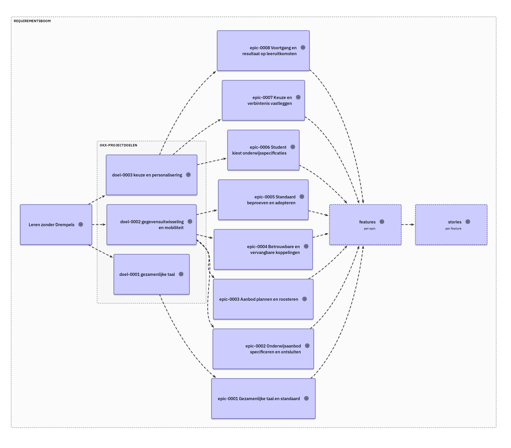

### 2.2 Requirementsleeswijzer

Elke rij draagt een id om naar te verwijzen (doel-0001, epic-0001, feature-0001, story-0001: plat per soort, voluit met vier cijfers) en een kolom Bron: de context en bronvermelding van die rij. Alle verwijzingen leven in de tabellen zelf, niet in deze leesroute. Systeemafkortingen: OC (onderwijscatalogus), SKS (studentkeuzesysteem), P&R (planning en roostering), SIS (studentinformatiesysteem), LMS (leermanagementsysteem), SVS (studievoortgangsysteem). Bronafkortingen: ADR (architectuurbesluit), U (uitgangspunt), OKx-AP (architectuurprincipe).

#### 2.2.1 Opdracht en doelen ([opdracht.md](#26-de-opdracht-leren-zonder-drempels))

- **Wat**: de doelen die vanuit de Npuls-programmacontext (Leren zonder Drempels) aan het project OKx zijn gesteld. Vooral voor product owner en kernteam.
- **Rij**: doel-id, omschrijving, bron; de tabel "Van doel naar epic" is de stap omlaag.

#### 2.2.2 Epics ([epics.md](#27-epics))

- **Wat**: vertalen de doelen naar thema's, bekwaamheden van de keten. Vooral voor product owner en kernteam.
- **Rij**: "Draagt bij aan" = de ouder (het doel) · Features = de stap omlaag · Bron.

#### 2.2.3 Features ([features.md](#28-features))

- **Wat**: één concreet stuk van een thema dat de keten moet kunnen, zoals kiesbaarheid bepalen of specificaties versioneren zonder verwijzingen te breken; per epic een eigen sectie. Vooral voor kernteam en technische werkgroep.
- **Rij**: Epic-cel = de ouder · Stories = de stap omlaag ("geen" = nog niet uitgewerkt) · Bron.

#### 2.2.4 Stories ([stories.md](#29-stories))

- **Wat**: één toetsbare wens van één actor, in één zin ("Als ... wil ik ... zodat ..."). Vooral voor de technische werkgroep en leveranciers.
- **Rij**: Feature-cel = de ouder · Bron · Ingevuld door = de brug naar de techniek: de berichtstroom die de story realiseert ("geen" = nog geen stroom).

### 2.3 Aansluiting op de techniek

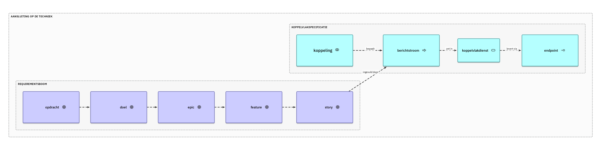

Een [koppeling](#4-koppelingen) beschrijft welke berichtstromen erover lopen. De kolom Ingevuld door van een story wijst de stroom aan die haar realiseert; die stroom noemt de story terug. Een stroom zet [koppelvlakdiensten](#5-koppelvlakdiensten) in, en elke dienst legt zijn verplichtingen en endpoints vast. Wie een featureset wil ondersteunen, implementeert de koppelingen waarvan de stromen de stories invullen, elk op een versie en in een rol.

### 2.4 Bijdragen

- Vorm en spelregels staan in de [skill okx-requirements-boom](https://github.com/Npuls-OKx/meta/blob/bd6fc9499b283fe974fd32c87bbb9307e75e7d1b/.agents/skills/okx-requirements-boom/SKILL.md) (gepind). Kern: één document per laag, elke rij één ouder, één bron en een id, overzicht boven volledigheid.
- Elke wijziging haalt de navigatiecontrole: `python3 scripts/validate-requirementsboom-navigatie.py` plus `python3 -m unittest discover -s tests`; beide draaien ook in de CI op elke pull request.
- Een idee of bevinding wordt een issue onder een milestone van deze repository; planningsstatus leeft in milestones en issues, niet in deze tabellen.
- Herkomst en verificatie van elke rij: de [extractieverantwoording](https://github.com/Npuls-OKx/meta/blob/bd6fc9499b283fe974fd32c87bbb9307e75e7d1b/architecture/agent-artifacts/research/20260806_0837_requirementsboom-extractie.md) met de parkeerlijst; oudere documenten gebruiken id-vormen van vóór de hernummering, de [hernummeringstabel](https://github.com/Npuls-OKx/meta/blob/bd6fc9499b283fe974fd32c87bbb9307e75e7d1b/architecture/agent-artifacts/research/20260816_1820_hernummering-requirementsboom.md) vertaalt oud naar nieuw.
- Eis-id's en uitvoerbare scenario's staan bewust niet in de boom; die achtergrondmechaniek volgt gefaseerd, zie de [synthese van het onderzoek](https://github.com/Npuls-OKx/meta/blob/bd6fc9499b283fe974fd32c87bbb9307e75e7d1b/architecture/agent-artifacts/research/20260804_1700_oplossingsrichtingen-business-techniek.md).
- Werkwijze voor branches, issues en review: [CONTRIBUTING](https://github.com/Npuls-OKx/meta/blob/bd6fc9499b283fe974fd32c87bbb9307e75e7d1b/CONTRIBUTING.md) (gepind).

### 2.5 Scope

Deze map bevat de requirementsboom: de vier laagdocumenten en deze leeswijzer. De boom verwijst naar bestaande documenten en herhaalt ze niet. Al het overige valt buiten scope.

<!-- pagina-einde -->

### 2.6 De opdracht: Leren zonder Drempels

Laag 1 van de [requirementsboom](#2-requirementsboom): waarom OKx bestaat en aan welke doelen elke epic bijdraagt.

#### 2.6.1 Context

OKx is onderdeel van het Npuls-groeifondsprogramma, pijler [Leren zonder Drempels](https://npuls.nl/pijlers/leren-zonder-drempels/). De kern van die pijler: lerenden ontwikkelen zich op een manier die bij hen past en krijgen meer regie over hun eigen leer- en ontwikkelroute, zonder (administratieve) drempels. Mbo (middelbaar beroepsonderwijs), hbo (hoger beroepsonderwijs) en wo (wetenschappelijk onderwijs) werken daarvoor aan een gezamenlijke onderwijsruimte met geharmoniseerde afspraken.

De pijler kent vijf programmaonderdelen. OKx draagt er een en raakt er twee:

| Programmaonderdeel | Wat het regelt | Rol van OKx |
|---|---|---|
| Identiteit | Eenmalige digitale identiteit (eduID) voor alle instellingen | voorwaarde: identiteitsuitgifte (identity provisioning) is nodig voor ketenwerking |
| Ontsluiten onderwijsaanbod | Gebundelde informatie over onderwijsmogelijkheden | **dit is OKx**, naast OKE (Onderwijslogistiek Keten Examen) en SURFeduhub |
| Aanmelden en inschrijven | Gestandaardiseerde aanmelding voor volledige en deelopleidingen | raakvlak: keuze en verbintenis |
| Credentials | Digitale portefeuille (eduwallet) en microcredentials | raakvlak: resultaat op leeruitkomsten |
| Verrekeningen | Financiële afrekening tussen instellingen | raakvlak: instellingsoverstijgende scenario's |

#### 2.6.2 Projectdoelen

De drie doelen waar elke [epic](#27-epics) aan bijdraagt.

| Doel | Omschrijving | Bron |
|---|---|---|
| doel-0001 | OKx levert een gezamenlijke taal en standaarden voor gegevensuitwisseling die een scala aan flexibilisering mogelijk maken. | [Leerroute-uitwerking §1.2](https://github.com/Npuls-OKx/meta/blob/bd6fc9499b283fe974fd32c87bbb9307e75e7d1b/architecture/docs/specificatie/leerroute-uitwerking/doc/leerroute-uitwerking-lr1.md#12-wat-wil-okx-bereiken) |
| doel-0002 | OKx realiseert functionele en technische gegevensuitwisseling voor mbo, hbo en wo die studentmobiliteit ondersteunt. | [Leerroute-uitwerking §1.2](https://github.com/Npuls-OKx/meta/blob/bd6fc9499b283fe974fd32c87bbb9307e75e7d1b/architecture/docs/specificatie/leerroute-uitwerking/doc/leerroute-uitwerking-lr1.md#12-wat-wil-okx-bereiken) |
| doel-0003 | OKx ondersteunt keuze, personalisering en ketenoverstijgende routes van de student binnen wettelijke en kwaliteitskaders, met de leeruitkomst als sleutel. | [ADR 0003](../Referentiemateriaal/adr/0003-student-kiest-leeruitkomsten-domeinprincipes.md) |

#### 2.6.3 Van doel naar epic

| Doel | Epics die eraan bijdragen |
|---|---|
| [doel-0001](#doel-0001) | [epic-0001 Gezamenlijke taal en standaard](#epic-0001) |
| [doel-0002](#doel-0002) | [epic-0002 Onderwijsaanbod specificeren en ontsluiten](#epic-0002); [epic-0003 Aanbod plannen en roosteren](#epic-0003); [epic-0004 Betrouwbare en vervangbare koppelingen](#epic-0004); [epic-0005 Standaard beproeven en adopteren](#epic-0005) |
| [doel-0003](#doel-0003) | [epic-0006 Student kiest onderwijsspecificaties](#epic-0006); [epic-0007 Keuze en verbintenis vastleggen](#epic-0007); [epic-0008 Voortgang en resultaat op leeruitkomsten](#epic-0008) |

De epics zelf, met doel en bron: [epics.md](#27-epics).

<!-- pagina-einde -->

### 2.7 Epics

Laag 2 van de [requirementsboom](#2-requirementsboom): de bekwaamheden van de keten, elk gekoppeld aan een [projectdoel](#26-de-opdracht-leren-zonder-drempels).

Zes epics zijn tot stories uitgewerkt, in wisselende diepte; de epics voor gezamenlijke taal en voor beproeven en adopteren dragen alleen features. De kandidaten voor verdere uitwerking staan op de [parkeerlijst](https://github.com/Npuls-OKx/meta/blob/bd6fc9499b283fe974fd32c87bbb9307e75e7d1b/architecture/agent-artifacts/research/20260806_0837_requirementsboom-extractie.md#parkeerlijst).

| Id | Epic | Doel | Draagt bij aan | Bron | Features |
|---|---|---|---|---|---|
| epic-0001 | Gezamenlijke taal en standaard | Ketenpartijen spreken dezelfde taal: één begrippenkader en uniforme leeruitkomstdefinities, aangesloten op landelijke referentiemodellen. | [doel-0001](#doel-0001) | [Begrippenkader](https://github.com/Npuls-OKx/meta/blob/bd6fc9499b283fe974fd32c87bbb9307e75e7d1b/architecture/docs/specificatie/leerroute-uitwerking/doc/begrippenkader.md) | [features](#281-gezamenlijke-taal-en-standaard) |
| epic-0002 | Onderwijsaanbod specificeren en ontsluiten | Elke ketenpartij werkt met dezelfde actuele onderwijsspecificaties en hetzelfde aanbod uit de onderwijscatalogus. | [doel-0002](#doel-0002) | [Scenario 1.1](https://github.com/Npuls-OKx/meta/blob/bd6fc9499b283fe974fd32c87bbb9307e75e7d1b/architecture/docs/specificatie/leerroute-uitwerking/doc/scenario-uitwerkingen/scenario-1.1-regulier-happyflow.md) | [features](#282-onderwijsaanbod-specificeren-en-ontsluiten) |
| epic-0003 | Aanbod plannen en roosteren | Studenten krijgen tijdig haalbaar, gefaseerd en geroosterd aanbod, met heldere terugkoppeling op hun keuzes. | [doel-0002](#doel-0002) | [Scenario 1.1](https://github.com/Npuls-OKx/meta/blob/bd6fc9499b283fe974fd32c87bbb9307e75e7d1b/architecture/docs/specificatie/leerroute-uitwerking/doc/scenario-uitwerkingen/scenario-1.1-regulier-happyflow.md) | [features](#283-aanbod-plannen-en-roosteren) |
| epic-0004 | Betrouwbare en vervangbare koppelingen | Instellingen vervangen componenten zonder ketenimpact, dankzij betrouwbare, veilige en versioneerbare koppelingen. | [doel-0002](#doel-0002) | [Architectuurprincipes, OKx-AP04](../Referentiemateriaal/principes/principes.md) | [features](#284-betrouwbare-en-vervangbare-koppelingen) |
| epic-0005 | Standaard beproeven en adopteren | Pilotscholen, instellingen en leveranciers implementeren en adopteren de standaard, beproefd in pilots. | [doel-0002](#doel-0002) | [Meetingverslag 17 april](https://github.com/Npuls-OKx/meta/blob/bd6fc9499b283fe974fd32c87bbb9307e75e7d1b/architecture/meetings/20260417_okx_kernteam_inhoud_uitwerken_studentkeuze_roostering_planning_pocs/summary.md#stakeholdermanagement-en-adoptiestrategie) | [features](#285-standaard-beproeven-en-adopteren) |
| epic-0006 | Student kiest onderwijsspecificaties | De student kiest zijn onderwijsspecificaties vrij en instellingsonafhankelijk, met zekerheid dat die keuze geldig is. | [doel-0003](#doel-0003) | [ADR 0012](../Referentiemateriaal/adr/0012-leerroute-onafhankelijk-keuzegate-nominaal-maatwerk.md) | [features](#286-student-kiest-onderwijsspecificaties) |
| epic-0007 | Keuze en verbintenis vastleggen | Keuze, intekening en verbintenis staan herleidbaar vast en zijn consistent bekend bij alle betrokken systemen. | [doel-0003](#doel-0003) | [Persona Jochem, instellingsjourney](https://github.com/Npuls-OKx/meta/blob/bd6fc9499b283fe974fd32c87bbb9307e75e7d1b/architecture/docs/specificatie/leerroute-uitwerking/doc/persona_jochem.md#instellingsjourney) | [features](#287-keuze-en-verbintenis-vastleggen) |
| epic-0008 | Voortgang en resultaat op leeruitkomsten | Voortgang en resultaten op leeruitkomsten zijn instellingsoverstijgend herleidbaar voor student en instelling. | [doel-0003](#doel-0003) | [Uitgangspunt U6](#8-uitgangspunten-voor-koppelingen) | [features](#288-voortgang-en-resultaat-op-leeruitkomsten) |

<!-- pagina-einde -->

### 2.8 Features

Laag 3 van de [requirementsboom](#2-requirementsboom): afgebakend gedrag per [epic](#27-epics). De ouder staat per rij in de kolom Epic en als groepering in de sectiekop; de kolom Stories linkt per feature naar zijn uitgewerkte [stories](#29-stories), of draagt "geen" zolang die uitwerking ontbreekt.

#### 2.8.1 [Gezamenlijke taal en standaard](#epic-0001)

| Id | Feature | Omschrijving | Bron | Epic | Stories |
|---|---|---|---|---|---|
| feature-0001 | Formele begrippenlijst als artefact | Alle informatiemodellen en data gebruiken eenduidige termen, herleidbaar tot één vastgestelde begrippenlijst. | [Sparsessie 5 augustus](https://github.com/Npuls-OKx/meta/blob/bd6fc9499b283fe974fd32c87bbb9307e75e7d1b/architecture/agent-artifacts/research/20260806_0837_requirementsboom-extractie.md#meetingbronnen-die-alleen-extern-zijn-vastgelegd) | [epic-0001](#epic-0001) | geen |
| feature-0002 | Uitlijning met ROSA en KOI | Instellingen en landelijke systemen herkennen dezelfde begrippen, zonder eigen vertaalslag naar ROSA (Referentie Onderwijs Sector Architectuur) of KOI (Kernmodel Onderwijsinformatie). | [Meetingverslag 30 april](https://github.com/Npuls-OKx/meta/blob/bd6fc9499b283fe974fd32c87bbb9307e75e7d1b/architecture/meetings/20260430_nde_nvd_klus53_allignment_OKx_referentiekader/summary.md#executive-summary) | [epic-0001](#epic-0001) | geen |
| feature-0003 | N:M-cardinaliteit en prerequisite-relaties | Systemen leggen relaties tussen leeruitkomsten, onderdelen en voorwaarden (prerequisites) eenduidig vast, ook waar één leeruitkomst meerdere onderdelen raakt. | [Informatie-en-gegevensmodellen, regels bij de schema's](https://github.com/Npuls-OKx/Public/blob/informatie-en-gegevensmodellen-v0.1.0/Informatie-en-gegevensmodellen/regels.md) | [epic-0001](#epic-0001) | geen |
| feature-0004 | Eenduidige regelevaluatie (conformance) | Elk systeem berekent voor dezelfde keuzeregel dezelfde uitkomst, een voorwaarde voor conformance-toetsing. | [Keuze-requirements R6](https://github.com/Npuls-OKx/meta/blob/bd6fc9499b283fe974fd32c87bbb9307e75e7d1b/architecture/docs/specificatie/student-keuze/keuze-requirements.md#6-requirements) | [epic-0001](#epic-0001) | geen |
| feature-0005 | Koppeling versus koppelvlak als vaste terminologie | Alle betrokkenen gebruiken de termen koppeling en koppelvlak eenduidig en zonder onderlinge verwarring. | [Uitgangspunt U2](#8-uitgangspunten-voor-koppelingen) | [epic-0001](#epic-0001) | geen |
| feature-0006 | Engelse veldnamen met Nederlandse mapping | Systemen gebruiken Engelstalige veldnamen die eenduidig terugvoeren op de eerdere Nederlandse veldnamen. | [Mapping veldnamen](https://github.com/Npuls-OKx/Public/blob/informatie-en-gegevensmodellen-v0.1.0/Informatie-en-gegevensmodellen/mapping.md) | [epic-0001](#epic-0001) | geen |

#### 2.8.2 [Onderwijsaanbod specificeren en ontsluiten](#epic-0002)

| Id | Feature | Omschrijving | Bron | Epic | Stories |
|---|---|---|---|---|---|
| feature-0007 | Catalogus vullen vanuit curriculumontwerp | Alle ketenpartijen binnen de instelling vertrouwen op één actuele, formeel vastgestelde bron voor haar onderwijsspecificaties. | [ADR 0002](../Referentiemateriaal/adr/0002-prioriteitsketen-catalogus-drielagen-fundament.md) | [epic-0002](#epic-0002) | geen |
| feature-0008 | Hiërarchische, refereerbare onderwijsspecificatiestructuur | Elk onderdeel van de onderwijsspecificatie is eenduidig herleidbaar en herbruikbaar, ook over leerwegen en doelgroepvarianten heen. | [Meetingverslag 10 juli, besluiten](https://github.com/Npuls-OKx/meta/blob/bd6fc9499b283fe974fd32c87bbb9307e75e7d1b/architecture/meetings/20260710_okx_kernteam_inhoud_specificatie_uitwerken_OC_P/summary.md#besluiten) en [technische details](https://github.com/Npuls-OKx/meta/blob/bd6fc9499b283fe974fd32c87bbb9307e75e7d1b/architecture/meetings/20260710_okx_kernteam_inhoud_specificatie_uitwerken_OC_P/summary.md#technische--implementatiedetails) | [epic-0002](#epic-0002) | [story-0001](#story-0001) |
| feature-0009 | Stabiele identiteit en versionering van specificaties | Verwijzingen van afnemers naar een specificatie blijven geldig, ook na inhoudelijke wijzigingen. | [Regels bij de schema's](https://github.com/Npuls-OKx/Public/blob/informatie-en-gegevensmodellen-v0.1.0/Informatie-en-gegevensmodellen/regels.md) | [epic-0002](#epic-0002) | [story-0002](#story-0002); [story-0030](#story-0030); [story-0032](#story-0032) |
| feature-0010 | Leeromgeving inrichten op de specificatie | De leeromgeving is altijd inhoudelijk consistent met de specificatie, met ruimte voor eigen invulling op lesniveau. | [Koppeling Leeromgeving inrichten](#426-leeromgeving-inrichten) | [epic-0002](#epic-0002) | [story-0003](#story-0003); [story-0029](#story-0029); [story-0031](#story-0031) |

#### 2.8.3 [Aanbod plannen en roosteren](#epic-0003)

| Id | Feature | Omschrijving | Bron | Epic | Stories |
|---|---|---|---|---|---|
| feature-0011 | Drie stadia van onderwijsaanbod | Systemen onderscheiden betrouwbaar in welke fase het aanbod verkeert, van specificatie tot concreet rooster. | [Begrippenkader, stadia van onderwijsaanbod](https://github.com/Npuls-OKx/meta/blob/bd6fc9499b283fe974fd32c87bbb9307e75e7d1b/architecture/docs/specificatie/leerroute-uitwerking/doc/begrippenkader.md#stadia-van-onderwijsaanbod-specificatie-planbaar-geroosterd) | [epic-0003](#epic-0003) | [story-0004](#story-0004); [story-0005](#story-0005) |
| feature-0012 | Planbaarheid als rijpheidskenmerk | Planners plannen zonder giswerk op elke horizon: meerjaren-, jaar- en periodeplanning kennen elk hun vooraf vastgelegde gegevensset in de specificatie. | [Kaderscenario leerroute 1](../Referentiemateriaal/kaderscenario%27s/leerroute-1-regulier.md) | [epic-0003](#epic-0003) | geen |
| feature-0013 | Geldig, gefaseerd aanbod afleiden | Het geplande aanbod is altijd geldig en sluit in de tijd logisch aan op de vereiste leeruitkomsten. | [Keuze-requirements R9 en R11](https://github.com/Npuls-OKx/meta/blob/bd6fc9499b283fe974fd32c87bbb9307e75e7d1b/architecture/docs/specificatie/student-keuze/keuze-requirements.md#6-requirements) | [epic-0003](#epic-0003) | [story-0006](#story-0006); [story-0007](#story-0007); [story-0008](#story-0008); [story-0026](#story-0026); [story-0028](#story-0028) |
| feature-0014 | Eigenaarschap van het aanbodobject | Planninggegevens en specificatie-inhoud blijven gescheiden; het aanbodobject bevat geen dubbele of verouderde specificatiegegevens. | [Meetingverslag 10 juli](https://github.com/Npuls-OKx/meta/blob/bd6fc9499b283fe974fd32c87bbb9307e75e7d1b/architecture/meetings/20260710_okx_kernteam_inhoud_specificatie_uitwerken_OC_P/summary.md#besluiten) | [epic-0003](#epic-0003) | geen |
| feature-0015 | Haalbaarheid van keuze en ontwerp toetsen | De student weet vóór bevestiging of zijn definitieve keuze haalbaar is, via acceptatie, afwijzing of een alternatief. | [ADR 0015](../Referentiemateriaal/adr/0015-request-for-offering-haalbaarheidstoets-tussen-sks-en-planning.md) | [epic-0003](#epic-0003) | [story-0009](#story-0009) |

#### 2.8.4 [Betrouwbare en vervangbare koppelingen](#epic-0004)

| Id | Feature | Omschrijving | Bron | Epic | Stories |
|---|---|---|---|---|---|
| feature-0016 | Betrouwbaar berichtenverkeer | Consumenten missen nooit een mutatie en verwerken elk bericht eenmalig en in de juiste volgorde. | [Uitgangspunten U4 en U5](#8-uitgangspunten-voor-koppelingen) | [epic-0004](#epic-0004) | [story-0010](#story-0010); [story-0011](#story-0011) |
| feature-0017 | Authenticatie via OAuth 2.0 Client Credentials | Alleen geautoriseerde consumenten krijgen toegang tot endpoints, via één gedeeld mechanisme voor alle koppelvlakken. | [Auth-standaard](#7-auth-standaard-voor-koppelvlakken) | [epic-0004](#epic-0004) | geen |
| feature-0018 | Maximaal twee actieve major versies | Afnemers hebben altijd voldoende tijd om over te stappen naar een nieuwe major versie. | [Meetingverslag 14 juli](https://github.com/Npuls-OKx/meta/blob/bd6fc9499b283fe974fd32c87bbb9307e75e7d1b/architecture/meetings/20260714_SI_afstemming_PR_specificatie_uitwerking_P_en_R/summary.md#progress) | [epic-0004](#epic-0004) | geen |
| feature-0019 | Intra-instelling eerst, federatie gefaseerd | Instellingen gebruiken koppelingen eerst betrouwbaar binnen de eigen instelling, vóór cross-instelling uitbreiding nodig is. | [Uitgangspunt U10](#8-uitgangspunten-voor-koppelingen) | [epic-0004](#epic-0004) | geen |

#### 2.8.5 [Standaard beproeven en adopteren](#epic-0005)

| Id | Feature | Omschrijving | Bron | Epic | Stories |
|---|---|---|---|---|---|
| feature-0020 | Standaard beproeven met pilotscholen | De standaard is bij pilotinstellingen in de praktijk beproefd voordat bredere adoptie start. | [Meetingverslag 17 april, POC-scholen](https://github.com/Npuls-OKx/meta/blob/bd6fc9499b283fe974fd32c87bbb9307e75e7d1b/architecture/meetings/20260417_okx_kernteam_inhoud_uitwerken_studentkeuze_roostering_planning_pocs/summary.md#voortgang-en-selectie-van-de-poc-scholen) | [epic-0005](#epic-0005) | geen |
| feature-0021 | Kennisopbouw bij instellingen | Instellingen beschikken over de kennis om de standaard en de onderliggende referentiearchitectuur toe te passen. | [Meetingverslag 17 april, MORA en kennisoverdracht](https://github.com/Npuls-OKx/meta/blob/bd6fc9499b283fe974fd32c87bbb9307e75e7d1b/architecture/meetings/20260417_okx_kernteam_inhoud_uitwerken_studentkeuze_roostering_planning_pocs/summary.md#uitdagingen-rondom-de-mora-en-kennisoverdracht) | [epic-0005](#epic-0005) | geen |
| feature-0022 | Leveranciersafspraken borgen via richtlijnen | Afspraken met leveranciers zijn geborgd zodat implementaties de standaard blijven volgen. | [Meetingverslag 17 april, EduV en borging](https://github.com/Npuls-OKx/meta/blob/bd6fc9499b283fe974fd32c87bbb9307e75e7d1b/architecture/meetings/20260417_okx_kernteam_inhoud_uitwerken_studentkeuze_roostering_planning_pocs/summary.md#status-van-eduv-en-potentiële-borging-integratiestandaarden) | [epic-0005](#epic-0005) | geen |
| feature-0023 | Feedbackloop met leveranciers en scholen | Specificaties zijn aangescherpt op basis van praktijkervaring van leveranciers en scholen. | [Meetingverslag 17 april, adoptiestrategie](https://github.com/Npuls-OKx/meta/blob/bd6fc9499b283fe974fd32c87bbb9307e75e7d1b/architecture/meetings/20260417_okx_kernteam_inhoud_uitwerken_studentkeuze_roostering_planning_pocs/summary.md#stakeholdermanagement-en-adoptiestrategie) | [epic-0005](#epic-0005) | geen |

#### 2.8.6 [Student kiest onderwijsspecificaties](#epic-0006)

| Id | Feature | Omschrijving | Bron | Epic | Stories |
|---|---|---|---|---|---|
| feature-0024 | Kiesbaarheid bepalen | Voor elke student staat op elk niveau vast welke onderwijsspecificaties hij mag kiezen (eligibility). | [Keuze-requirements R1](https://github.com/Npuls-OKx/meta/blob/bd6fc9499b283fe974fd32c87bbb9307e75e7d1b/architecture/docs/specificatie/student-keuze/keuze-requirements.md#6-requirements) | [epic-0006](#epic-0006) | [story-0012](#story-0012); [story-0013](#story-0013); [story-0014](#story-0014) |
| feature-0025 | Keuzecriteria als queryparameters op de aanbodquery | Systemen doorzoeken het onderwijsaanbod met precieze, herbruikbare criteria die rechtstreeks uit de leervraag volgen. | [ADR 0007](../Referentiemateriaal/adr/0007-student-keuze-criteria-als-query-parameters-onderwijs-aanbod.md) | [epic-0006](#epic-0006) | geen |
| feature-0026 | Regelsets los van items, met min/max-keuzeregels | Beheerders wijzigen regelsets los van catalogusitems; keuzeregels leggen per benoemd bereik vast hoeveel er minimaal en maximaal gekozen wordt. | [Keuze-requirements R2 en R5](https://github.com/Npuls-OKx/meta/blob/bd6fc9499b283fe974fd32c87bbb9307e75e7d1b/architecture/docs/specificatie/student-keuze/keuze-requirements.md#6-requirements) | [epic-0006](#epic-0006) | [story-0015](#story-0015); [story-0016](#story-0016); [story-0017](#story-0017); [story-0018](#story-0018) |
| feature-0027 | Leeruitkomst-id's als verbindende sleutels in keuzeregels | Systemen wisselen keuzegegevens uit zonder de inhoud van leeruitkomsten te hoeven delen. | [ADR 0026](../Referentiemateriaal/adr/0026-leeruitkomst-als-verbindende-sleutel.md) en [Keuze-requirements R14 en R15](https://github.com/Npuls-OKx/meta/blob/bd6fc9499b283fe974fd32c87bbb9307e75e7d1b/architecture/docs/specificatie/student-keuze/keuze-requirements.md#6-requirements) | [epic-0006](#epic-0006) | geen |
| feature-0028 | Regelsets versioneren voor verantwoording | Achteraf staat vast welke regelversie gold bij een keuze, nodig voor de diplomaverantwoording. | [Keuze-requirements R17](https://github.com/Npuls-OKx/meta/blob/bd6fc9499b283fe974fd32c87bbb9307e75e7d1b/architecture/docs/specificatie/student-keuze/keuze-requirements.md#6-requirements) | [epic-0006](#epic-0006) | geen |
| feature-0029 | Bottom-up en top-down samenstellen | Een opleiding is van bovenaf en van onderop samen te stellen, met dezelfde onderliggende onderdelen als uitkomst. | [Keuze-requirements R13](https://github.com/Npuls-OKx/meta/blob/bd6fc9499b283fe974fd32c87bbb9307e75e7d1b/architecture/docs/specificatie/student-keuze/keuze-requirements.md#6-requirements) | [epic-0006](#epic-0006) | [story-0019](#story-0019) |

#### 2.8.7 [Keuze en verbintenis vastleggen](#epic-0007)

| Id | Feature | Omschrijving | Bron | Epic | Stories |
|---|---|---|---|---|---|
| feature-0030 | Verbintenis als toestandsmachine per niveau | Systemen en actoren stellen op elk niveau, van programma tot toets, de actuele status van de verbintenis vast. | [Begrippenkader, stadia van onderwijsverbintenis](https://github.com/Npuls-OKx/meta/blob/bd6fc9499b283fe974fd32c87bbb9307e75e7d1b/architecture/docs/specificatie/leerroute-uitwerking/doc/begrippenkader.md#stadia-van-onderwijsverbintenis-aangemeld-ingeschreven-deelnemend-afgerond) | [epic-0007](#epic-0007) | [story-0025](#story-0025); [story-0027](#story-0027) |
| feature-0031 | Keuze gescheiden van inschrijving en resultaat | Studentkeuze staat als eigen verantwoordelijkheid los van de formele inschrijving en van resultaat en voortgang. | [ADR 0014](../Referentiemateriaal/adr/0014-splitsing-inschrijving-rodkrs-en-studentkeuze-sks.md) en [ADR 0009](../Referentiemateriaal/adr/0009-sks-svs-rollenverdeling-keuze-vs-resultaat-voortgang.md) | [epic-0007](#epic-0007) | geen |
| feature-0032 | Examenplanwijzigingen alleen na impactanalyse | Een wijziging in het examenplan raakt lopende verbintenissen nooit ongecontroleerd. | [Koppeling Examenplanwijziging toetsen](#4302-acceptatietoets-bij-wijziging-examenplan) | [epic-0007](#epic-0007) | [story-0020](#story-0020) |

#### 2.8.8 [Voortgang en resultaat op leeruitkomsten](#epic-0008)

| Id | Feature | Omschrijving | Bron | Epic | Stories |
|---|---|---|---|---|---|
| feature-0033 | Resultaatstructuur inrichten en resultaten registreren | Elk onderwijsresultaat koppelt gewogen en herleidbaar aan de behaalde leeruitkomsten van de student. | [ADR 0022](../Referentiemateriaal/adr/0022-resultaatbegrippen-conform-rosa-koi.md) | [epic-0008](#epic-0008) | [story-0021](#story-0021); [story-0022](#story-0022); [story-0023](#story-0023) |
| feature-0034 | Voorwaarden vooraf uitgedrukt in behaalde leeruitkomsten | Een voorwaarde vooraf (prerequisite) is uitgedrukt in behaalde leeruitkomsten, niet in doorlopen specificaties; via welke route de student de leeruitkomst behaalde doet er niet toe. | [Keuze-requirements R7](https://github.com/Npuls-OKx/meta/blob/bd6fc9499b283fe974fd32c87bbb9307e75e7d1b/architecture/docs/specificatie/student-keuze/keuze-requirements.md#6-requirements) | [epic-0008](#epic-0008) | geen |
| feature-0035 | Aanvullend resultaat-koppelvlak voor bewijsvoering | Afnemers beschikken naast de verbintenisstatus over rijkere bewijsvoering van resultaten op leeruitkomstniveau. | [Begrippenkader, stadia van onderwijsverbintenis](https://github.com/Npuls-OKx/meta/blob/bd6fc9499b283fe974fd32c87bbb9307e75e7d1b/architecture/docs/specificatie/leerroute-uitwerking/doc/begrippenkader.md#stadia-van-onderwijsverbintenis-aangemeld-ingeschreven-deelnemend-afgerond) | [epic-0008](#epic-0008) | geen |
| feature-0036 | Toetsing zodra het leeruitkomst-niveau is behaald | De student kan toetsen zodra het vereiste niveau van de leeruitkomsten is behaald, ook zonder elke leergelegenheid te hebben bijgewoond. | [Scenario 3.1](https://github.com/Npuls-OKx/meta/blob/bd6fc9499b283fe974fd32c87bbb9307e75e7d1b/architecture/docs/specificatie/leerroute-uitwerking/doc/scenario-uitwerkingen/scenario-3.1-versnellen-by-design.md) | [epic-0008](#epic-0008) | [story-0024](#story-0024) |

<!-- pagina-einde -->

### 2.9 Stories

Laag 4 van de [requirementsboom](#2-requirementsboom): toetsbare wensen van één actor, per uitgewerkte [epic](#27-epics). Een story traceert via zijn feature terug naar de epic; de kolom Ingevuld door linkt naar de berichtstroom in een [koppeling](#4-koppelingen) die de story realiseert. Die stroom noemt de koppelvlakdiensten en het interactiepatroon waarmee dat gebeurt.

#### 2.9.1 [Onderwijsaanbod specificeren en ontsluiten](#epic-0002)

| Id | Story | Feature | Bron | Ingevuld door |
|---|---|---|---|---|
| story-0001 | Als onderwijsontwerper wil ik dat de keten bij publicatie valideert dat de studielast (studiebelastingsuren en studiepunten, SBU/EC) van onderliggende delen optelt naar het bovenliggende niveau, zodat een aggregatiefout tot terugdraaien (rollback) leidt. | [feature-0008 Hiërarchische, refereerbare onderwijsspecificatiestructuur](#feature-0008) | [ADR 0017](../Referentiemateriaal/adr/0017-hierarchisch-datamodel-aanbodstructuur-leeruitkomsten-en-sbuec-aggregatie.md) | geen |
| story-0002 | Als planner wil ik dat bij een specificatie-update de vorige versie actief blijft voor lopend aanbod en de nieuwe alleen op nieuw aanbod geldt, zodat lopende planningen niet breken. | [feature-0009 Stabiele identiteit en versionering van specificaties](#feature-0009) | [Koppeling Late wijziging toetsen](#412-late-wijziging-toetsen) | [Acceptatietoets bij late wijziging](#4122-acceptatietoets-bij-late-wijziging) |
| story-0003 | Als onderwijsontwikkelaar wil ik dat het leermanagementsysteem de gelegde leermiddelkoppeling als eigen resource terugmeldt, zodat de catalogus die kan ophalen en tonen bij het aanbod. | [feature-0010 Leeromgeving inrichten op de specificatie](#feature-0010) | [Koppeling Leeromgeving inrichten](#426-leeromgeving-inrichten) | [Leeromgeving inrichten en leermiddelkoppeling melden](#4262-leeromgeving-inrichten-en-leermiddelkoppeling-melden) |
| story-0029 | Als onderwijsontwikkelaar wil ik dat het leermanagementsysteem na de beschikbaar-melding de specificatiestructuur ophaalt, de leeromgeving inricht en de uitkomst van de inrichting met referentie terugmeldt, zodat de catalogus weet of de leeromgeving klaarstaat. | [feature-0010 Leeromgeving inrichten op de specificatie](#feature-0010) | [Koppeling Leeromgeving inrichten](#426-leeromgeving-inrichten) | [Leeromgeving inrichten en leermiddelkoppeling melden](#4262-leeromgeving-inrichten-en-leermiddelkoppeling-melden) |
| story-0030 | Als planner wil ik bij een specificatiewijziging alleen het verschil met de vorige versie kunnen ophalen, zodat ik de planning kan bijwerken zonder de volledige structuur opnieuw te verwerken. | [feature-0009 Stabiele identiteit en versionering van specificaties](#feature-0009) | [Koppeling Onderwijsspecificatie ophalen](#43-onderwijsspecificatie-ophalen) | [Specificatiewijziging melden](#433-specificatiewijziging-melden) |
| story-0031 | Als onderwijsontwikkelaar wil ik dat het leermanagementsysteem zijn inrichting bijwerkt op het verschil met de vorige specificatieversie, zodat een wijziging niet de volledige structuur opnieuw hoeft te doorlopen. | [feature-0010 Leeromgeving inrichten op de specificatie](#feature-0010) | [Koppeling Leeromgeving bijwerken](#427-leeromgeving-bijwerken) | [Inrichting bijwerken na wijziging](#4272-inrichting-bijwerken-na-wijziging) |
| story-0032 | Als beheerder van de onderwijscatalogus wil ik een statuswijziging kunnen melden die niet aan een nieuwe versie hangt, zoals van gepubliceerd naar gedeactiveerd, zodat afnemers hun afgeleide status bijwerken zonder herplanronde. | [feature-0009 Stabiele identiteit en versionering van specificaties](#feature-0009) | [Koppeling Specificatiestatus volgen](#44-specificatiestatus-volgen) | [Specificatiestatus gewijzigd melden](#442-specificatiestatus-gewijzigd-melden) |

#### 2.9.2 [Aanbod plannen en roosteren](#epic-0003)

| Id | Story | Feature | Bron | Ingevuld door |
|---|---|---|---|---|
| story-0004 | Als roosteraar wil ik geroosterd aanbod per periode publiceren en beschikbaar stellen aan student en docent, zodat latere perioden planbaar blijven. | [feature-0011 Drie stadia van onderwijsaanbod](#feature-0011) | [Scenario 1.1](https://github.com/Npuls-OKx/meta/blob/bd6fc9499b283fe974fd32c87bbb9307e75e7d1b/architecture/docs/specificatie/leerroute-uitwerking/doc/scenario-uitwerkingen/scenario-1.1-regulier-happyflow.md) | geen |
| story-0005 | Als student wil ik voor de start van het onderwijs toegang tot het leermanagementsysteem en mijn periode-rooster krijgen, zodat ik op de eerste lesdag kan beginnen. | [feature-0011 Drie stadia van onderwijsaanbod](#feature-0011) | [Scenario 1.1](https://github.com/Npuls-OKx/meta/blob/bd6fc9499b283fe974fd32c87bbb9307e75e7d1b/architecture/docs/specificatie/leerroute-uitwerking/doc/scenario-uitwerkingen/scenario-1.1-regulier-happyflow.md) | geen |
| story-0006 | Als planner wil ik dat de catalogus een planbaar geworden specificatie met een dun event (id en versie) meldt en ik de structuur of delta kan ophalen, zodat ik er opleidingsaanbod van kan maken. | [feature-0013 Geldig, gefaseerd aanbod afleiden](#feature-0013) | [Koppeling Onderwijsspecificatie ophalen](#43-onderwijsspecificatie-ophalen) | [Specificatie beschikbaar melden](#432-specificatie-beschikbaar-melden) |
| story-0007 | Als onderwijsontwikkelaar wil ik dat planning de uitkomst van het planproces met referentie naar het opleidingsaanbod terugmeldt, zodat de catalogus weet of de specificatie planbaar bleek. | [feature-0013 Geldig, gefaseerd aanbod afleiden](#feature-0013) | [Koppeling Opleidingsaanbod aanmaken](#410-opleidingsaanbod-aanmaken) | [Planuitkomst melden](#4102-planuitkomst-melden) en [Planning niet gelukt melden](#4103-planning-niet-gelukt-melden) |
| story-0008 | Als planner wil ik per combinatie keuzedeel, locatie en periode bepalen hoeveel groepen ik beschikbaar stel, zodat keuzes stabiel tussen systemen uitwisselbaar zijn. | [feature-0013 Geldig, gefaseerd aanbod afleiden](#feature-0013) | [Keuze-requirements R4](https://github.com/Npuls-OKx/meta/blob/bd6fc9499b283fe974fd32c87bbb9307e75e7d1b/architecture/docs/specificatie/student-keuze/keuze-requirements.md#6-requirements) | geen |
| story-0026 | Als planner wil ik leergelegenheden uit een latere periode vervroegd kunnen roosteren en hun capaciteit kunnen uitbreiden voor een versnellende student, zodat versnelling zonder herontwerp van de route kan. | [feature-0013 Geldig, gefaseerd aanbod afleiden](#feature-0013) | [Scenario 1.3](https://github.com/Npuls-OKx/meta/blob/bd6fc9499b283fe974fd32c87bbb9307e75e7d1b/architecture/docs/specificatie/leerroute-uitwerking/doc/scenario-uitwerkingen/scenario-1.3-regulier-versnelling-by-accident.md) | geen |
| story-0028 | Als student wil ik gemiste leergelegenheden in een latere periode kunnen inhalen, zodat ik met beperkte uitloop mijn diploma haal. | [feature-0013 Geldig, gefaseerd aanbod afleiden](#feature-0013) | [Scenario 1.2](https://github.com/Npuls-OKx/meta/blob/bd6fc9499b283fe974fd32c87bbb9307e75e7d1b/architecture/docs/specificatie/leerroute-uitwerking/doc/scenario-uitwerkingen/scenario-1.2-regulier-vertraging-by-accident.md) | geen |
| story-0009 | Als onderwijsontwerper wil ik dat het planningssysteem mijn concept-programma met een snelle toets (quick scan) op realiseerbaarheid beoordeelt, zodat ik het ontwerp vóór publicatie kan aanpassen. | [feature-0015 Haalbaarheid van keuze en ontwerp toetsen](#feature-0015) | [Archief leerroute-uitwerking §19, F3](https://github.com/Npuls-OKx/meta/blob/bd6fc9499b283fe974fd32c87bbb9307e75e7d1b/architecture/docs/specificatie/leerroute-uitwerking/doc/archief-conceptmodellen.md#19-faalmatrix--overzicht-ketenfaalmodi) | geen |

#### 2.9.3 [Betrouwbare en vervangbare koppelingen](#epic-0004)

| Id | Story | Feature | Bron | Ingevuld door |
|---|---|---|---|---|
| story-0010 | Als beheerder van een afnemend systeem wil ik een afleveradres met event-typen kunnen registreren voordat events afgeleverd worden, zodat de aflevering vastligt. | [feature-0016 Betrouwbaar berichtenverkeer](#feature-0016) | [Koppeling Afleverabonnement registreren](#431-afleverabonnement-registreren) | [Abonnement registreren](#4312-abonnement-registreren) |
| story-0011 | Als beheerder van een afnemend systeem wil ik na een gemist of onverwerkbaar event de gepubliceerde specificaties en aanbod-instanties opnieuw kunnen opvragen, zodat uitval geen informatie kost. | [feature-0016 Betrouwbaar berichtenverkeer](#feature-0016) | [Koppeling Reconciliatie](#432-reconciliatie) | [Reconciliatie na gemist event](#4322-reconciliatie-na-gemist-event) |

#### 2.9.4 [Student kiest onderwijsspecificaties](#epic-0006)

| Id | Story | Feature | Bron | Ingevuld door |
|---|---|---|---|---|
| story-0012 | Als student wil ik dezelfde opleiding by design in een lager tempo kunnen volgen, bijvoorbeeld vier in plaats van drie jaar, zodat ik studeren met werk en gezin kan combineren. | [feature-0024 Kiesbaarheid bepalen](#feature-0024) | [Scenario 2.1](https://github.com/Npuls-OKx/meta/blob/bd6fc9499b283fe974fd32c87bbb9307e75e7d1b/architecture/docs/specificatie/leerroute-uitwerking/doc/scenario-uitwerkingen/scenario-2.1-temporiseren-by-design.md) | geen |
| story-0013 | Als student wil ik eerst de door mijn instelling voorgesorteerde keuzedelen zien, zodat ik gericht kan kiezen binnen mijn leerroute en keuzedeelruimte. | [feature-0024 Kiesbaarheid bepalen](#feature-0024) | [Persona Jochem, kiezen keuzedelen (instellingsjourney)](https://github.com/Npuls-OKx/meta/blob/bd6fc9499b283fe974fd32c87bbb9307e75e7d1b/architecture/docs/specificatie/leerroute-uitwerking/doc/persona_jochem.md#instellingsjourney-kiezen-keuzedelen) | geen |
| story-0014 | Als student wil ik alleen keuzedelen als kiesbaar zien wanneer ze op mijn locatie en in mijn periode beschikbaar zijn, zodat ik geen onhaalbare keuze maak. | [feature-0024 Kiesbaarheid bepalen](#feature-0024) | [Keuze-requirements R3](https://github.com/Npuls-OKx/meta/blob/bd6fc9499b283fe974fd32c87bbb9307e75e7d1b/architecture/docs/specificatie/student-keuze/keuze-requirements.md#6-requirements) | geen |
| story-0015 | Als planner wil ik dezelfde voorwaarde-regel gebruiken die het keuzemoment stuurde, zodat keuze en rooster niet uiteenlopen. | [feature-0026 Regelsets los van items, met min/max-keuzeregels](#feature-0026) | [Keuze-requirements R8](https://github.com/Npuls-OKx/meta/blob/bd6fc9499b283fe974fd32c87bbb9307e75e7d1b/architecture/docs/specificatie/student-keuze/keuze-requirements.md#6-requirements) | geen |
| story-0016 | Als instelling wil ik naast algemene en beroepsspecifieke keuzedelen eigen kiesbaarheidsklassen kunnen toevoegen, zodat de indeling niet vastligt. | [feature-0026 Regelsets los van items, met min/max-keuzeregels](#feature-0026) | [Keuze-requirements R10](https://github.com/Npuls-OKx/meta/blob/bd6fc9499b283fe974fd32c87bbb9307e75e7d1b/architecture/docs/specificatie/student-keuze/keuze-requirements.md#6-requirements) | geen |
| story-0017 | Als beheerder wil ik een keuzedeelprogramma via een regelset over opleidingen heen kunnen hergebruiken, zodat ik hetzelfde keuzedeel niet per opleiding opnieuw definieer. | [feature-0026 Regelsets los van items, met min/max-keuzeregels](#feature-0026) | [Informatie-en-gegevensmodellen, regels bij de schema's](https://github.com/Npuls-OKx/Public/blob/informatie-en-gegevensmodellen-v0.1.0/Informatie-en-gegevensmodellen/regels.md) | geen |
| story-0018 | Als instelling wil ik dezelfde regelvorm op elk specificatieniveau en op leeruitkomsten van elke orde kunnen toepassen, zodat keuzedelen nu en losse leeronderdelen straks dezelfde regels volgen. | [feature-0026 Regelsets los van items, met min/max-keuzeregels](#feature-0026) | [Keuze-requirements R16](https://github.com/Npuls-OKx/meta/blob/bd6fc9499b283fe974fd32c87bbb9307e75e7d1b/architecture/docs/specificatie/student-keuze/keuze-requirements.md#6-requirements) | geen |
| story-0019 | Als student wil ik mijn opleiding van onderop uit losse leeronderdelen kunnen samenstellen, zodat ik dezelfde leeruitkomsten bereik als via de nominale route van bovenaf. | [feature-0029 Bottom-up en top-down samenstellen](#feature-0029) | [Keuze-requirements R13](https://github.com/Npuls-OKx/meta/blob/bd6fc9499b283fe974fd32c87bbb9307e75e7d1b/architecture/docs/specificatie/student-keuze/keuze-requirements.md#6-requirements) | geen |

#### 2.9.5 [Keuze en verbintenis vastleggen](#epic-0007)

| Id | Story | Feature | Bron | Ingevuld door |
|---|---|---|---|---|
| story-0025 | Als student wil ik dat mijn verbintenis bij uitval wordt onderbroken en daarna hervat, zodat mijn opleiding na de uitval gewoon doorloopt. | [feature-0030 Verbintenis als toestandsmachine per niveau](#feature-0030) | [Scenario 1.2](https://github.com/Npuls-OKx/meta/blob/bd6fc9499b283fe974fd32c87bbb9307e75e7d1b/architecture/docs/specificatie/leerroute-uitwerking/doc/scenario-uitwerkingen/scenario-1.2-regulier-vertraging-by-accident.md) | geen |
| story-0027 | Als instelling wil ik per werkproces de actuele verbintenisstatus kunnen vaststellen, zodat zichtbaar is dat een student in totaal op tempo is maar per werkproces uit ritme. | [feature-0030 Verbintenis als toestandsmachine per niveau](#feature-0030) | [Scenario 1.4](https://github.com/Npuls-OKx/meta/blob/bd6fc9499b283fe974fd32c87bbb9307e75e7d1b/architecture/docs/specificatie/leerroute-uitwerking/doc/scenario-uitwerkingen/scenario-1.4-regulier-hybride-by-accident.md) | geen |
| story-0020 | Als examencommissie wil ik dat een examenplanwijziging op een resultaatstructuur waarop verbintenissen lopen eerst een acceptatietoets doorloopt, zodat lopende verbintenissen beschermd blijven. | [feature-0032 Examenplanwijzigingen alleen na impactanalyse](#feature-0032) | [Koppeling Examenplanwijziging toetsen](#430-examenplanwijziging-toetsen) | [Acceptatietoets bij wijziging examenplan](#4302-acceptatietoets-bij-wijziging-examenplan) |

#### 2.9.6 [Voortgang en resultaat op leeruitkomsten](#epic-0008)

| Id | Story | Feature | Bron | Ingevuld door |
|---|---|---|---|---|
| story-0021 | Als docent wil ik tijdens de uitvoering per les de verbintenistoestand (Association.state) van studenten muteren en resultaten vastleggen, zodat voortgang en resultaat herleidbaar zijn. | [feature-0033 Resultaatstructuur inrichten en resultaten registreren](#feature-0033) | [Scenario 1.1](https://github.com/Npuls-OKx/meta/blob/bd6fc9499b283fe974fd32c87bbb9307e75e7d1b/architecture/docs/specificatie/leerroute-uitwerking/doc/scenario-uitwerkingen/scenario-1.1-regulier-happyflow.md) | geen |
| story-0022 | Als onderwijsontwikkelaar wil ik dat het studentinformatiesysteem na de beschikbaar-melding de specificatiestructuur en de resultaatstructuur ophaalt en het nominale template inricht, zodat het onderwijs administratief klaarstaat. | [feature-0033 Resultaatstructuur inrichten en resultaten registreren](#feature-0033) | [Koppeling Nominaal template inrichten](#429-nominaal-template-inrichten) | [Nominaal template en resultaatstructuur inrichten](#4292-nominaal-template-en-resultaatstructuur-inrichten) |
| story-0023 | Als onderwijsontwikkelaar wil ik dat het studentinformatiesysteem de uitkomst van de inrichting met referentie terugmeldt, zodat de catalogus weet of het onderwijs klaarstaat. | [feature-0033 Resultaatstructuur inrichten en resultaten registreren](#feature-0033) | [Koppeling Nominaal template inrichten](#429-nominaal-template-inrichten) | [Nominaal template en resultaatstructuur inrichten](#4292-nominaal-template-en-resultaatstructuur-inrichten) |
| story-0024 | Als student wil ik vrijstellingen kunnen aanvragen op basis van eerder behaalde resultaten of aangetoonde competenties, zodat ik mijn opleiding versneld kan afronden. | [feature-0036 Toetsing zodra het leeruitkomst-niveau is behaald](#feature-0036) | [Persona Linda, examineren](https://github.com/Npuls-OKx/meta/blob/bd6fc9499b283fe974fd32c87bbb9307e75e7d1b/architecture/docs/specificatie/leerroute-uitwerking/doc/persona_linda.md#examineren) | geen |

<!-- pagina-einde -->

## 3 Applicatiecomponenten

Het koppelvlak van een component is de optelsom van alle koppelingen die het raken ([instap-README](README.md), [ADR 0021](../Referentiemateriaal/adr/0021-koppeling-versus-koppelvlak-terminologie.md)). Deze map maakt die optelsom concreet: één document per systeem, met de [koppelvlakdiensten](Koppelvlakdiensten) die het implementeert en de [koppelingen](#4-koppelingen) waarin het optreedt. Het contract van een dienst — verplichtingen, endpoints, payloads — staat bij die dienst. Elk systeem uit de keten heeft een eigen document, ook wanneer dit pakket er nog geen dienst bij belegt: dan beschrijft het document wat het systeem voorstelt en waar het in de keten staat.

### 3.1 Ecosysteem

De hoofdplaat toont het volledige ecosysteem: alle informatiestromen tussen de applicatiecomponenten in de keten. Versie 1.7 is leidend; de legenda draagt nog de aanduiding "concept", dus de plaat is richtinggevend.

<!-- pagina-einde -->

### 3.2 Onderwijscatalogus (OC)

De onderwijscatalogus is het distributiepunt voor onderwijsspecificaties: zij neemt ze aan van de curriculum-ontwerptool, legt ze vast en publiceert ze naar de systemen die het onderwijs klaarzetten voor de start van de student. Zij bezit de onderwijsspecificaties ([U3](#83-u3-resource-eigenaarschap)), en is daarmee de aanbieder van de koppelingen die specificaties ontsluiten: zij meldt een wijziging en levert de resource ([U4](#84-u4-event-notification)).

#### 3.2.1 Koppelvlak

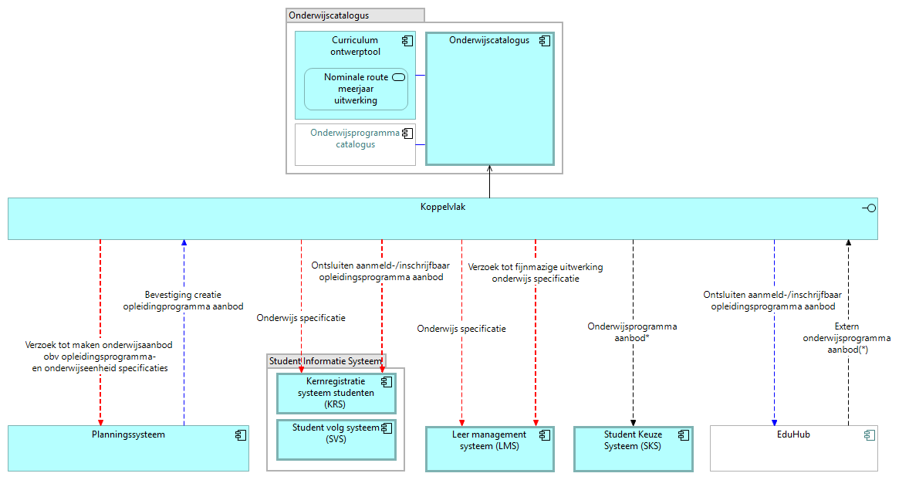

De view toont het koppelvlak van de onderwijscatalogus: de optelsom van haar koppelingen op de informatiestromen-hoofdplaat v1.7.

Dezelfde optelsom van binnen: elke koppelvlakdienst die de catalogus implementeert, met daaronder de endpoints waarmee zij die levert. Een dienst die zelf niets aanbiedt draagt in plaats daarvan een blok dat benoemt wat hij dan doet. De plaat wordt gegenereerd uit [`model/componenten.c4`](model/componenten.c4); die bron gaat met de release mee, zodat de inhoud machinaal te lezen is en niet alleen als plaat.

#### 3.2.2 Koppelvlakdiensten

Dit component implementeert de volgende [koppelvlakdiensten](#5-koppelvlakdiensten):

- [afleverabonnement-aanbieder](#528-afleverabonnement-aanbieder)
- [afleverabonnement-afnemer](#529-afleverabonnement-afnemer)
- [keuzeregelset-aanbieder](#56-keuzeregelset-aanbieder)
- [leermiddelkoppeling-afnemer](#525-leermiddelkoppeling-afnemer)
- [onderwijsspecificatie-inname-aanbieder](#54-onderwijsspecificatie-inname-aanbieder)
- [onderwijsspecificatiestructuur-aanbieder](#52-onderwijsspecificatiestructuur-aanbieder)
- [planbaar-onderwijsaanbod-afnemer](#59-planbaar-onderwijsaanbod-afnemer)
- [resultaatstructuur-aanbieder](#520-resultaatstructuur-aanbieder)
- [verwerkingsuitkomst-afnemer](#527-verwerkingsuitkomst-afnemer)

#### 3.2.3 Koppelingen

| Koppeling | Rol |
|---|---|
| [Onderwijsspecificatie ophalen](#43-onderwijsspecificatie-ophalen) | Aanbieder |
| [Specificatiestatus volgen](#44-specificatiestatus-volgen) | Aanbieder |
| [Resultaatstructuur ophalen](#45-resultaatstructuur-ophalen) | Aanbieder |
| [Specificatie aanpassen op verzoek](#46-specificatie-aanpassen-op-verzoek) | Aanbieder |
| [Keuzeaanbod ontsluiten](#47-keuzeaanbod-ontsluiten) | Aanbieder |
| [Inschrijfbaar aanbod ontsluiten](#48-inschrijfbaar-aanbod-ontsluiten) | Aanbieder |
| [Specificatie ter vaststelling aanbieden](#49-specificatie-ter-vaststelling-aanbieden) | Aanbieder |
| [Opleidingsaanbod aanmaken](#410-opleidingsaanbod-aanmaken) | Afnemer |
| [Opleidingsaanbod herplannen](#411-opleidingsaanbod-herplannen) | Afnemer |
| [Late wijziging toetsen](#412-late-wijziging-toetsen) | Afnemer |
| [Planningselementen ontsluiten](#413-planningselementen-ontsluiten) | Afnemer |
| [Leeromgeving inrichten](#426-leeromgeving-inrichten) | Afnemer |
| [Leeromgeving bijwerken](#427-leeromgeving-bijwerken) | Afnemer |
| [Nominaal template inrichten](#429-nominaal-template-inrichten) | Afnemer |
| [Examenplanwijziging toetsen](#430-examenplanwijziging-toetsen) | Afnemer |

<!-- pagina-einde -->

### 3.3 Planningssysteem (P)

Het planningssysteem maakt van een gepubliceerde onderwijsspecificatie planbaar `opleidingsaanbod`: het bepaalt wanneer, hoe vaak en in welke vorm het onderwijs wordt aangeboden, en meldt de referentie naar dat aanbod terug aan de catalogus. Het bezit het onderwijsaanbod ([U3](#83-u3-resource-eigenaarschap)). Het rooster zelf ligt bij het [roostersysteem](#36-roostersysteem-r).

#### 3.3.1 Koppelvlak

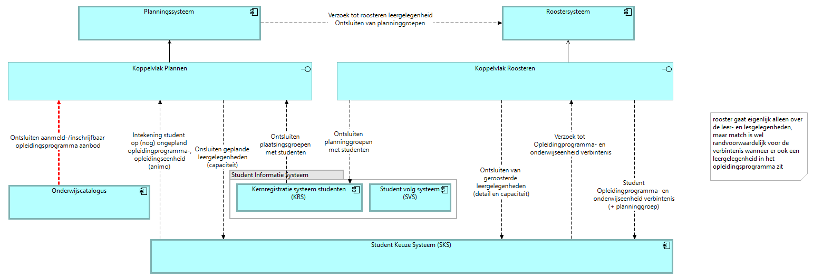

De view toont planning en roostering samen, zoals de informatiestromen-hoofdplaat v1.7 ze tekent. Elk van de twee heeft wel een eigen koppelvlak: de optelsom van de koppelingen die het raken ([U2](#82-u2-koppeling-versus-koppelvlak)).

Dezelfde optelsom van binnen: elke koppelvlakdienst die het planningssysteem implementeert, met daaronder de endpoints waarmee het die levert. Een dienst die zelf niets aanbiedt draagt in plaats daarvan een blok dat benoemt wat hij dan doet. De plaat wordt gegenereerd uit [`model/componenten.c4`](model/componenten.c4); die bron gaat met de release mee, zodat de inhoud machinaal te lezen is en niet alleen als plaat.

#### 3.3.2 Koppelvlakdiensten

Dit component implementeert de volgende [koppelvlakdiensten](#5-koppelvlakdiensten):

- [afleverabonnement-aanbieder](#528-afleverabonnement-aanbieder)
- [afleverabonnement-afnemer](#529-afleverabonnement-afnemer)
- [geroosterd-onderwijsaanbod-afnemer](#515-geroosterd-onderwijsaanbod-afnemer)
- [onderwijsspecificatiestructuur-afnemer](#53-onderwijsspecificatiestructuur-afnemer)
- [planbaar-onderwijsaanbod-aanbieder](#58-planbaar-onderwijsaanbod-aanbieder)
- [verwerkingsuitkomst-aanbieder](#526-verwerkingsuitkomst-aanbieder)

#### 3.3.3 Koppelingen

| Koppeling | Rol |
|---|---|
| [Onderwijsspecificatie ophalen](#43-onderwijsspecificatie-ophalen) | Afnemer |
| [Specificatiestatus volgen](#44-specificatiestatus-volgen) | Afnemer |
| [Specificatie aanpassen op verzoek](#46-specificatie-aanpassen-op-verzoek) | Afnemer |
| [Opleidingsaanbod aanmaken](#410-opleidingsaanbod-aanmaken) | Aanbieder |
| [Opleidingsaanbod herplannen](#411-opleidingsaanbod-herplannen) | Aanbieder |
| [Late wijziging toetsen](#412-late-wijziging-toetsen) | Aanbieder |
| [Planningselementen ontsluiten](#413-planningselementen-ontsluiten) | Aanbieder |
| [Geplande leergelegenheden ontsluiten](#414-geplande-leergelegenheden-ontsluiten) | Aanbieder |
| [Planninggroepen ontsluiten](#415-planninggroepen-ontsluiten) | Aanbieder |
| [Plaatsingsgroepen ontsluiten](#416-plaatsingsgroepen-ontsluiten) | Afnemer |
| [Animo doorgeven](#418-animo-doorgeven) | Afnemer |
| [Leergelegenheden roosteren](#423-leergelegenheden-roosteren) | Afnemer |

<!-- pagina-einde -->

### 3.4 Studentinformatiesysteem (SIS)

Het studentinformatiesysteem is hier de combinatie van het **kernregistratiesysteem (KRS)**, dat de inschrijving en de verbintenis vastlegt, en het **studentvolgsysteem (SVS)**, dat de individuele structuur, de voortgang en de resultaten bijhoudt. Het bezit de verbintenissen, de individuele structuren, de voortgang en de resultaten ([U3](#83-u3-resource-eigenaarschap)). Uit de catalogus haalt het twee dingen op, de onderwijsspecificatiestructuur en de resultaatstructuur, en richt daarmee het nominale template in plus de mapping van welke toetsonderdeelresultaten welke leeruitkomsten afdichten.

#### 3.4.1 Koppelvlak

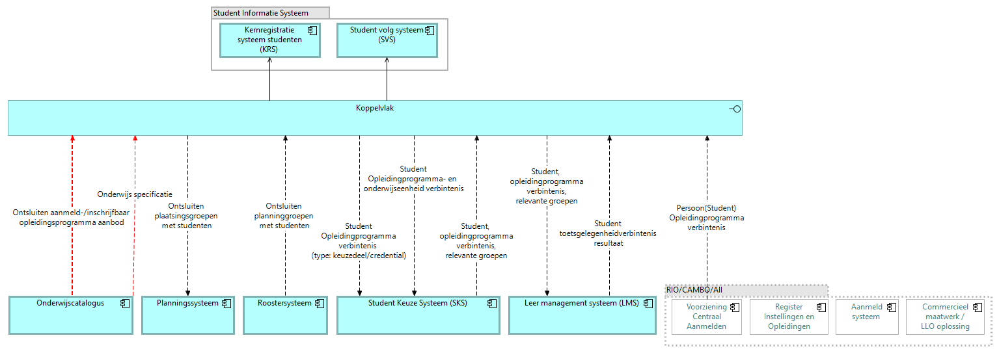

De view toont het koppelvlak van het studentinformatiesysteem op de informatiestromen-hoofdplaat v1.7. Kernregistratie (KRS) en studievoortgang (SVS) maken er deel van uit.

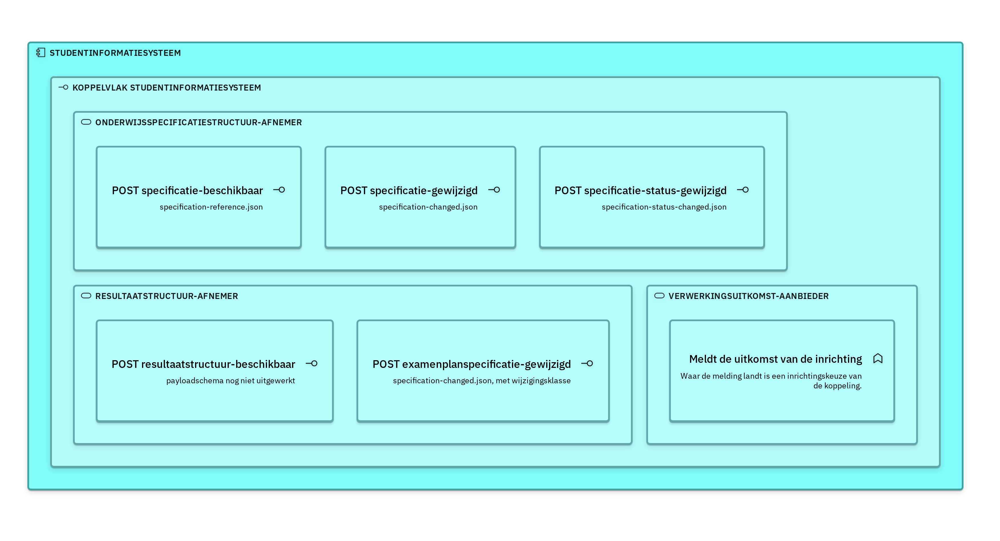

Dezelfde optelsom van binnen: elke koppelvlakdienst die het studentinformatiesysteem implementeert, met daaronder de endpoints waarmee het die levert. Een dienst die zelf niets aanbiedt draagt in plaats daarvan een blok dat benoemt wat hij dan doet. De plaat wordt gegenereerd uit [`model/componenten.c4`](model/componenten.c4); die bron gaat met de release mee, zodat de inhoud machinaal te lezen is en niet alleen als plaat.

#### 3.4.2 Koppelvlakdiensten

Dit component implementeert de volgende [koppelvlakdiensten](#5-koppelvlakdiensten):

- [afleverabonnement-aanbieder](#528-afleverabonnement-aanbieder)
- [afleverabonnement-afnemer](#529-afleverabonnement-afnemer)
- [onderwijsspecificatiestructuur-afnemer](#53-onderwijsspecificatiestructuur-afnemer)
- [resultaatstructuur-afnemer](#521-resultaatstructuur-afnemer)
- [verbintenistoestand-aanbieder](#518-verbintenistoestand-aanbieder)
- [verwerkingsuitkomst-aanbieder](#526-verwerkingsuitkomst-aanbieder)

#### 3.4.3 Koppelingen

| Koppeling | Rol |
|---|---|
| [Onderwijsspecificatie ophalen](#43-onderwijsspecificatie-ophalen) | Afnemer (SVS) |
| [Resultaatstructuur ophalen](#45-resultaatstructuur-ophalen) | Afnemer (SVS) |
| [Inschrijfbaar aanbod ontsluiten](#48-inschrijfbaar-aanbod-ontsluiten) | Afnemer (KRS) |
| [Plaatsingsgroepen ontsluiten](#416-plaatsingsgroepen-ontsluiten) | Aanbieder (KRS) |
| [Opleidingsprogrammaverbintenis ontsluiten](#417-opleidingsprogrammaverbintenis-ontsluiten) | Aanbieder (KRS) |
| [Keuzeverbintenis vastleggen](#420-keuzeverbintenis-vastleggen) | Afnemer (KRS) |
| [Onderwijseenheidverbintenis doorgeven](#421-onderwijseenheidverbintenis-doorgeven) | Afnemer (SVS) |
| [Planninggroepen met studenten ontsluiten](#425-planninggroepen-met-studenten-ontsluiten) | Afnemer (KRS) |
| [Toetsresultaat doorgeven](#428-toetsresultaat-doorgeven) | Afnemer (SVS) |
| [Nominaal template inrichten](#429-nominaal-template-inrichten) | Aanbieder (SVS) |
| [Examenplanwijziging toetsen](#430-examenplanwijziging-toetsen) | Aanbieder (SVS) |

<!-- pagina-einde -->

### 3.5 Leermanagementsysteem (LMS)

Het leermanagementsysteem is de online leeromgeving waarin de student het onderwijs volgt. Het neemt de onderwijsspecificatiestructuur van de catalogus over, inclusief de inhoudsvelden van de leeruitkomsten die het aan de student toont, en richt daarmee de leeromgeving in. Het bezit de leermiddelkoppeling, de koppeling tussen leermiddelgroepen en specificatie ([U3](#83-u3-resource-eigenaarschap)), en meldt die terug aan de catalogus. Kiesbaarheid is niet zijn domein: in [Onderwijsspecificatie ophalen](#43-onderwijsspecificatie-ophalen) laat het de regelsets liggen ([gebruiksprofielen](https://github.com/Npuls-OKx/Public/blob/informatie-en-gegevensmodellen-v0.1.0/Informatie-en-gegevensmodellen/gebruiksprofielen.md)).

#### 3.5.1 Koppelvlak

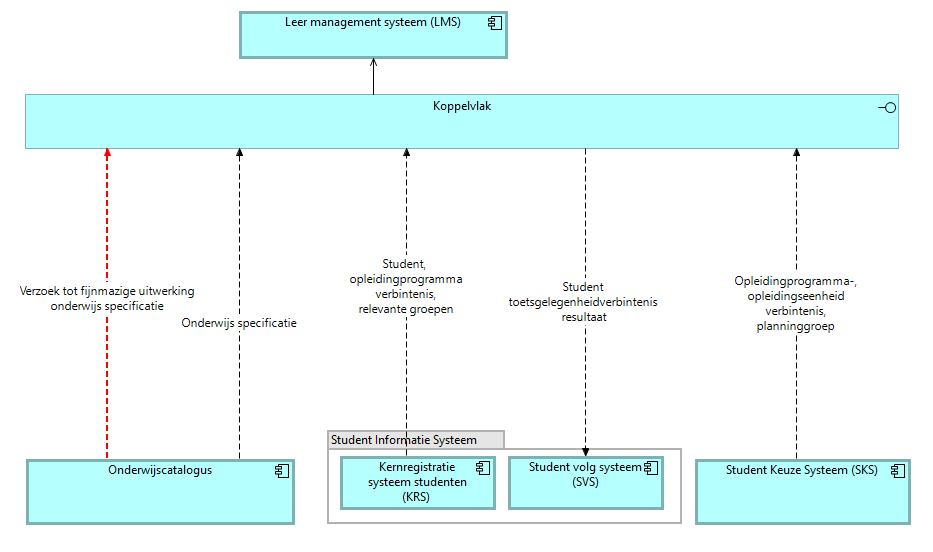

De view toont het koppelvlak van het leermanagementsysteem: de optelsom van zijn koppelingen op de informatiestromen-hoofdplaat v1.7.

Dezelfde optelsom van binnen: elke koppelvlakdienst die het leermanagementsysteem implementeert, met daaronder de endpoints waarmee het die levert. Een dienst die zelf niets aanbiedt draagt in plaats daarvan een blok dat benoemt wat hij dan doet. De plaat wordt gegenereerd uit [`model/componenten.c4`](model/componenten.c4); die bron gaat met de release mee, zodat de inhoud machinaal te lezen is en niet alleen als plaat.

#### 3.5.2 Koppelvlakdiensten

Dit component implementeert de volgende [koppelvlakdiensten](#5-koppelvlakdiensten):

- [afleverabonnement-aanbieder](#528-afleverabonnement-aanbieder)
- [afleverabonnement-afnemer](#529-afleverabonnement-afnemer)
- [leermiddelkoppeling-aanbieder](#524-leermiddelkoppeling-aanbieder)
- [onderwijsspecificatiestructuur-afnemer](#53-onderwijsspecificatiestructuur-afnemer)
- [verbintenistoestand-afnemer](#519-verbintenistoestand-afnemer)
- [verwerkingsuitkomst-aanbieder](#526-verwerkingsuitkomst-aanbieder)

#### 3.5.3 Koppelingen

| Koppeling | Rol |
|---|---|
| [Onderwijsspecificatie ophalen](#43-onderwijsspecificatie-ophalen) | Afnemer |
| [Specificatiestatus volgen](#44-specificatiestatus-volgen) | Afnemer |
| [Opleidingsprogrammaverbintenis ontsluiten](#417-opleidingsprogrammaverbintenis-ontsluiten) | Afnemer |
| [Verbintenis en planninggroep doorgeven](#422-verbintenis-en-planninggroep-doorgeven) | Afnemer |
| [Leeromgeving inrichten](#426-leeromgeving-inrichten) | Aanbieder |
| [Leeromgeving bijwerken](#427-leeromgeving-bijwerken) | Aanbieder |
| [Toetsresultaat doorgeven](#428-toetsresultaat-doorgeven) | Aanbieder |

<!-- pagina-einde -->

### 3.6 Roostersysteem (R)

Het roostersysteem plaatst het geplande onderwijs in tijd en ruimte: het maakt van het `opleidingsaanbod` een rooster met momenten, docenten en zalen. Het bezit het rooster, waar het planningssysteem het aanbod bezit en de catalogus de specificaties ([U3](#83-u3-resource-eigenaarschap)).

#### 3.6.1 Koppelvlak

De view toont planning en roostering samen, zoals de informatiestromen-hoofdplaat v1.7 ze tekent. Elk van de twee heeft wel een eigen koppelvlak: de optelsom van de koppelingen die het raken ([U2](#82-u2-koppeling-versus-koppelvlak)).

#### 3.6.2 Koppelvlakdiensten

Dit component implementeert de volgende [koppelvlakdiensten](#5-koppelvlakdiensten):

- [afleverabonnement-aanbieder](#528-afleverabonnement-aanbieder)
- [afleverabonnement-afnemer](#529-afleverabonnement-afnemer)
- [geroosterd-onderwijsaanbod-aanbieder](#514-geroosterd-onderwijsaanbod-aanbieder)

#### 3.6.3 Koppelingen

| Koppeling | Rol |
|---|---|
| [Planninggroepen ontsluiten](#415-planninggroepen-ontsluiten) | Afnemer |
| [Plaatsing op lesgelegenheid aanvragen](#419-plaatsing-op-lesgelegenheid-aanvragen) | Aanbieder |
| [Leergelegenheden roosteren](#423-leergelegenheden-roosteren) | Aanbieder |
| [Geroosterde leergelegenheden ontsluiten](#424-geroosterde-leergelegenheden-ontsluiten) | Aanbieder |
| [Planninggroepen met studenten ontsluiten](#425-planninggroepen-met-studenten-ontsluiten) | Aanbieder |

<!-- pagina-einde -->

### 3.7 Studentkeuzesysteem (SKS)

Het studentkeuzesysteem is de component waar de student zijn keuzes maakt. Het is bewust als **zelfstandige** referentiecomponent belegd en niet verspreid over portaal, catalogus of leeromgeving, zodat de keuze-interactie expliciet wordt in plaats van verborgen ([ADR 0005](../Referentiemateriaal/adr/0005-student-keuze-systeem-zelfstandige-referentiecomponent.md)). Het draagt de keuze-interacties van de student; het studentvolgsysteem blijft bij resultaat en voortgang, en de inschrijving blijft bij het kernregistratiesysteem ([ADR 0009](../Referentiemateriaal/adr/0009-sks-svs-rollenverdeling-keuze-vs-resultaat-voortgang.md), [ADR 0014](../Referentiemateriaal/adr/0014-splitsing-inschrijving-rodkrs-en-studentkeuze-sks.md)).

#### 3.7.1 Koppelvlak

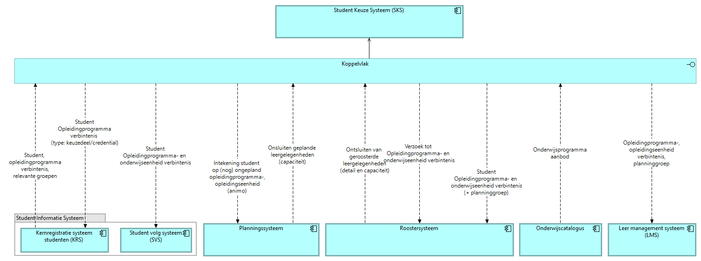

De view toont het koppelvlak van het studentkeuzesysteem: de optelsom van zijn koppelingen op de informatiestromen-hoofdplaat v1.7.

#### 3.7.2 Koppelvlakdiensten

Dit component implementeert de volgende [koppelvlakdiensten](#5-koppelvlakdiensten):

- [afleverabonnement-aanbieder](#528-afleverabonnement-aanbieder)
- [afleverabonnement-afnemer](#529-afleverabonnement-afnemer)
- [geroosterd-onderwijsaanbod-afnemer](#515-geroosterd-onderwijsaanbod-afnemer)
- [keuzeregelset-afnemer](#57-keuzeregelset-afnemer)
- [onderwijsspecificatiestructuur-afnemer](#53-onderwijsspecificatiestructuur-afnemer)
- [planbaar-onderwijsaanbod-afnemer](#59-planbaar-onderwijsaanbod-afnemer)
- [verbintenistoestand-afnemer](#519-verbintenistoestand-afnemer)

#### 3.7.3 Koppelingen

| Koppeling | Rol |
|---|---|
| [Onderwijsspecificatie ophalen](#43-onderwijsspecificatie-ophalen) | Afnemer |
| [Keuzeaanbod ontsluiten](#47-keuzeaanbod-ontsluiten) | Afnemer |
| [Geplande leergelegenheden ontsluiten](#414-geplande-leergelegenheden-ontsluiten) | Afnemer |
| [Opleidingsprogrammaverbintenis ontsluiten](#417-opleidingsprogrammaverbintenis-ontsluiten) | Afnemer |
| [Animo doorgeven](#418-animo-doorgeven) | Aanbieder |
| [Plaatsing op lesgelegenheid aanvragen](#419-plaatsing-op-lesgelegenheid-aanvragen) | Afnemer |
| [Keuzeverbintenis vastleggen](#420-keuzeverbintenis-vastleggen) | Aanbieder |
| [Onderwijseenheidverbintenis doorgeven](#421-onderwijseenheidverbintenis-doorgeven) | Aanbieder |
| [Verbintenis en planninggroep doorgeven](#422-verbintenis-en-planninggroep-doorgeven) | Aanbieder |
| [Geroosterde leergelegenheden ontsluiten](#424-geroosterde-leergelegenheden-ontsluiten) | Afnemer |

<!-- pagina-einde -->

### 3.8 Curriculum-ontwerptool (CO)

De curriculum-ontwerptool is waar onderwijsspecificaties ontstaan: ontwerpers werken er het curriculum uit en leveren het resultaat aan de onderwijscatalogus, die het vanaf daar distribueert. Zij staat daarmee aan het begin van de keten die dit pakket beschrijft.

Hoe de curriculum-ontwerptool en de catalogus zich tot elkaar verhouden is wel als besluit vastgelegd: de catalogus synchroniseert de aangeleverde specificatie en kan die federatief overnemen ([ADR 0020](../Referentiemateriaal/adr/0020-curriculumontwerp-onderwijscatalogus-happy-flow-synchronisatie-en-federatie-adopt-klonen.md)).

#### 3.8.1 Koppelvlakdiensten

Dit component implementeert de volgende [koppelvlakdiensten](#5-koppelvlakdiensten):

- [afleverabonnement-afnemer](#529-afleverabonnement-afnemer)
- [onderwijsspecificatie-inname-afnemer](#55-onderwijsspecificatie-inname-afnemer)

#### 3.8.2 Koppelingen

| Koppeling | Rol |
|---|---|
| [Specificatie ter vaststelling aanbieden](#49-specificatie-ter-vaststelling-aanbieden) | Afnemer |

<!-- pagina-einde -->

## 4 Koppelingen

Een koppeling is één of meer endpoint-interacties met één doel, tussen een aanbieder en een afnemer. Zij is afgeleid van een applicatiedienst uit de domeinarchitectuur: het gedrag dat de [informatiestromen-hoofdplaat](src/informatiestromen_hoofdplaat_v1_7.png) in een component tekent, zoals *Periode planning* in het planningssysteem. Elke koppeling komt één op één overeen met een OEAPI-profiel, met dezelfde naam en dezelfde versie ([U2](#82-u2-koppeling-versus-koppelvlak), [release management §4.2](release-management.md#42-een-koppeling-draagt-haar-eigen-versie)).

Een koppeling legt berichtstromen vast. Elke berichtstroom noemt het [interactiepatroon](#6-interactiepatronen) en de [koppelvlakdiensten](#5-koppelvlakdiensten) die hij inzet, en een koppelvlakdienst levert via endpoints. Een applicatiedienst en een koppelvlakdienst zijn daarmee verschillende dingen: de eerste is gedrag van een component zoals de domeinarchitectuur het benoemt, de tweede het contract waarmee een component een deel van dat gedrag over een koppeling aanbiedt of afneemt.

### 4.1 Ontwerpregels

**Eén aanbieder.** Alle endpoints van een koppeling staan in het OpenAPI-document van één component: de paden die het serveert en de meldingen die het verstuurt. De afnemer roept die paden aan en ontvangt de meldingen op het adres dat hij heeft geregistreerd. Daardoor is een koppeling precies één OpenAPI-document en één OEAPI-profiel. Vraagt een uitwisseling aan beide kanten endpoints, dan zijn het twee koppelingen. De prijs is dat melden en terugmelden in twee koppelingen staan die naar elkaar verwijzen, zoals [Onderwijsspecificatie ophalen](#43-onderwijsspecificatie-ophalen) en [Opleidingsaanbod aanmaken](#410-opleidingsaanbod-aanmaken).

**Vereist in plaats van herhaald.** Een koppeling noemt onder *Vereist* de koppelingen waarop zij steunt; wie haar implementeert, implementeert die ook. Elke koppeling met meldingen steunt op [Afleverabonnement registreren](#431-afleverabonnement-registreren) en [Reconciliatie](#432-reconciliatie). Een OEAPI-profiel kan niet naar een ander profiel verwijzen en moet op zichzelf staan; het profiel van een koppeling neemt daarom de endpoints op van wat zij vereist.

**Velden vereisen, niet verbieden.** Verschillende koppelingen zetten dezelfde koppelvlakdienst in, en daarmee hetzelfde endpoint. Een koppeling mag velden van dat endpoint verplicht stellen, maar niet verbieden: twee profielen met tegengestelde eisen aan hetzelfde endpoint kan één implementatie niet allebei halen. Verschil per afnemer loopt via een parameter van het endpoint.

**Beveiliging.** Voor elk endpoint van elke koppeling geldt de [auth-standaard](#7-auth-standaard-voor-koppelvlakken).

### 4.2 Overzicht

| Afgeleid van | Koppeling | Aanbieder | Afnemer |
|---|---|---|---|
| *Onderwijsspecificatie uitwerking* | [Onderwijsspecificatie ophalen](#43-onderwijsspecificatie-ophalen) | Onderwijscatalogus | Planningssysteem, Studentinformatiesysteem (SVS), Leermanagementsysteem, Studentkeuzesysteem |
| *Onderwijsspecificatie uitwerking* | [Specificatiestatus volgen](#44-specificatiestatus-volgen) | Onderwijscatalogus | Planningssysteem, Leermanagementsysteem |
| *Onderwijsspecificatie uitwerking* | [Resultaatstructuur ophalen](#45-resultaatstructuur-ophalen) | Onderwijscatalogus | Studentinformatiesysteem (SVS) |
| *Onderwijsspecificatie uitwerking* | [Specificatie aanpassen op verzoek](#46-specificatie-aanpassen-op-verzoek) | Onderwijscatalogus | Planningssysteem |
| *Onderwijsspecificatie uitwerking* | [Keuzeaanbod ontsluiten](#47-keuzeaanbod-ontsluiten) | Onderwijscatalogus | Studentkeuzesysteem |
| *Onderwijsspecificatie uitwerking* | [Inschrijfbaar aanbod ontsluiten](#48-inschrijfbaar-aanbod-ontsluiten) | Onderwijscatalogus | Studentinformatiesysteem (KRS), EduHub, CAMBO |
| *Nominale route meerjaar uitwerking* | [Specificatie ter vaststelling aanbieden](#49-specificatie-ter-vaststelling-aanbieden) | Onderwijscatalogus | Curriculum-ontwerptool |
| *(Meer)jaar capaciteitsplanning* | [Opleidingsaanbod aanmaken](#410-opleidingsaanbod-aanmaken) | Planningssysteem | Onderwijscatalogus |
| *(Meer)jaar capaciteitsplanning* | [Opleidingsaanbod herplannen](#411-opleidingsaanbod-herplannen) | Planningssysteem | Onderwijscatalogus |
| *(Meer)jaar capaciteitsplanning* | [Late wijziging toetsen](#412-late-wijziging-toetsen) | Planningssysteem | Onderwijscatalogus |
| *(Meer)jaar capaciteitsplanning* | [Planningselementen ontsluiten](#413-planningselementen-ontsluiten) | Planningssysteem | Onderwijscatalogus |
| *Periode planning* | [Geplande leergelegenheden ontsluiten](#414-geplande-leergelegenheden-ontsluiten) | Planningssysteem | Studentkeuzesysteem |
| *Periode planning* | [Planninggroepen ontsluiten](#415-planninggroepen-ontsluiten) | Planningssysteem | Roostersysteem |
| *Inschrijving op opleidingsprogramma* | [Plaatsingsgroepen ontsluiten](#416-plaatsingsgroepen-ontsluiten) | Studentinformatiesysteem (KRS) | Planningssysteem |
| *Inschrijving op opleidingsprogramma* | [Opleidingsprogrammaverbintenis ontsluiten](#417-opleidingsprogrammaverbintenis-ontsluiten) | Studentinformatiesysteem (KRS) | Studentkeuzesysteem, Leermanagementsysteem |
| *Keuze aanvraag beheer* | [Animo doorgeven](#418-animo-doorgeven) | Studentkeuzesysteem | Planningssysteem |
| *Verwerken van definitieve keuzes* | [Plaatsing op lesgelegenheid aanvragen](#419-plaatsing-op-lesgelegenheid-aanvragen) | Roostersysteem | Studentkeuzesysteem |
| *Verwerken van definitieve keuzes* | [Keuzeverbintenis vastleggen](#420-keuzeverbintenis-vastleggen) | Studentkeuzesysteem | Studentinformatiesysteem (KRS) |
| *Verwerken van definitieve keuzes* | [Onderwijseenheidverbintenis doorgeven](#421-onderwijseenheidverbintenis-doorgeven) | Studentkeuzesysteem | Studentinformatiesysteem (SVS) |
| *Verwerken van definitieve keuzes* | [Verbintenis en planninggroep doorgeven](#422-verbintenis-en-planninggroep-doorgeven) | Studentkeuzesysteem | Leermanagementsysteem |
| Geen (roostersysteem) | [Leergelegenheden roosteren](#423-leergelegenheden-roosteren) | Roostersysteem | Planningssysteem |
| Geen (roostersysteem) | [Geroosterde leergelegenheden ontsluiten](#424-geroosterde-leergelegenheden-ontsluiten) | Roostersysteem | Studentkeuzesysteem |
| Geen (roostersysteem) | [Planninggroepen met studenten ontsluiten](#425-planninggroepen-met-studenten-ontsluiten) | Roostersysteem | Studentinformatiesysteem (KRS) |
| Geen (leermanagementsysteem) | [Leeromgeving inrichten](#426-leeromgeving-inrichten) | Leermanagementsysteem | Onderwijscatalogus |
| Geen (leermanagementsysteem) | [Leeromgeving bijwerken](#427-leeromgeving-bijwerken) | Leermanagementsysteem | Onderwijscatalogus |
| Geen (leermanagementsysteem) | [Toetsresultaat doorgeven](#428-toetsresultaat-doorgeven) | Leermanagementsysteem | Studentinformatiesysteem (SVS) |
| Geen (studentvolgsysteem) | [Nominaal template inrichten](#429-nominaal-template-inrichten) | Studentinformatiesysteem (SVS) | Onderwijscatalogus |
| Geen (studentvolgsysteem) | [Examenplanwijziging toetsen](#430-examenplanwijziging-toetsen) | Studentinformatiesysteem (SVS) | Onderwijscatalogus |
| Geen (ondersteunend) | [Afleverabonnement registreren](#431-afleverabonnement-registreren) | Wie meldt | Wie ontvangt |
| Geen (ondersteunend) | [Reconciliatie](#432-reconciliatie) | Wie meldde | Wie miste |

<!-- pagina-einde -->

### 4.3 Onderwijsspecificatie ophalen

Een afnemer haalt de vastgestelde structuur van een gepubliceerde onderwijsspecificatie op, volledig of als delta, nadat de onderwijscatalogus heeft gemeld dat zij beschikbaar of gewijzigd is.

| Kenmerk | Waarde |
|---|---|
| Aanbieder | [Onderwijscatalogus](#32-onderwijscatalogus-oc) |
| Afnemer | [Planningssysteem](#33-planningssysteem-p), [Studentinformatiesysteem](#34-studentinformatiesysteem-sis) (SVS), [Leermanagementsysteem](#35-leermanagementsysteem-lms), [Studentkeuzesysteem](#37-studentkeuzesysteem-sks) |
| Afgeleid van | *Onderwijsspecificatie uitwerking*, applicatiedienst van de onderwijscatalogus |
| Versie | `1.0` |
| Vereist | [Afleverabonnement registreren](#431-afleverabonnement-registreren), [Reconciliatie](#432-reconciliatie) |
| OEAPI-profiel | `okx-onderwijsspecificatie-ophalen` |

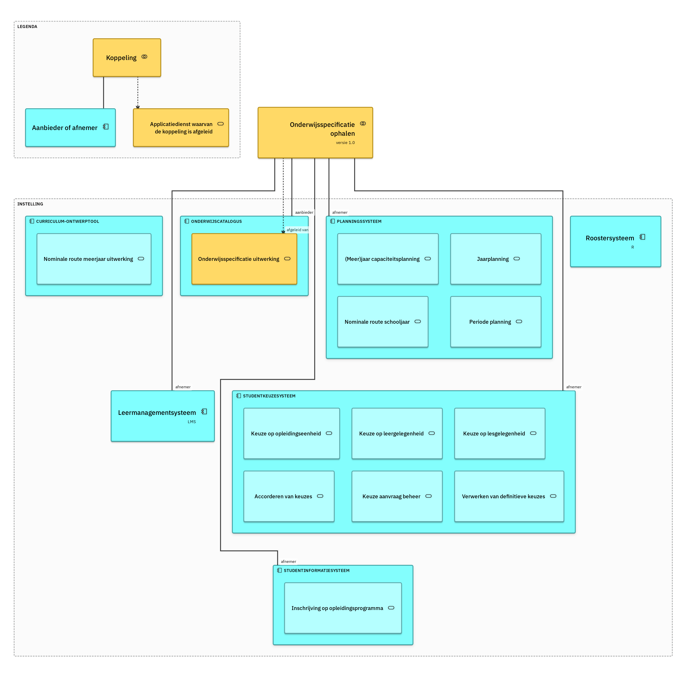

#### 4.3.1 Stories

| Story | Ingevuld door |
|---|---|
| [story-0006](#story-0006) | [Specificatie beschikbaar melden](#432-specificatie-beschikbaar-melden) |
| [story-0030](#story-0030) | [Specificatiewijziging melden](#433-specificatiewijziging-melden) |

#### 4.3.2 Specificatie beschikbaar melden

Doel: een afnemer haalt een gepubliceerde specificatie op zodra die beschikbaar is. Trigger: onderwijsspecificatie krijgt status `gepubliceerd`. Initiator: Onderwijscatalogus.

| Interactiepatronen | Koppelvlakdiensten |
|---|---|
| [Event Notification](#61-event-notification) | [onderwijsspecificatiestructuur-aanbieder](#52-onderwijsspecificatiestructuur-aanbieder), [onderwijsspecificatiestructuur-afnemer](#53-onderwijsspecificatiestructuur-afnemer) |

Endpoints:

- [webhook `specificatie-beschikbaar`](#53-onderwijsspecificatiestructuur-afnemer)
- [`GET /onderwijsspecificaties/{id}`](#52-onderwijsspecificatiestructuur-aanbieder)

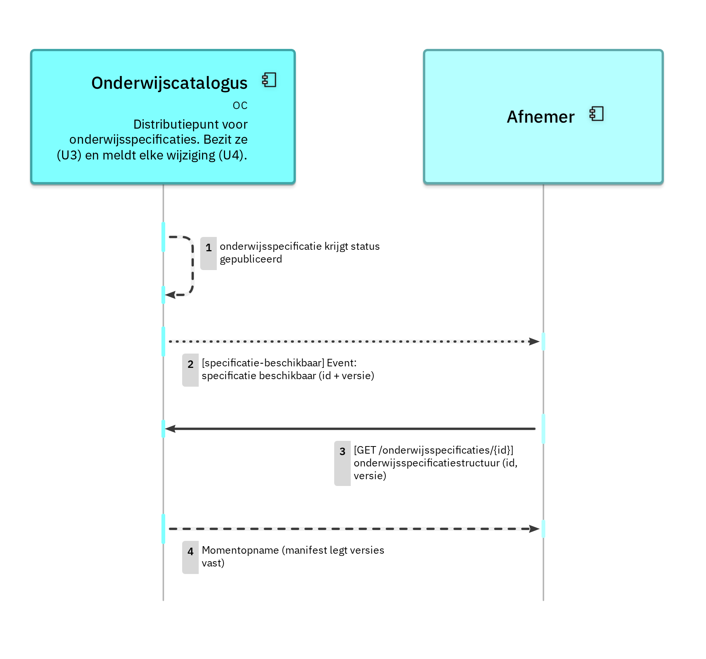

#### 4.3.3 Specificatiewijziging melden

Doel: een afnemer volgt een nieuwe versie van een specificatie die hij al gebruikt, met de delta of de volledige structuur als zijn keuze. Trigger: nieuwe versie van een gepubliceerde specificatie. Initiator: Onderwijscatalogus.

| Interactiepatronen | Koppelvlakdiensten |
|---|---|
| [Event Notification](#61-event-notification) | [onderwijsspecificatiestructuur-aanbieder](#52-onderwijsspecificatiestructuur-aanbieder), [onderwijsspecificatiestructuur-afnemer](#53-onderwijsspecificatiestructuur-afnemer) |

Endpoints:

- [webhook `specificatie-gewijzigd`](#53-onderwijsspecificatiestructuur-afnemer)
- [`GET /onderwijsspecificaties/{id}/delta` of `GET /onderwijsspecificaties/{id}`](#52-onderwijsspecificatiestructuur-aanbieder)

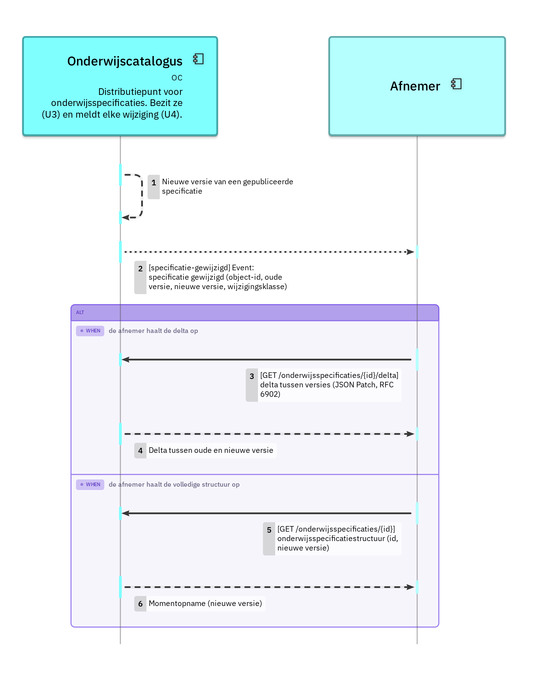

<!-- pagina-einde -->

### 4.4 Specificatiestatus volgen

Een afnemer werkt zijn afgeleide status bij wanneer een specificatie van status wisselt zonder nieuwe versie, zoals van `gepubliceerd` naar `gedeactiveerd`.

| Kenmerk | Waarde |
|---|---|
| Aanbieder | [Onderwijscatalogus](#32-onderwijscatalogus-oc) |
| Afnemer | [Planningssysteem](#33-planningssysteem-p), [Leermanagementsysteem](#35-leermanagementsysteem-lms) |
| Afgeleid van | *Onderwijsspecificatie uitwerking*, applicatiedienst van de onderwijscatalogus |
| Versie | `1.0` |
| Vereist | [Afleverabonnement registreren](#431-afleverabonnement-registreren), [Reconciliatie](#432-reconciliatie) |
| OEAPI-profiel | `okx-specificatiestatus-volgen` |

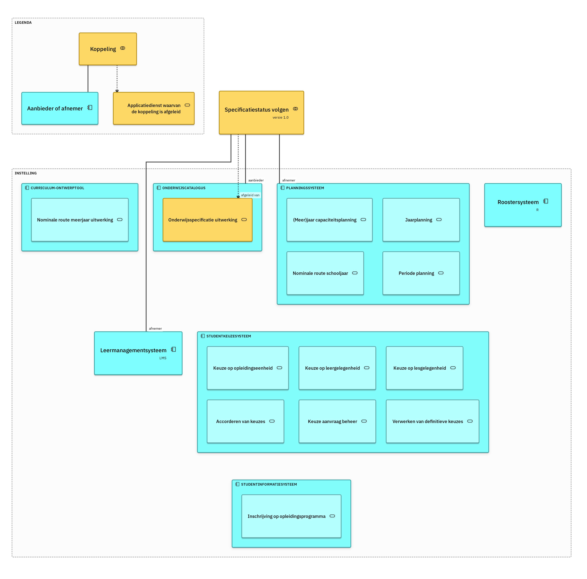

#### 4.4.1 Stories

| Story | Ingevuld door |
|---|---|
| [story-0032](#story-0032) | [Specificatiestatus gewijzigd melden](#442-specificatiestatus-gewijzigd-melden) |

#### 4.4.2 Specificatiestatus gewijzigd melden

Doel: de onderwijscatalogus een statuswijziging laten melden die los staat van een nieuwe versie, zodat de afnemer zijn afgeleide status kan bijwerken zonder op te halen. Trigger: specificatie krijgt een nieuwe status buiten een versiewijziging om (bv. `gepubliceerd` naar `gedeactiveerd`, [regels bij de schema's](https://github.com/Npuls-OKx/Public/blob/informatie-en-gegevensmodellen-v0.1.0/Informatie-en-gegevensmodellen/regels.md)). Initiator: Onderwijscatalogus. Voorbeeldgeval: een opleiding die voor een ouder cohort bewust niet meer wordt aangeboden is nog wel planbaar, maar wordt niet meer gepland; dat is deze statuswijziging (met archivering als vervolg), geen planningsfout.

| Interactiepatronen | Koppelvlakdiensten |
|---|---|
| [Event-Carried State Transfer](#62-event-carried-state-transfer) | [onderwijsspecificatiestructuur-afnemer](#53-onderwijsspecificatiestructuur-afnemer) |

Endpoints:

- [webhook `specificatie-status-gewijzigd`](#53-onderwijsspecificatiestructuur-afnemer)

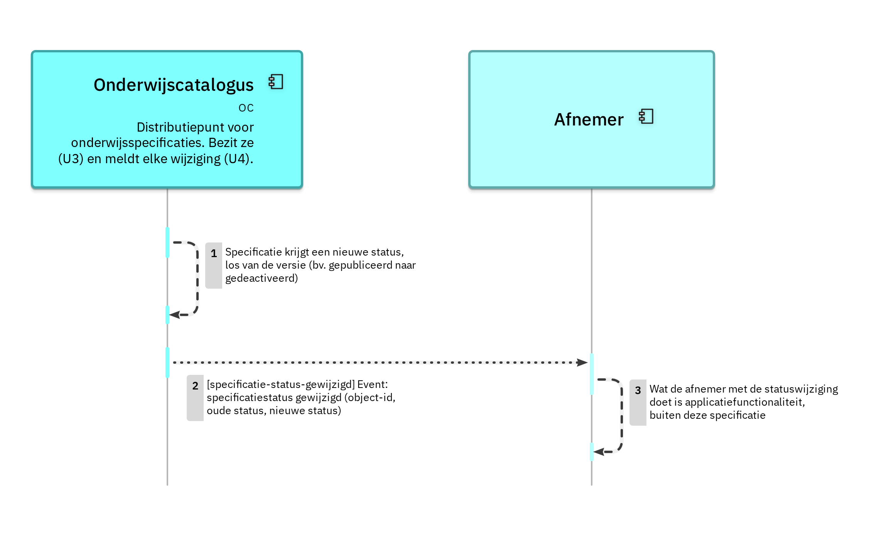

<!-- pagina-einde -->

### 4.5 Resultaatstructuur ophalen

Het studentinformatiesysteem haalt de resultaatstructuur van een gepubliceerde examenplanspecificatie op, en volgt een wijziging daarvan, nadat de onderwijscatalogus die heeft gemeld.

| Kenmerk | Waarde |
|---|---|
| Aanbieder | [Onderwijscatalogus](#32-onderwijscatalogus-oc) |
| Afnemer | [Studentinformatiesysteem](#34-studentinformatiesysteem-sis) (SVS) |
| Afgeleid van | *Onderwijsspecificatie uitwerking*, applicatiedienst van de onderwijscatalogus |
| Versie | `1.0` |
| Vereist | [Afleverabonnement registreren](#431-afleverabonnement-registreren), [Reconciliatie](#432-reconciliatie) |
| OEAPI-profiel | `okx-resultaatstructuur-ophalen` |

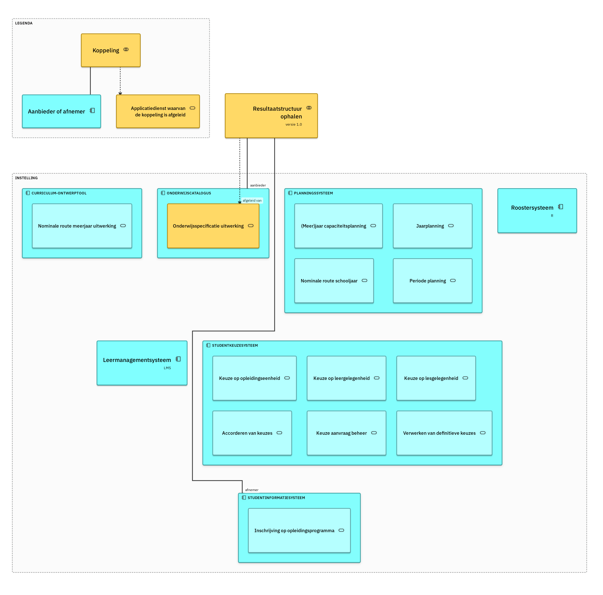

#### 4.5.1 Resultaatstructuur beschikbaar melden

Doel: het studentinformatiesysteem haalt de resultaatstructuur op zodra de examenplanspecificatie is gepubliceerd. Trigger: examenplanspecificatie krijgt status `gepubliceerd`. Initiator: Onderwijscatalogus.

| Interactiepatronen | Koppelvlakdiensten |
|---|---|
| [Event Notification](#61-event-notification) | [resultaatstructuur-aanbieder](#520-resultaatstructuur-aanbieder), [resultaatstructuur-afnemer](#521-resultaatstructuur-afnemer) |

Endpoints:

- [webhook `resultaatstructuur-beschikbaar`](#521-resultaatstructuur-afnemer)
- [`GET /examenplanspecificaties/{id}`](#520-resultaatstructuur-aanbieder)

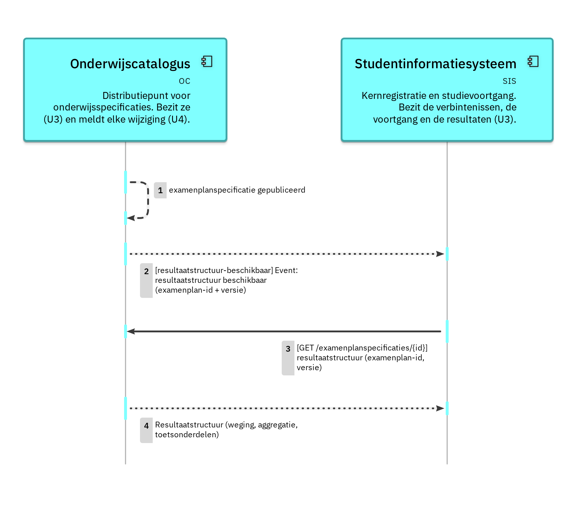

#### 4.5.2 Examenplanwijziging melden

Doel: het studentinformatiesysteem hoort van een wijziging in een examenplanspecificatie waarop het al heeft ingericht. Trigger: examenplanspecificatie wijzigt. Initiator: Onderwijscatalogus.

| Interactiepatronen | Koppelvlakdiensten |
|---|---|
| [Event Notification](#61-event-notification) | [resultaatstructuur-afnemer](#521-resultaatstructuur-afnemer) |

Endpoints:

- [webhook `examenplanspecificatie-gewijzigd`](#521-resultaatstructuur-afnemer)

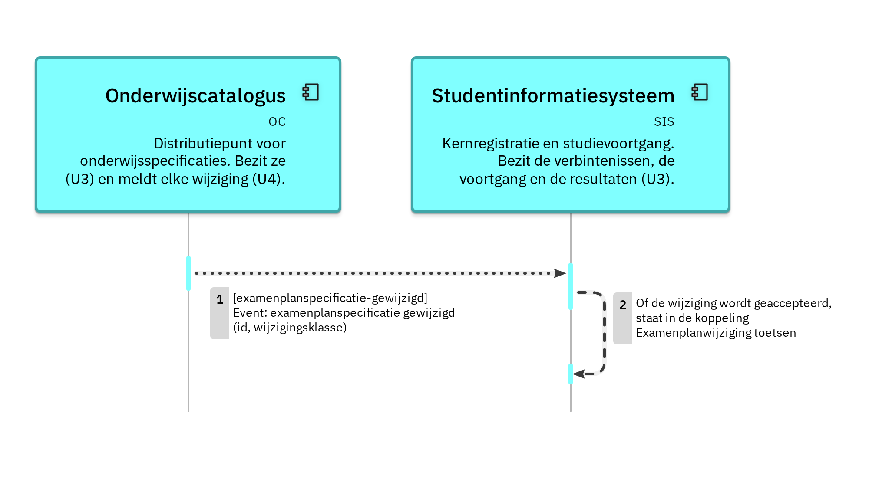

<!-- pagina-einde -->

### 4.6 Specificatie aanpassen op verzoek

Het planningssysteem vraagt een aanpassing aan van een specificatie die niet planbaar blijkt, en krijgt de uitkomst van dat verzoek terug.

| Kenmerk | Waarde |
|---|---|
| Aanbieder | [Onderwijscatalogus](#32-onderwijscatalogus-oc) |
| Afnemer | [Planningssysteem](#33-planningssysteem-p) |
| Afgeleid van | *Onderwijsspecificatie uitwerking*, applicatiedienst van de onderwijscatalogus |
| Versie | — |
| Vereist | [Afleverabonnement registreren](#431-afleverabonnement-registreren), [Reconciliatie](#432-reconciliatie) |
| OEAPI-profiel | `okx-specificatie-aanpassen-op-verzoek` |

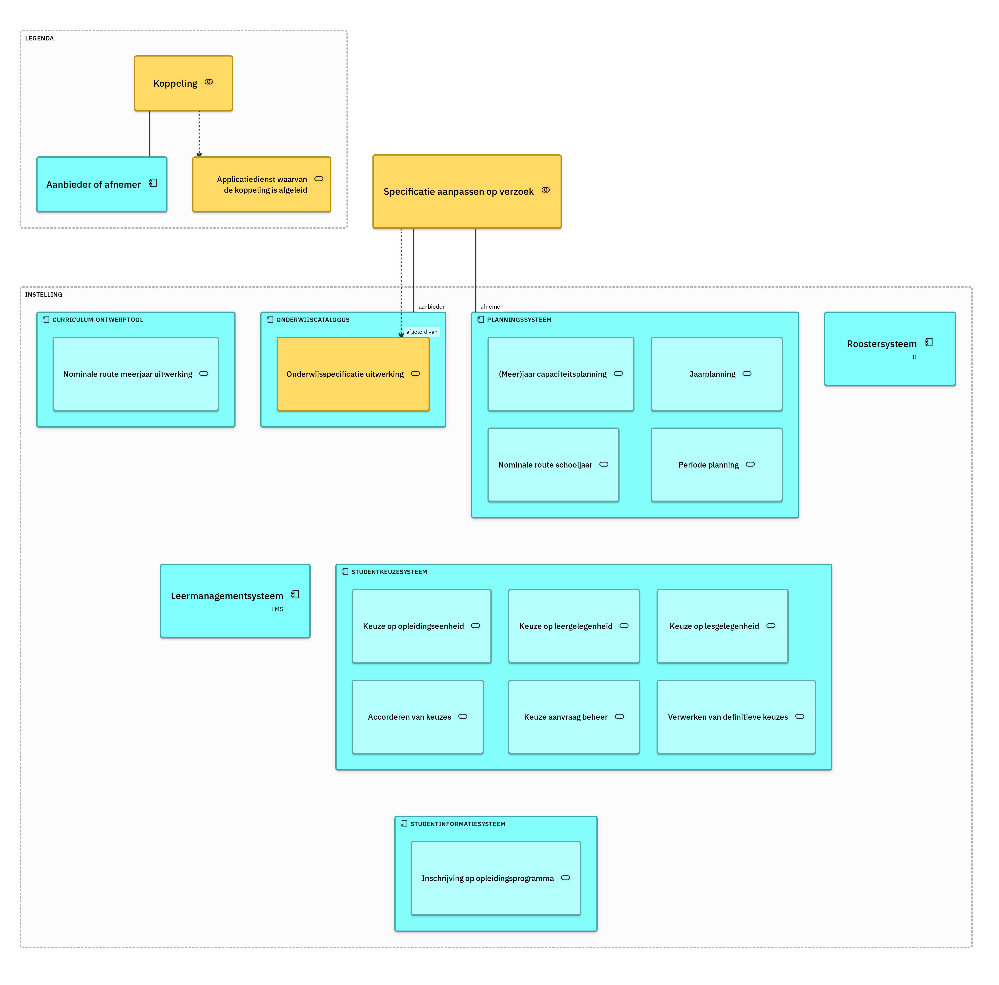

#### 4.6.1 Aanpassing aanvragen

Doel: een specificatie die niet planbaar blijkt, laten aanpassen in plaats van de planning te forceren. Trigger: het planningssysteem kan een specificatie niet plannen zoals zij is gespecificeerd. Initiator: Planningssysteem.

| Interactiepatronen | Koppelvlakdiensten |
|---|---|
| [Asynchronous Request-Reply](#63-asynchronous-request-reply) | Nog niet belegd |

Endpoints: nog niet vastgelegd.

<!-- pagina-einde -->

### 4.7 Keuzeaanbod ontsluiten

Het studentkeuzesysteem kent het onderwijsprogramma-aanbod waaruit een student kan kiezen, met de regelsets die de keuzeruimte begrenzen.

| Kenmerk | Waarde |
|---|---|
| Aanbieder | [Onderwijscatalogus](#32-onderwijscatalogus-oc) |
| Afnemer | [Studentkeuzesysteem](#37-studentkeuzesysteem-sks) |
| Afgeleid van | *Onderwijsspecificatie uitwerking*, applicatiedienst van de onderwijscatalogus |
| Versie | — |
| Vereist | [Onderwijsspecificatie ophalen](#43-onderwijsspecificatie-ophalen), [Afleverabonnement registreren](#431-afleverabonnement-registreren), [Reconciliatie](#432-reconciliatie) |
| OEAPI-profiel | `okx-keuzeaanbod-ontsluiten` |

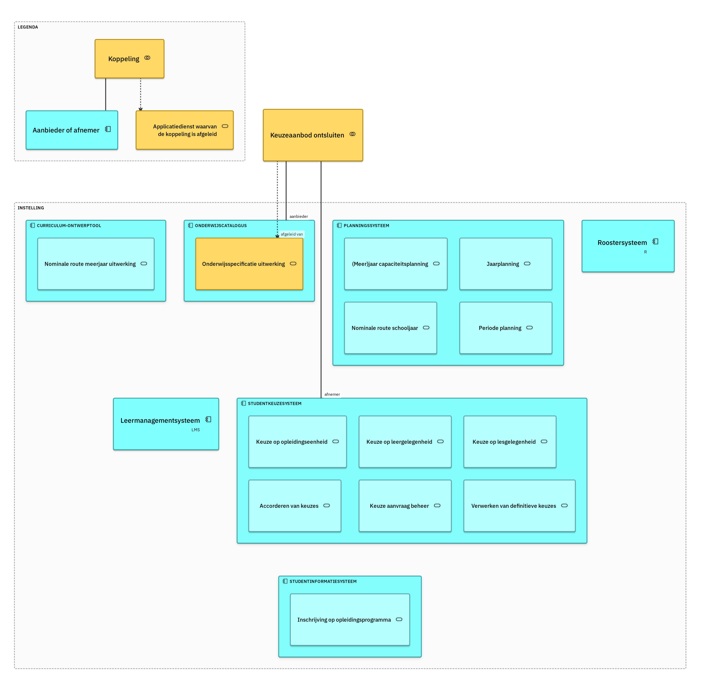

#### 4.7.1 Keuzeregelset melden

Doel: het studentkeuzesysteem haalt de regelset op die de keuzeruimte binnen een specificatie begrenst. Trigger: een regelset wordt vastgesteld of gewijzigd. Initiator: Onderwijscatalogus.

| Interactiepatronen | Koppelvlakdiensten |
|---|---|
| [Event Notification](#61-event-notification) | [keuzeregelset-aanbieder](#56-keuzeregelset-aanbieder), [keuzeregelset-afnemer](#57-keuzeregelset-afnemer) |

Endpoints: nog niet vastgelegd.

<!-- pagina-einde -->

### 4.8 Inschrijfbaar aanbod ontsluiten

Het kernregistratiesysteem en de externe aanmeldkanalen kennen het opleidingsprogramma-aanbod waarvoor een student zich kan aanmelden en inschrijven.

| Kenmerk | Waarde |
|---|---|
| Aanbieder | [Onderwijscatalogus](#32-onderwijscatalogus-oc) |
| Afnemer | [Studentinformatiesysteem](#34-studentinformatiesysteem-sis) (KRS), EduHub, Voorziening Centraal Aanmelden (CAMBO) |
| Afgeleid van | *Onderwijsspecificatie uitwerking*, applicatiedienst van de onderwijscatalogus |
| Versie | — |
| Vereist | [Afleverabonnement registreren](#431-afleverabonnement-registreren), [Reconciliatie](#432-reconciliatie) |
| OEAPI-profiel | `okx-inschrijfbaar-aanbod-ontsluiten` |

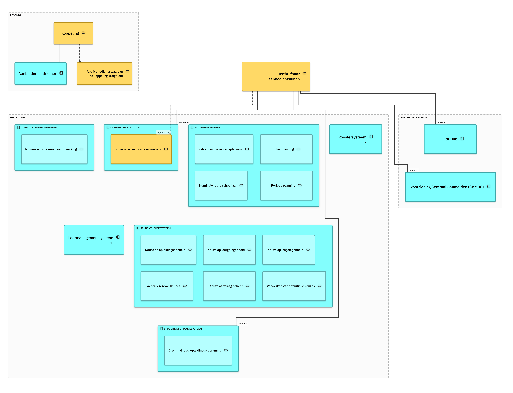

#### 4.8.1 Inschrijfbaar aanbod melden

Doel: afnemers horen dat er opleidingsprogramma-aanbod is waarvoor aanmelding openstaat, en halen het op. Trigger: opleidingsprogramma-aanbod wordt voor aanmelding opengesteld. Initiator: Onderwijscatalogus.

| Interactiepatronen | Koppelvlakdiensten |
|---|---|
| [Event Notification](#61-event-notification) | Nog niet belegd |

Endpoints: nog niet vastgelegd.

<!-- pagina-einde -->

### 4.9 Specificatie ter vaststelling aanbieden

Een in de curriculum-ontwerptool uitgewerkte meerjarige nominale route wordt in de onderwijscatalogus vastgesteld als onderwijsspecificatie, en de curriculum-ontwerptool krijgt de bevestiging of de afkeuring terug.

| Kenmerk | Waarde |
|---|---|
| Aanbieder | [Onderwijscatalogus](#32-onderwijscatalogus-oc) |
| Afnemer | [Curriculum-ontwerptool](#38-curriculum-ontwerptool-co) |
| Afgeleid van | *Nominale route meerjaar uitwerking*, applicatiedienst van de curriculum-ontwerptool |
| Versie | — |
| Vereist | [Afleverabonnement registreren](#431-afleverabonnement-registreren), [Reconciliatie](#432-reconciliatie) |
| OEAPI-profiel | `okx-specificatie-ter-vaststelling-aanbieden` |

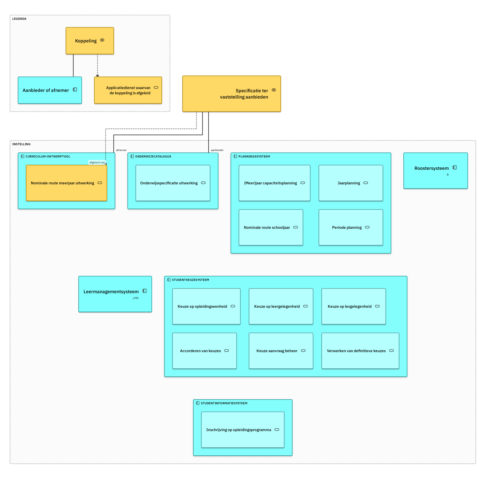

#### 4.9.1 Specificatie aanleveren

Doel: een ontwerp vastleggen als onderwijsspecificatie met een eigen identiteit en versie. Trigger: een ontwerp is gereed voor vaststelling. Initiator: Curriculum-ontwerptool.

| Interactiepatronen | Koppelvlakdiensten |
|---|---|
| [Asynchronous Request-Reply](#63-asynchronous-request-reply) | [onderwijsspecificatie-inname-aanbieder](#54-onderwijsspecificatie-inname-aanbieder), [onderwijsspecificatie-inname-afnemer](#55-onderwijsspecificatie-inname-afnemer) |

Endpoints: nog niet vastgelegd.

<!-- pagina-einde -->

### 4.10 Opleidingsaanbod aanmaken

Het planningssysteem maakt van een gepubliceerde opleidingsprogramma- of onderwijseenheidspecificatie planbaar opleidingsaanbod, en meldt de uitkomst met een referentie naar dat aanbod terug aan de onderwijscatalogus.

| Kenmerk | Waarde |
|---|---|
| Aanbieder | [Planningssysteem](#33-planningssysteem-p) |
| Afnemer | [Onderwijscatalogus](#32-onderwijscatalogus-oc) |
| Afgeleid van | *(Meer)jaar capaciteitsplanning*, applicatiedienst van het planningssysteem |
| Versie | `1.0` |
| Vereist | [Onderwijsspecificatie ophalen](#43-onderwijsspecificatie-ophalen), [Afleverabonnement registreren](#431-afleverabonnement-registreren), [Reconciliatie](#432-reconciliatie) |
| OEAPI-profiel | `okx-opleidingsaanbod-aanmaken` |

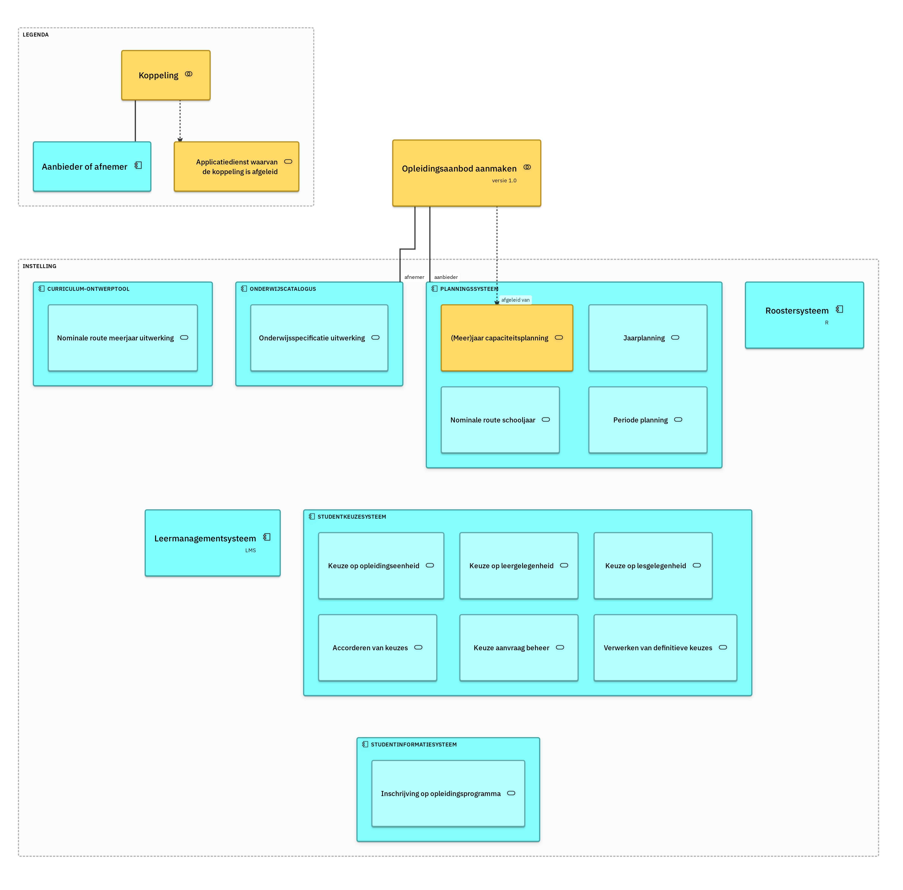

#### 4.10.1 Stories

| Story | Ingevuld door |
|---|---|
| [story-0007](#story-0007) | [Planuitkomst melden](#4102-planuitkomst-melden) en [Planning niet gelukt melden](#4103-planning-niet-gelukt-melden) |

#### 4.10.2 Planuitkomst melden

Doel: het planningssysteem meldt of het van een opgehaalde specificatie planbaar `opleidingsaanbod` kon maken, met een referentie naar dat aanbod. Trigger: de melding [Specificatie beschikbaar](#432-specificatie-beschikbaar-melden) en het ophalen van de structuur. Initiator: Planningssysteem.

| Interactiepatronen | Koppelvlakdiensten |
|---|---|
| [Asynchronous Request-Reply](#63-asynchronous-request-reply) | [verwerkingsuitkomst-aanbieder](#526-verwerkingsuitkomst-aanbieder), [verwerkingsuitkomst-afnemer](#527-verwerkingsuitkomst-afnemer), [planbaar-onderwijsaanbod-aanbieder](#58-planbaar-onderwijsaanbod-aanbieder), [planbaar-onderwijsaanbod-afnemer](#59-planbaar-onderwijsaanbod-afnemer) |

Endpoints:

- [webhook `verwerkingsuitkomst`](#527-verwerkingsuitkomst-afnemer)
- [`GET /onderwijsaanbod/{id}` (optioneel)](#58-planbaar-onderwijsaanbod-aanbieder)

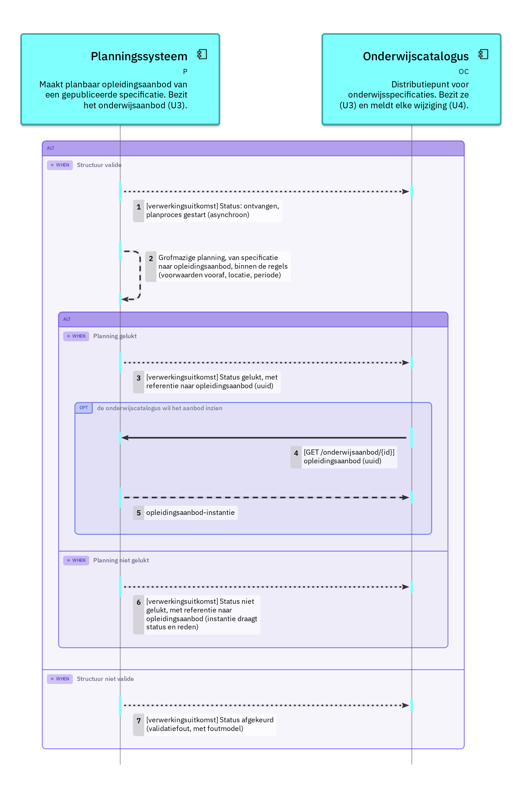

#### 4.10.3 Planning niet gelukt melden

Doel: de onderwijscatalogus in kennis stellen dat een specificatie voor een of meer cohorten niet planbaar blijkt, met referentie en knelpunten, zonder de aanroep te blokkeren. Trigger: planproces bij het planningssysteem vindt geen geldige planning. Initiator: Planningssysteem.

| Interactiepatronen | Koppelvlakdiensten |
|---|---|
| [Asynchronous Request-Reply](#63-asynchronous-request-reply) | [verwerkingsuitkomst-afnemer](#527-verwerkingsuitkomst-afnemer), [planbaar-onderwijsaanbod-aanbieder](#58-planbaar-onderwijsaanbod-aanbieder) |

Endpoints:

- [webhook `verwerkingsuitkomst`](#527-verwerkingsuitkomst-afnemer)
- [`GET /onderwijsaanbod/{id}` (optioneel)](#58-planbaar-onderwijsaanbod-aanbieder)

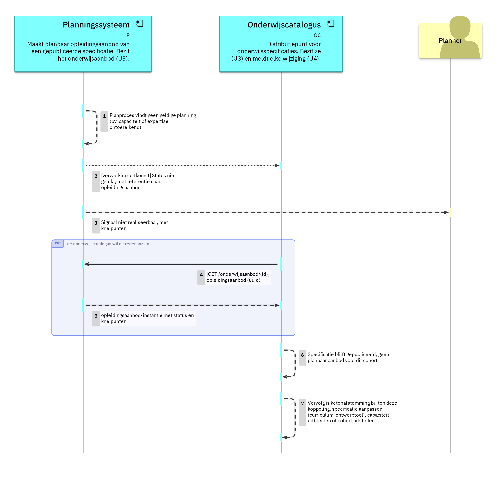

<!-- pagina-einde -->

### 4.11 Opleidingsaanbod herplannen

Het planningssysteem laat lopend opleidingsaanbod volgen op een nieuwe specificatieversie en meldt de uitkomst terug aan de onderwijscatalogus.

| Kenmerk | Waarde |
|---|---|
| Aanbieder | [Planningssysteem](#33-planningssysteem-p) |
| Afnemer | [Onderwijscatalogus](#32-onderwijscatalogus-oc) |
| Afgeleid van | *(Meer)jaar capaciteitsplanning*, applicatiedienst van het planningssysteem |
| Versie | `1.0` |
| Vereist | [Onderwijsspecificatie ophalen](#43-onderwijsspecificatie-ophalen), [Afleverabonnement registreren](#431-afleverabonnement-registreren), [Reconciliatie](#432-reconciliatie) |
| OEAPI-profiel | `okx-opleidingsaanbod-herplannen` |

#### 4.11.1 Herplanuitkomst melden

Doel: een lopende planning laten volgen op een nieuwe specificatieversie, met delta of volledige structuur als keuze voor het planningssysteem. Trigger: de melding [Specificatiewijziging](#433-specificatiewijziging-melden) voor een specificatie die al in een manifest is vastgelegd. Initiator: Planningssysteem.

| Interactiepatronen | Koppelvlakdiensten |
|---|---|
| [Asynchronous Request-Reply](#63-asynchronous-request-reply) | [verwerkingsuitkomst-aanbieder](#526-verwerkingsuitkomst-aanbieder), [verwerkingsuitkomst-afnemer](#527-verwerkingsuitkomst-afnemer) |

Endpoints:

- [webhook `verwerkingsuitkomst`](#527-verwerkingsuitkomst-afnemer)

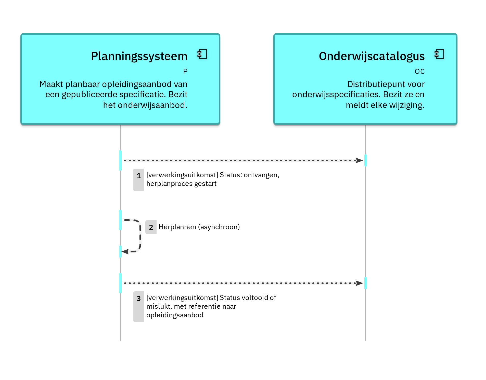

<!-- pagina-einde -->

### 4.12 Late wijziging toetsen

Een specificatiewijziging na een afgeronde planning komt alleen in de planning terecht als het planningssysteem haar accepteert; de uitkomst gaat terug naar de onderwijscatalogus.

| Kenmerk | Waarde |
|---|---|
| Aanbieder | [Planningssysteem](#33-planningssysteem-p) |
| Afnemer | [Onderwijscatalogus](#32-onderwijscatalogus-oc) |
| Afgeleid van | *(Meer)jaar capaciteitsplanning*, applicatiedienst van het planningssysteem |
| Versie | `1.0` |
| Vereist | [Onderwijsspecificatie ophalen](#43-onderwijsspecificatie-ophalen), [Afleverabonnement registreren](#431-afleverabonnement-registreren), [Reconciliatie](#432-reconciliatie) |
| OEAPI-profiel | `okx-late-wijziging-toetsen` |

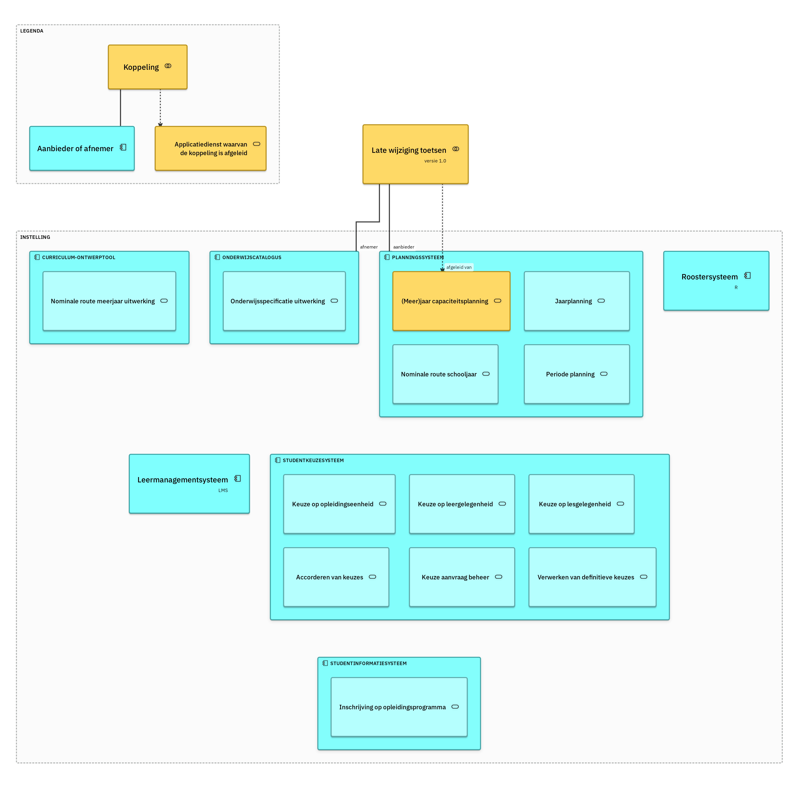

#### 4.12.1 Stories

| Story | Ingevuld door |
|---|---|
| [story-0002](#story-0002) | [Acceptatietoets bij late wijziging](#4122-acceptatietoets-bij-late-wijziging) |

#### 4.12.2 Acceptatietoets bij late wijziging

Doel: een afgeronde planning beschermen tegen een wijziging die er ongecontroleerd doorheen breekt. Trigger: de melding [Specificatiewijziging](#433-specificatiewijziging-melden) terwijl de planning al is afgerond. Initiator: Planningssysteem.

| Interactiepatronen | Koppelvlakdiensten |
|---|---|
| [Asynchronous Request-Reply](#63-asynchronous-request-reply) | [verwerkingsuitkomst-aanbieder](#526-verwerkingsuitkomst-aanbieder), [verwerkingsuitkomst-afnemer](#527-verwerkingsuitkomst-afnemer) |

Endpoints:

- [webhook `verwerkingsuitkomst`](#527-verwerkingsuitkomst-afnemer)

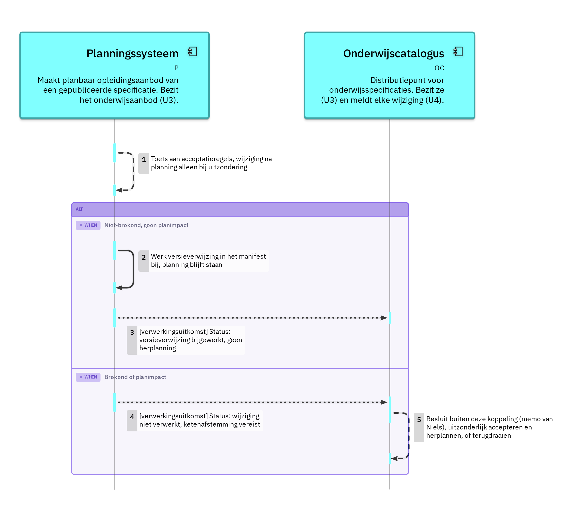

<!-- pagina-einde -->

### 4.13 Planningselementen ontsluiten

De onderwijscatalogus kent de planningselementen die het planningssysteem hanteert, zodat specificaties daarbinnen blijven.

| Kenmerk | Waarde |
|---|---|
| Aanbieder | [Planningssysteem](#33-planningssysteem-p) |
| Afnemer | [Onderwijscatalogus](#32-onderwijscatalogus-oc) |
| Afgeleid van | *(Meer)jaar capaciteitsplanning*, applicatiedienst van het planningssysteem |
| Versie | — |
| Vereist | [Afleverabonnement registreren](#431-afleverabonnement-registreren), [Reconciliatie](#432-reconciliatie) |
| OEAPI-profiel | `okx-planningselementen-ontsluiten` |

#### 4.13.1 Planningselementen melden

Doel: de onderwijscatalogus haalt de planningselementen op wanneer het planningssysteem ze vastlegt of wijzigt. Trigger: het planningssysteem legt planningselementen vast of wijzigt ze. Initiator: Planningssysteem.

| Interactiepatronen | Koppelvlakdiensten |
|---|---|
| [Event Notification](#61-event-notification) | Nog niet belegd |

Endpoints: nog niet vastgelegd.

<!-- pagina-einde -->

### 4.14 Geplande leergelegenheden ontsluiten

Het studentkeuzesysteem kent de geplande leergelegenheden met hun capaciteit, zodat een student daaruit kan kiezen.

| Kenmerk | Waarde |
|---|---|
| Aanbieder | [Planningssysteem](#33-planningssysteem-p) |
| Afnemer | [Studentkeuzesysteem](#37-studentkeuzesysteem-sks) |
| Afgeleid van | *Periode planning*, applicatiedienst van het planningssysteem |
| Versie | — |
| Vereist | [Afleverabonnement registreren](#431-afleverabonnement-registreren), [Reconciliatie](#432-reconciliatie) |
| OEAPI-profiel | `okx-geplande-leergelegenheden-ontsluiten` |

#### 4.14.1 Geplande leergelegenheden melden

Doel: het studentkeuzesysteem haalt de leergelegenheden van een periode op zodra die gepland zijn. Trigger: het planningssysteem stelt de leergelegenheden voor een periode vast. Initiator: Planningssysteem.

| Interactiepatronen | Koppelvlakdiensten |
|---|---|
| [Event Notification](#61-event-notification) | [planbaar-onderwijsaanbod-aanbieder](#58-planbaar-onderwijsaanbod-aanbieder), [planbaar-onderwijsaanbod-afnemer](#59-planbaar-onderwijsaanbod-afnemer) |

Endpoints: nog niet vastgelegd.

<!-- pagina-einde -->

### 4.15 Planninggroepen ontsluiten

Het roostersysteem kent de planninggroepen bij de leergelegenheden die het roostert.

| Kenmerk | Waarde |
|---|---|
| Aanbieder | [Planningssysteem](#33-planningssysteem-p) |
| Afnemer | [Roostersysteem](#36-roostersysteem-r) |
| Afgeleid van | *Periode planning*, applicatiedienst van het planningssysteem |
| Versie | — |
| Vereist | [Afleverabonnement registreren](#431-afleverabonnement-registreren), [Reconciliatie](#432-reconciliatie) |
| OEAPI-profiel | `okx-planninggroepen-ontsluiten` |

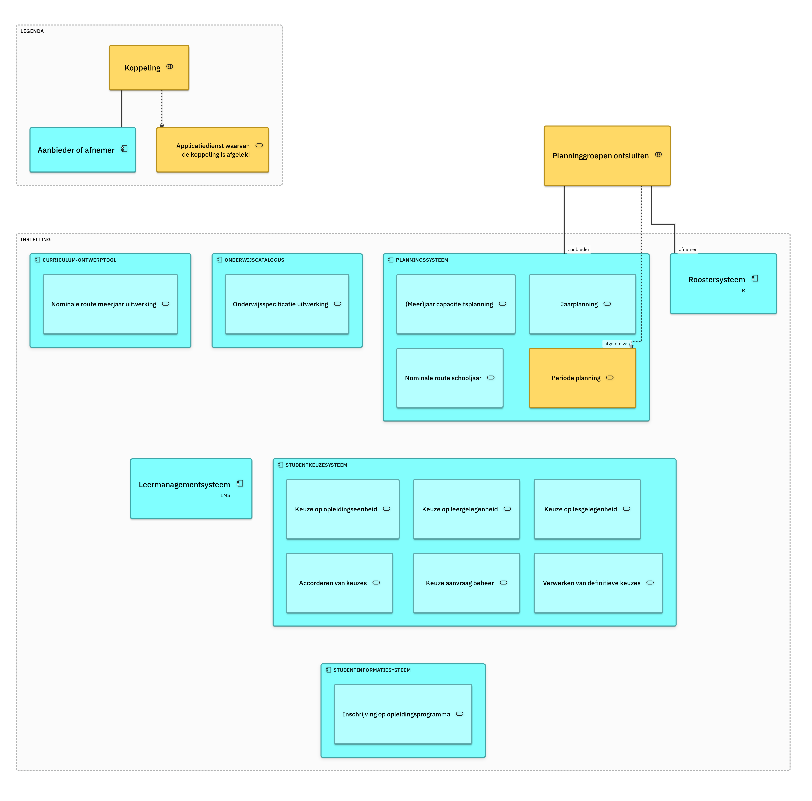

#### 4.15.1 Planninggroepen melden

Doel: het roostersysteem haalt de planninggroepen van een periode op zodra die zijn vastgesteld. Trigger: het planningssysteem stelt de planninggroepen voor een periode vast. Initiator: Planningssysteem.

| Interactiepatronen | Koppelvlakdiensten |
|---|---|
| [Event Notification](#61-event-notification) | Nog niet belegd |

Endpoints: nog niet vastgelegd.

<!-- pagina-einde -->

### 4.16 Plaatsingsgroepen ontsluiten

Het planningssysteem kent de plaatsingsgroepen met hun studenten, zodat het plant op de werkelijke groepen.

| Kenmerk | Waarde |
|---|---|
| Aanbieder | [Studentinformatiesysteem](#34-studentinformatiesysteem-sis) (KRS) |
| Afnemer | [Planningssysteem](#33-planningssysteem-p) |
| Afgeleid van | *Inschrijving op opleidingsprogramma*, applicatiedienst van het kernregistratiesysteem |
| Versie | — |
| Vereist | [Afleverabonnement registreren](#431-afleverabonnement-registreren), [Reconciliatie](#432-reconciliatie) |
| OEAPI-profiel | `okx-plaatsingsgroepen-ontsluiten` |

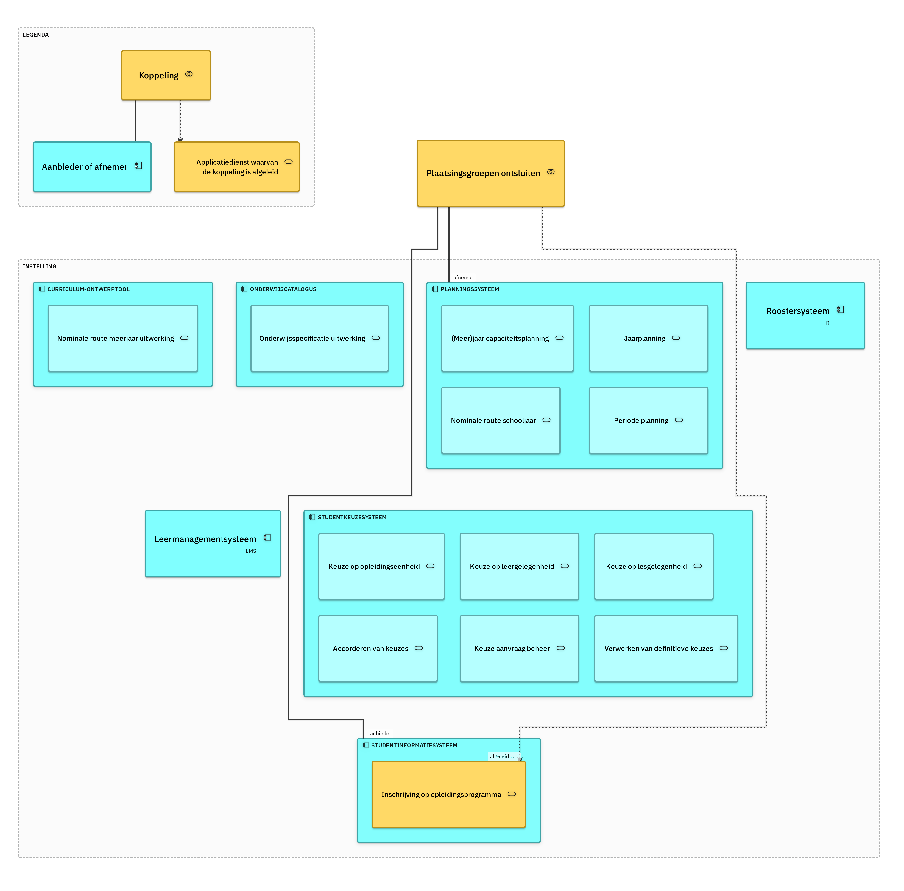

#### 4.16.1 Plaatsingsgroepen melden

Doel: het planningssysteem haalt een plaatsingsgroep op wanneer die ontstaat of wijzigt. Trigger: inschrijvingen leiden tot een nieuwe of gewijzigde plaatsingsgroep. Initiator: Studentinformatiesysteem (KRS).

| Interactiepatronen | Koppelvlakdiensten |
|---|---|
| [Event Notification](#61-event-notification) | Nog niet belegd |

Endpoints: nog niet vastgelegd.

<!-- pagina-einde -->

### 4.17 Opleidingsprogrammaverbintenis ontsluiten

Het studentkeuzesysteem en het leermanagementsysteem kennen de student, zijn opleidingsprogrammaverbintenis en de groepen die daarbij horen.

| Kenmerk | Waarde |
|---|---|
| Aanbieder | [Studentinformatiesysteem](#34-studentinformatiesysteem-sis) (KRS) |
| Afnemer | [Studentkeuzesysteem](#37-studentkeuzesysteem-sks), [Leermanagementsysteem](#35-leermanagementsysteem-lms) |
| Afgeleid van | *Inschrijving op opleidingsprogramma*, applicatiedienst van het kernregistratiesysteem |
| Versie | — |
| Vereist | [Afleverabonnement registreren](#431-afleverabonnement-registreren), [Reconciliatie](#432-reconciliatie) |
| OEAPI-profiel | `okx-opleidingsprogrammaverbintenis-ontsluiten` |

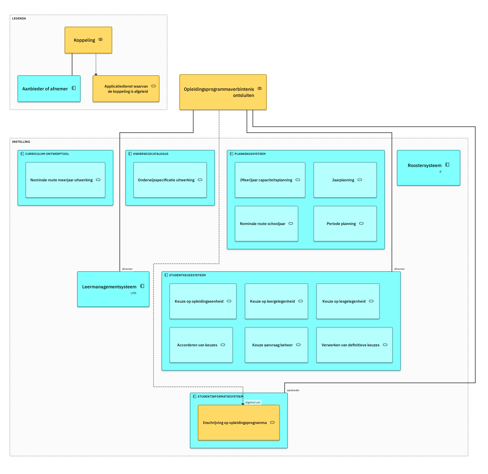

#### 4.17.1 Verbintenistoestand melden

Doel: afnemers werken hun beeld van de verbintenis bij zonder op te halen. Trigger: een opleidingsprogrammaverbintenis ontstaat of wisselt van toestand. Initiator: Studentinformatiesysteem (KRS).

| Interactiepatronen | Koppelvlakdiensten |
|---|---|
| [Event-Carried State Transfer](#62-event-carried-state-transfer) | [verbintenistoestand-aanbieder](#518-verbintenistoestand-aanbieder), [verbintenistoestand-afnemer](#519-verbintenistoestand-afnemer) |

Endpoints: nog niet vastgelegd.

<!-- pagina-einde -->

### 4.18 Animo doorgeven

Het planningssysteem kent de belangstelling van studenten voor opleidingsprogramma's en opleidingseenheden die nog niet gepland zijn.

| Kenmerk | Waarde |
|---|---|
| Aanbieder | [Studentkeuzesysteem](#37-studentkeuzesysteem-sks) |
| Afnemer | [Planningssysteem](#33-planningssysteem-p) |
| Afgeleid van | *Keuze aanvraag beheer*, applicatiedienst van het studentkeuzesysteem |
| Versie | — |
| Vereist | [Afleverabonnement registreren](#431-afleverabonnement-registreren), [Reconciliatie](#432-reconciliatie) |
| OEAPI-profiel | `okx-animo-doorgeven` |

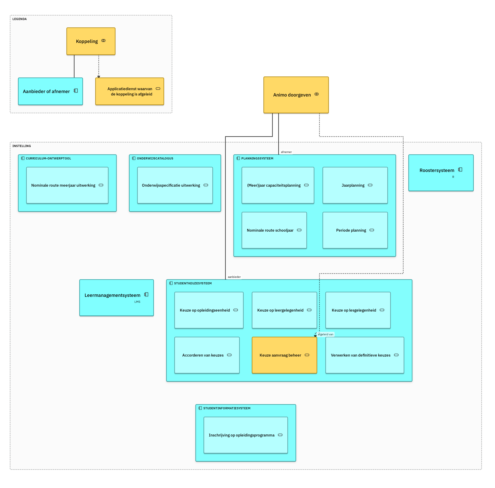

#### 4.18.1 Animo melden

Doel: het planningssysteem haalt de intekeningen op nog niet gepland aanbod op, als invoer voor haalbaar aanbod. Trigger: studenten tekenen in op aanbod dat nog niet gepland is. Initiator: Studentkeuzesysteem.

| Interactiepatronen | Koppelvlakdiensten |
|---|---|
| [Event Notification](#61-event-notification) | Nog niet belegd |

Endpoints: nog niet vastgelegd.

<!-- pagina-einde -->

### 4.19 Plaatsing op lesgelegenheid aanvragen

Een student wordt op een geroosterde lesgelegenheid geplaatst; het studentkeuzesysteem krijgt de verbintenis met de planninggroep terug.

| Kenmerk | Waarde |
|---|---|
| Aanbieder | [Roostersysteem](#36-roostersysteem-r) |
| Afnemer | [Studentkeuzesysteem](#37-studentkeuzesysteem-sks) |
| Afgeleid van | *Verwerken van definitieve keuzes*, applicatiedienst van het studentkeuzesysteem |
| Versie | — |
| Vereist | [Afleverabonnement registreren](#431-afleverabonnement-registreren), [Reconciliatie](#432-reconciliatie) |
| OEAPI-profiel | `okx-plaatsing-op-lesgelegenheid-aanvragen` |

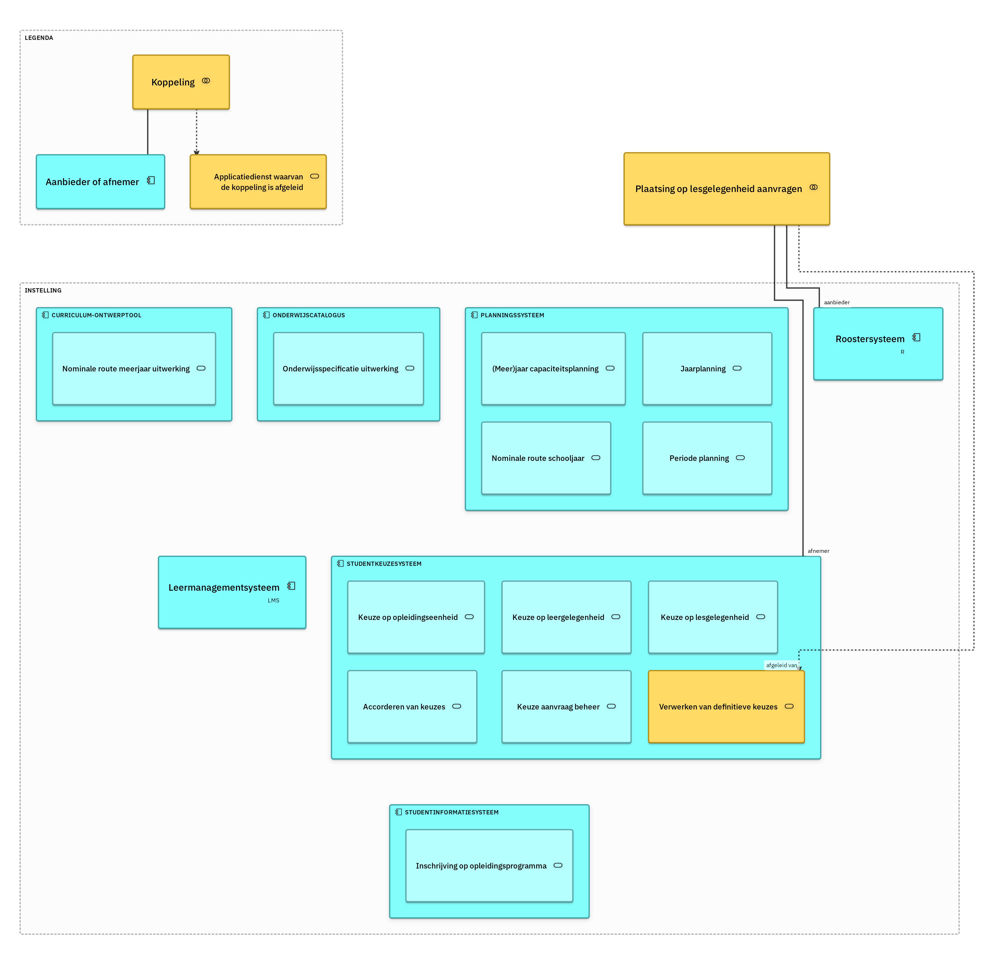

#### 4.19.1 Plaatsing aanvragen

Doel: de keuze van een student voor een lesgelegenheid omzetten in een plaatsing in een planninggroep. Trigger: een student kiest definitief een lesgelegenheid. Initiator: Studentkeuzesysteem.

| Interactiepatronen | Koppelvlakdiensten |
|---|---|
| [Asynchronous Request-Reply](#63-asynchronous-request-reply) | Nog niet belegd |

Endpoints: nog niet vastgelegd.

<!-- pagina-einde -->

### 4.20 Keuzeverbintenis vastleggen

Het kernregistratiesysteem legt de opleidingsprogrammaverbintenis vast die uit een definitieve keuze volgt, van het type keuzedeel of credential.

| Kenmerk | Waarde |
|---|---|
| Aanbieder | [Studentkeuzesysteem](#37-studentkeuzesysteem-sks) |
| Afnemer | [Studentinformatiesysteem](#34-studentinformatiesysteem-sis) (KRS) |
| Afgeleid van | *Verwerken van definitieve keuzes*, applicatiedienst van het studentkeuzesysteem |
| Versie | — |
| Vereist | [Afleverabonnement registreren](#431-afleverabonnement-registreren), [Reconciliatie](#432-reconciliatie) |
| OEAPI-profiel | `okx-keuzeverbintenis-vastleggen` |

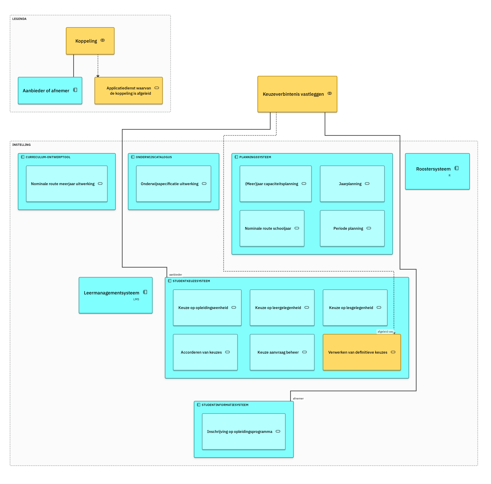

#### 4.20.1 Definitieve keuze melden

Doel: het kernregistratiesysteem haalt een definitieve keuze op en legt de verbintenis vast. Trigger: een keuze wordt definitief. Initiator: Studentkeuzesysteem.

| Interactiepatronen | Koppelvlakdiensten |
|---|---|
| [Event Notification](#61-event-notification) | Nog niet belegd |

Endpoints: nog niet vastgelegd.

<!-- pagina-einde -->

### 4.21 Onderwijseenheidverbintenis doorgeven

Het studentvolgsysteem kent de opleidingsprogramma- en onderwijseenheidverbintenissen waarop het voortgang en resultaat bijhoudt.

| Kenmerk | Waarde |
|---|---|
| Aanbieder | [Studentkeuzesysteem](#37-studentkeuzesysteem-sks) |
| Afnemer | [Studentinformatiesysteem](#34-studentinformatiesysteem-sis) (SVS) |
| Afgeleid van | *Verwerken van definitieve keuzes*, applicatiedienst van het studentkeuzesysteem |
| Versie | — |
| Vereist | [Afleverabonnement registreren](#431-afleverabonnement-registreren), [Reconciliatie](#432-reconciliatie) |
| OEAPI-profiel | `okx-onderwijseenheidverbintenis-doorgeven` |

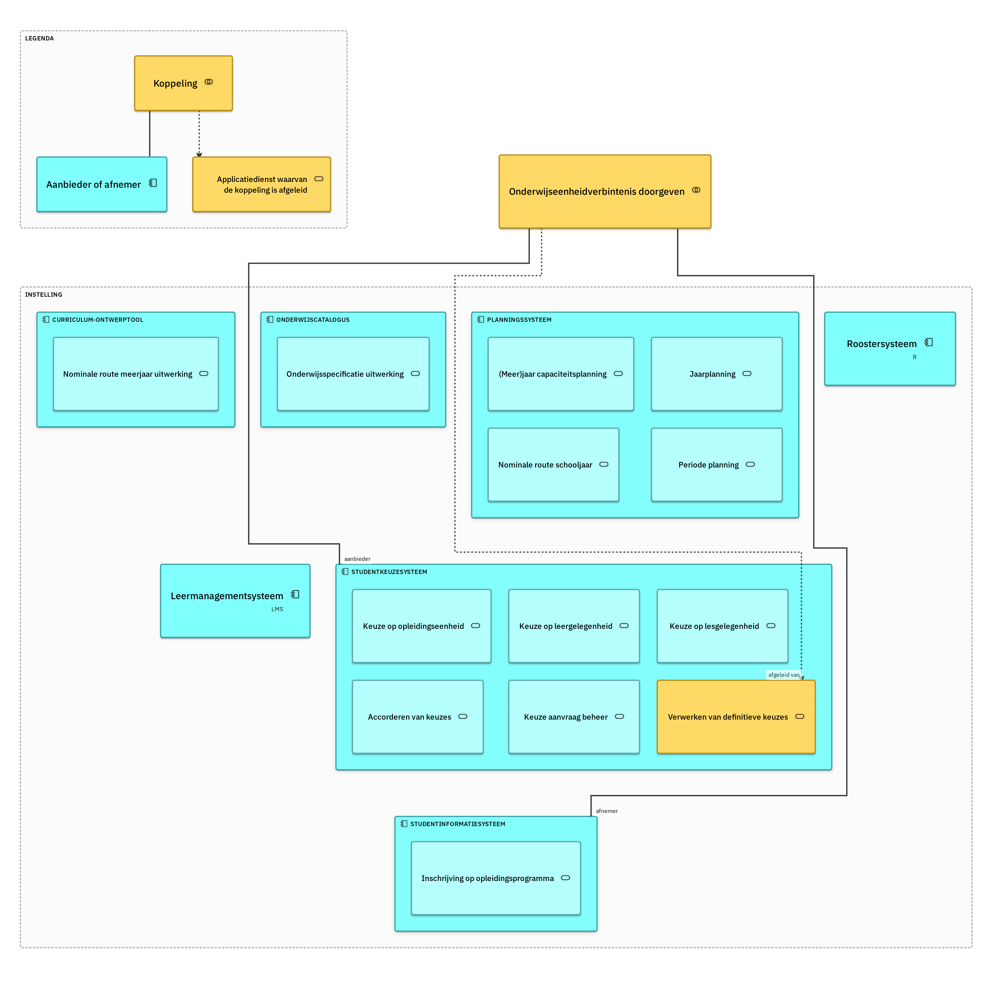

#### 4.21.1 Definitieve keuze melden

Doel: het studentvolgsysteem haalt een definitieve keuze op en neemt de verbintenissen op in de individuele structuur. Trigger: een keuze wordt definitief. Initiator: Studentkeuzesysteem.

| Interactiepatronen | Koppelvlakdiensten |
|---|---|
| [Event Notification](#61-event-notification) | Nog niet belegd |

Endpoints: nog niet vastgelegd.

<!-- pagina-einde -->

### 4.22 Verbintenis en planninggroep doorgeven

Het leermanagementsysteem geeft een student toegang tot de gekozen opleidingseenheden, in de juiste planninggroep.

| Kenmerk | Waarde |
|---|---|
| Aanbieder | [Studentkeuzesysteem](#37-studentkeuzesysteem-sks) |
| Afnemer | [Leermanagementsysteem](#35-leermanagementsysteem-lms) |
| Afgeleid van | *Verwerken van definitieve keuzes*, applicatiedienst van het studentkeuzesysteem |
| Versie | — |
| Vereist | [Afleverabonnement registreren](#431-afleverabonnement-registreren), [Reconciliatie](#432-reconciliatie) |
| OEAPI-profiel | `okx-verbintenis-en-planninggroep-doorgeven` |

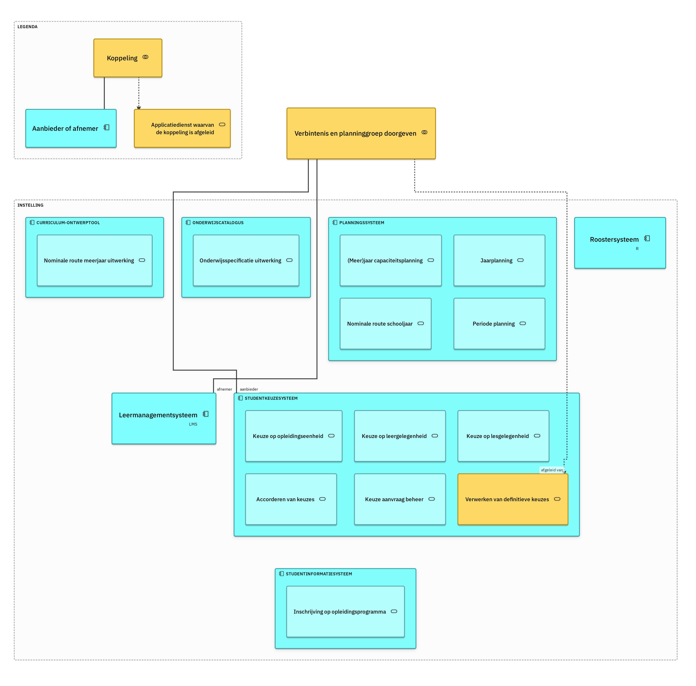

#### 4.22.1 Definitieve keuze melden

Doel: het leermanagementsysteem haalt een definitieve keuze op met de verbintenis en de planninggroep. Trigger: een keuze wordt definitief. Initiator: Studentkeuzesysteem.

| Interactiepatronen | Koppelvlakdiensten |
|---|---|
| [Event Notification](#61-event-notification) | Nog niet belegd |

Endpoints: nog niet vastgelegd.

<!-- pagina-einde -->

### 4.23 Leergelegenheden roosteren

Het roostersysteem plaatst de geplande leergelegenheden in tijd en ruimte en meldt het rooster terug aan het planningssysteem.

| Kenmerk | Waarde |
|---|---|
| Aanbieder | [Roostersysteem](#36-roostersysteem-r) |
| Afnemer | [Planningssysteem](#33-planningssysteem-p) |
| Afgeleid van | Geen: het roostersysteem heeft op de hoofdplaat nog geen applicatiedienst |
| Versie | — |
| Vereist | [Planninggroepen ontsluiten](#415-planninggroepen-ontsluiten), [Afleverabonnement registreren](#431-afleverabonnement-registreren), [Reconciliatie](#432-reconciliatie) |
| OEAPI-profiel | `okx-leergelegenheden-roosteren` |

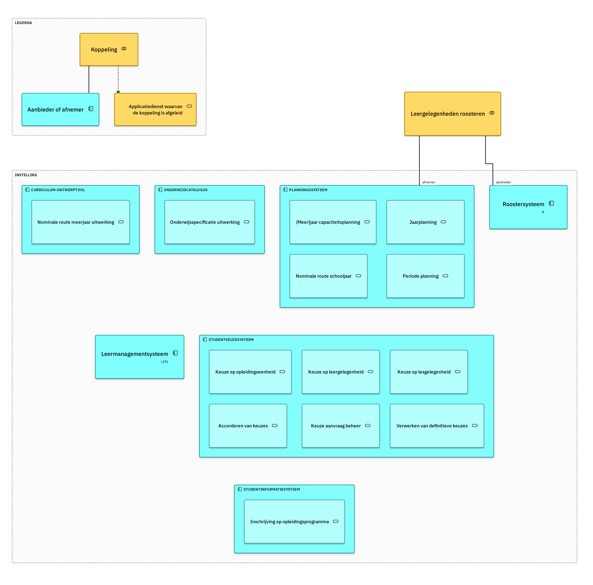

#### 4.23.1 Roosteren aanvragen

Doel: geplande leergelegenheden een plek in tijd en ruimte geven, met het rooster als uitkomst. Trigger: het planningssysteem stelt de leergelegenheden voor een periode vast. Initiator: Planningssysteem.

| Interactiepatronen | Koppelvlakdiensten |
|---|---|
| [Asynchronous Request-Reply](#63-asynchronous-request-reply) | [geroosterd-onderwijsaanbod-aanbieder](#514-geroosterd-onderwijsaanbod-aanbieder), [geroosterd-onderwijsaanbod-afnemer](#515-geroosterd-onderwijsaanbod-afnemer) |

Endpoints: nog niet vastgelegd.

<!-- pagina-einde -->

### 4.24 Geroosterde leergelegenheden ontsluiten

Het studentkeuzesysteem kent de geroosterde leergelegenheden met hun details en capaciteit, zodat een student op lesgelegenheid kan kiezen.

| Kenmerk | Waarde |
|---|---|
| Aanbieder | [Roostersysteem](#36-roostersysteem-r) |
| Afnemer | [Studentkeuzesysteem](#37-studentkeuzesysteem-sks) |
| Afgeleid van | Geen: het roostersysteem heeft op de hoofdplaat nog geen applicatiedienst |
| Versie | — |
| Vereist | [Afleverabonnement registreren](#431-afleverabonnement-registreren), [Reconciliatie](#432-reconciliatie) |
| OEAPI-profiel | `okx-geroosterde-leergelegenheden-ontsluiten` |

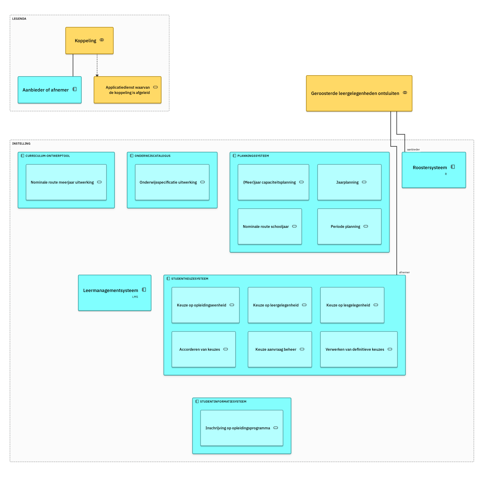

#### 4.24.1 Geroosterde leergelegenheden melden

Doel: het studentkeuzesysteem haalt het rooster van een periode op zodra het bekend is of wijzigt. Trigger: het rooster voor een periode is bekend of wijzigt. Initiator: Roostersysteem.

| Interactiepatronen | Koppelvlakdiensten |
|---|---|
| [Event Notification](#61-event-notification) | [geroosterd-onderwijsaanbod-aanbieder](#514-geroosterd-onderwijsaanbod-aanbieder), [geroosterd-onderwijsaanbod-afnemer](#515-geroosterd-onderwijsaanbod-afnemer) |

Endpoints: nog niet vastgelegd.

<!-- pagina-einde -->

### 4.25 Planninggroepen met studenten ontsluiten

Het kernregistratiesysteem kent de planninggroepen met de studenten die erin zijn geplaatst.

| Kenmerk | Waarde |
|---|---|
| Aanbieder | [Roostersysteem](#36-roostersysteem-r) |
| Afnemer | [Studentinformatiesysteem](#34-studentinformatiesysteem-sis) (KRS) |
| Afgeleid van | Geen: het roostersysteem heeft op de hoofdplaat nog geen applicatiedienst |
| Versie | — |
| Vereist | [Afleverabonnement registreren](#431-afleverabonnement-registreren), [Reconciliatie](#432-reconciliatie) |
| OEAPI-profiel | `okx-planninggroepen-met-studenten-ontsluiten` |

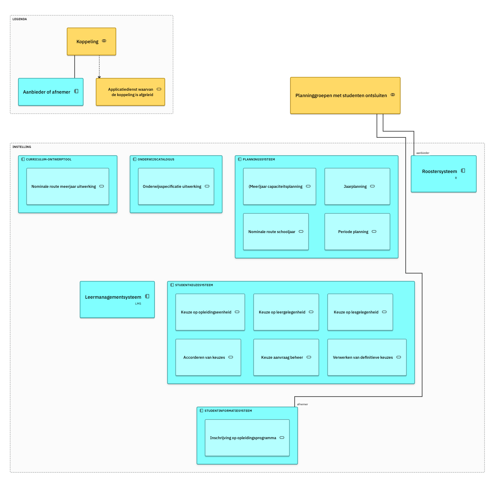

#### 4.25.1 Planninggroepen met studenten melden

Doel: het kernregistratiesysteem haalt een planninggroep op wanneer de plaatsing van studenten erin wijzigt. Trigger: de plaatsing van studenten in een planninggroep wijzigt. Initiator: Roostersysteem.

| Interactiepatronen | Koppelvlakdiensten |
|---|---|
| [Event Notification](#61-event-notification) | Nog niet belegd |

Endpoints: nog niet vastgelegd.

<!-- pagina-einde -->

### 4.26 Leeromgeving inrichten

Het leermanagementsysteem richt de leeromgeving in op een gepubliceerde specificatie en meldt de uitkomst en de gelegde leermiddelkoppeling terug aan de onderwijscatalogus.

| Kenmerk | Waarde |
|---|---|
| Aanbieder | [Leermanagementsysteem](#35-leermanagementsysteem-lms) |
| Afnemer | [Onderwijscatalogus](#32-onderwijscatalogus-oc) |
| Afgeleid van | Geen: het leermanagementsysteem heeft op de hoofdplaat nog geen applicatiedienst |
| Versie | `1.0` |
| Vereist | [Onderwijsspecificatie ophalen](#43-onderwijsspecificatie-ophalen), [Afleverabonnement registreren](#431-afleverabonnement-registreren), [Reconciliatie](#432-reconciliatie) |
| OEAPI-profiel | `okx-leeromgeving-inrichten` |

#### 4.26.1 Stories

| Story | Ingevuld door |
|---|---|
| [story-0003](#story-0003) | [Leeromgeving inrichten en leermiddelkoppeling melden](#4262-leeromgeving-inrichten-en-leermiddelkoppeling-melden) |
| [story-0029](#story-0029) | [Leeromgeving inrichten en leermiddelkoppeling melden](#4262-leeromgeving-inrichten-en-leermiddelkoppeling-melden) |

#### 4.26.2 Leeromgeving inrichten en leermiddelkoppeling melden

Doel: een gepubliceerde specificatie omzetten in een ingerichte leeromgeving, met een leermiddelkoppeling terug naar de onderwijscatalogus. Trigger: de melding [Specificatie beschikbaar](#432-specificatie-beschikbaar-melden) en het ophalen van de structuur. Initiator: Leermanagementsysteem.

| Interactiepatronen | Koppelvlakdiensten |
|---|---|
| [Asynchronous Request-Reply](#63-asynchronous-request-reply), [Event Notification](#61-event-notification) | [verwerkingsuitkomst-aanbieder](#526-verwerkingsuitkomst-aanbieder), [verwerkingsuitkomst-afnemer](#527-verwerkingsuitkomst-afnemer), [leermiddelkoppeling-aanbieder](#524-leermiddelkoppeling-aanbieder), [leermiddelkoppeling-afnemer](#525-leermiddelkoppeling-afnemer) |

Endpoints:

- [webhook `verwerkingsuitkomst`](#527-verwerkingsuitkomst-afnemer)
- [webhook `leermiddelkoppeling-beschikbaar`](#525-leermiddelkoppeling-afnemer)
- [`GET /leermiddelkoppelingen/{id}` (optioneel)](#524-leermiddelkoppeling-aanbieder)

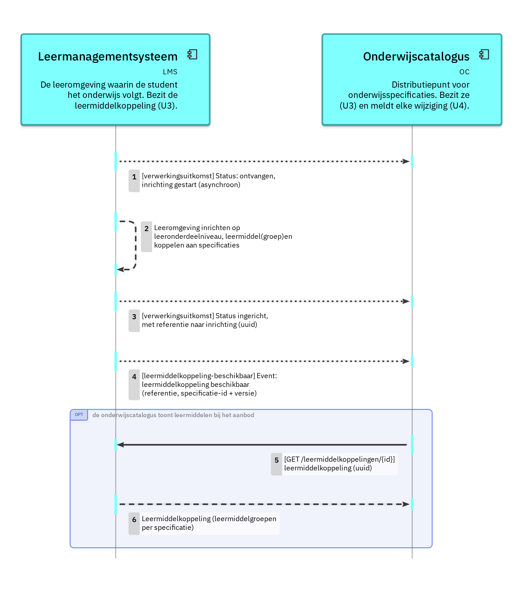

<!-- pagina-einde -->

### 4.27 Leeromgeving bijwerken

Het leermanagementsysteem laat een bestaande inrichting volgen op een nieuwe specificatieversie en meldt de uitkomst terug aan de onderwijscatalogus.

| Kenmerk | Waarde |
|---|---|
| Aanbieder | [Leermanagementsysteem](#35-leermanagementsysteem-lms) |
| Afnemer | [Onderwijscatalogus](#32-onderwijscatalogus-oc) |
| Afgeleid van | Geen: het leermanagementsysteem heeft op de hoofdplaat nog geen applicatiedienst |
| Versie | `1.0` |
| Vereist | [Onderwijsspecificatie ophalen](#43-onderwijsspecificatie-ophalen), [Afleverabonnement registreren](#431-afleverabonnement-registreren), [Reconciliatie](#432-reconciliatie) |
| OEAPI-profiel | `okx-leeromgeving-bijwerken` |

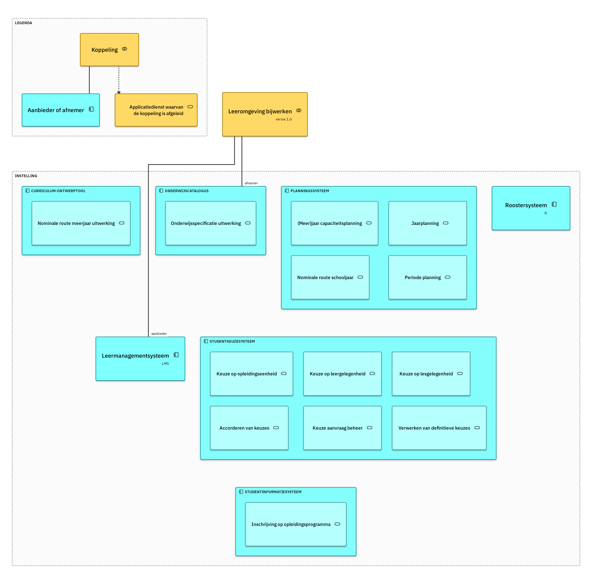

#### 4.27.1 Stories

| Story | Ingevuld door |
|---|---|
| [story-0031](#story-0031) | [Inrichting bijwerken na wijziging](#4272-inrichting-bijwerken-na-wijziging) |

#### 4.27.2 Inrichting bijwerken na wijziging

Doel: een bestaande inrichting laten volgen op een nieuwe specificatieversie, met delta of volledige structuur als keuze voor het leermanagementsysteem. Trigger: de melding [Specificatiewijziging](#433-specificatiewijziging-melden) voor een specificatie waarop het leermanagementsysteem is ingericht. Initiator: Leermanagementsysteem.

| Interactiepatronen | Koppelvlakdiensten |
|---|---|
| [Asynchronous Request-Reply](#63-asynchronous-request-reply) | [verwerkingsuitkomst-aanbieder](#526-verwerkingsuitkomst-aanbieder), [verwerkingsuitkomst-afnemer](#527-verwerkingsuitkomst-afnemer) |

Endpoints:

- [webhook `verwerkingsuitkomst`](#527-verwerkingsuitkomst-afnemer)

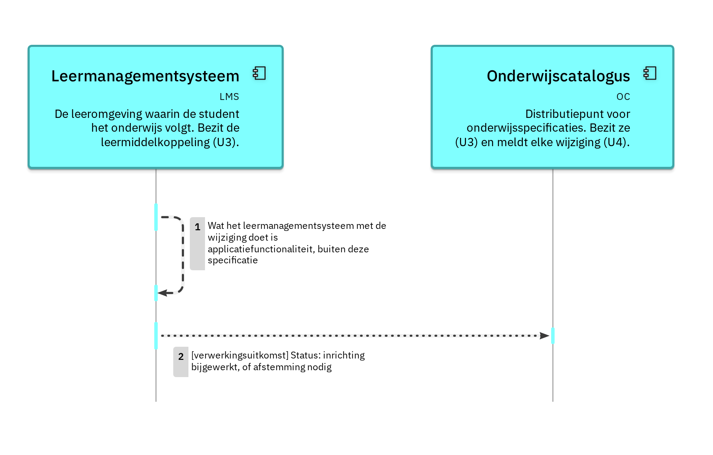

<!-- pagina-einde -->

### 4.28 Toetsresultaat doorgeven

Het studentvolgsysteem ontvangt het resultaat dat een student op een toetsgelegenheid behaalde, zodat het voortgang en behaalde leeruitkomsten kan bijhouden.

| Kenmerk | Waarde |
|---|---|
| Aanbieder | [Leermanagementsysteem](#35-leermanagementsysteem-lms) |
| Afnemer | [Studentinformatiesysteem](#34-studentinformatiesysteem-sis) (SVS) |
| Afgeleid van | Geen: het leermanagementsysteem heeft op de hoofdplaat nog geen applicatiedienst |
| Versie | — |
| Vereist | [Afleverabonnement registreren](#431-afleverabonnement-registreren), [Reconciliatie](#432-reconciliatie) |
| OEAPI-profiel | `okx-toetsresultaat-doorgeven` |

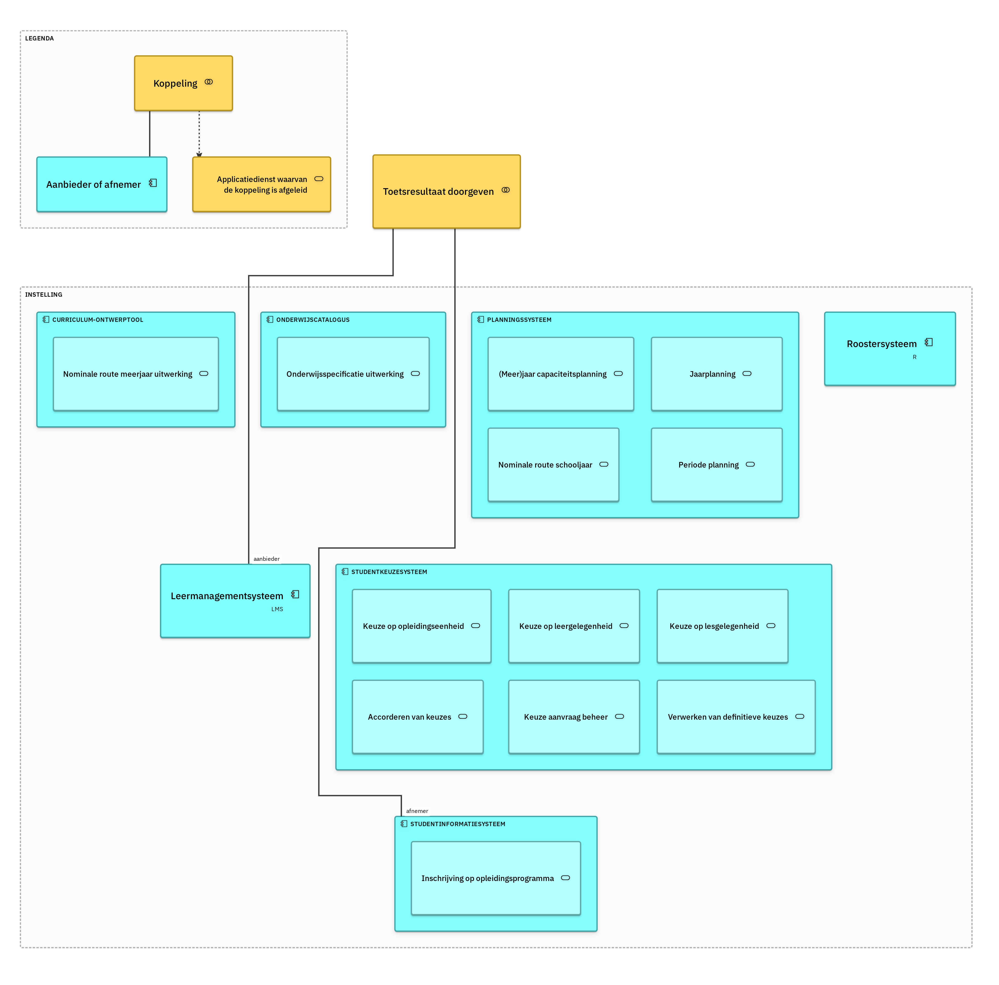

#### 4.28.1 Toetsresultaat melden

Doel: het studentvolgsysteem haalt een vastgesteld resultaat op een toetsgelegenheidverbintenis op. Trigger: een resultaat op een toetsgelegenheidverbintenis wordt vastgesteld. Initiator: Leermanagementsysteem.

| Interactiepatronen | Koppelvlakdiensten |
|---|---|
| [Event Notification](#61-event-notification) | Nog niet belegd |

Endpoints: nog niet vastgelegd.

<!-- pagina-einde -->

### 4.29 Nominaal template inrichten

Het studentinformatiesysteem richt met een gepubliceerde specificatie en resultaatstructuur het nominale template in, en meldt de uitkomst terug aan de onderwijscatalogus.

| Kenmerk | Waarde |
|---|---|
| Aanbieder | [Studentinformatiesysteem](#34-studentinformatiesysteem-sis) (SVS) |
| Afnemer | [Onderwijscatalogus](#32-onderwijscatalogus-oc) |
| Afgeleid van | Geen: het studentvolgsysteem heeft op de hoofdplaat nog geen applicatiedienst |
| Versie | `1.0` |
| Vereist | [Onderwijsspecificatie ophalen](#43-onderwijsspecificatie-ophalen), [Resultaatstructuur ophalen](#45-resultaatstructuur-ophalen), [Afleverabonnement registreren](#431-afleverabonnement-registreren), [Reconciliatie](#432-reconciliatie) |
| OEAPI-profiel | `okx-nominaal-template-inrichten` |

#### 4.29.1 Stories

| Story | Ingevuld door |
|---|---|
| [story-0022](#story-0022) | [Nominaal template en resultaatstructuur inrichten](#4292-nominaal-template-en-resultaatstructuur-inrichten) |
| [story-0023](#story-0023) | [Nominaal template en resultaatstructuur inrichten](#4292-nominaal-template-en-resultaatstructuur-inrichten) |

#### 4.29.2 Nominaal template en resultaatstructuur inrichten

Doel: een gepubliceerde specificatie en examenplanspecificatie omzetten in een ingericht nominaal template en resultaatstructuur bij het studentinformatiesysteem. Trigger: de meldingen [Specificatie beschikbaar](#432-specificatie-beschikbaar-melden) en [Resultaatstructuur beschikbaar](#451-resultaatstructuur-beschikbaar-melden), en het ophalen van beide. Initiator: Studentinformatiesysteem.

| Interactiepatronen | Koppelvlakdiensten |
|---|---|
| [Asynchronous Request-Reply](#63-asynchronous-request-reply) | [verwerkingsuitkomst-aanbieder](#526-verwerkingsuitkomst-aanbieder), [verwerkingsuitkomst-afnemer](#527-verwerkingsuitkomst-afnemer) |

Endpoints:

- [webhook `verwerkingsuitkomst`](#527-verwerkingsuitkomst-afnemer)

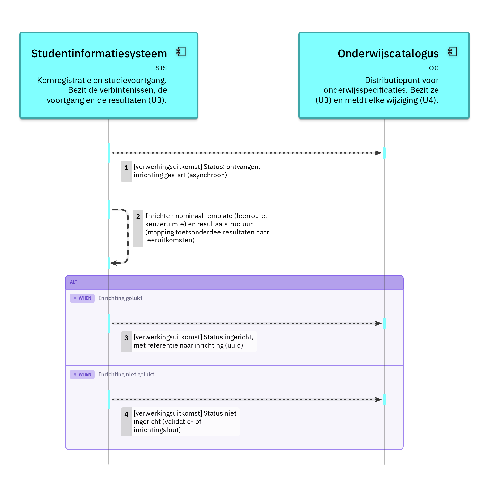

<!-- pagina-einde -->

### 4.30 Examenplanwijziging toetsen

Een examenplanwijziging raakt lopende verbintenissen alleen als het studentinformatiesysteem haar accepteert; de uitkomst gaat terug naar de onderwijscatalogus.

| Kenmerk | Waarde |
|---|---|
| Aanbieder | [Studentinformatiesysteem](#34-studentinformatiesysteem-sis) (SVS) |
| Afnemer | [Onderwijscatalogus](#32-onderwijscatalogus-oc) |
| Afgeleid van | Geen: het studentvolgsysteem heeft op de hoofdplaat nog geen applicatiedienst |
| Versie | `1.0` |
| Vereist | [Resultaatstructuur ophalen](#45-resultaatstructuur-ophalen), [Afleverabonnement registreren](#431-afleverabonnement-registreren), [Reconciliatie](#432-reconciliatie) |
| OEAPI-profiel | `okx-examenplanwijziging-toetsen` |

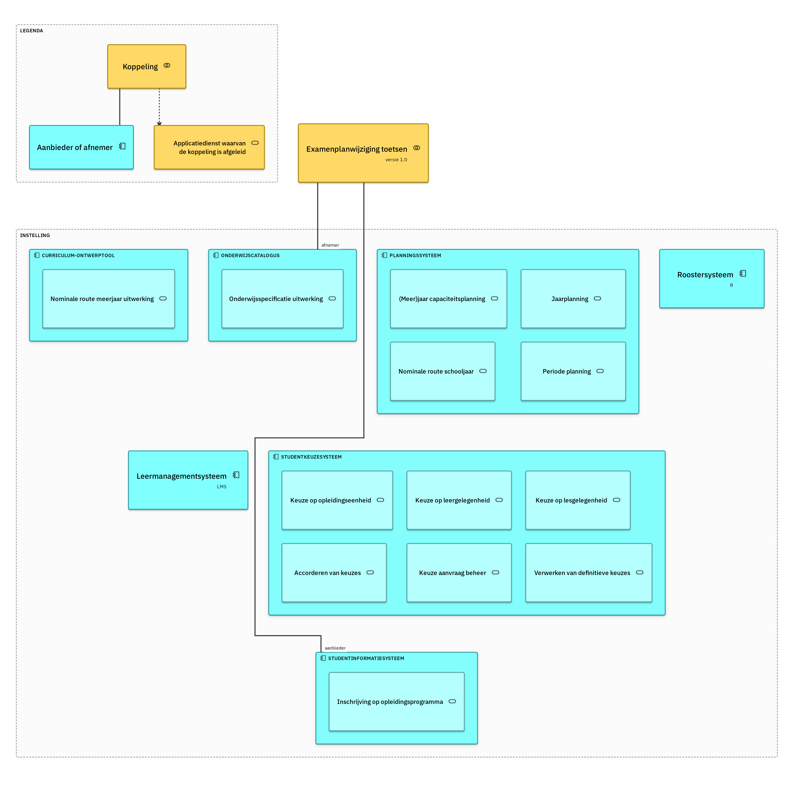

#### 4.30.1 Stories

| Story | Ingevuld door |
|---|---|
| [story-0020](#story-0020) | [Acceptatietoets bij wijziging examenplan](#4302-acceptatietoets-bij-wijziging-examenplan) |

#### 4.30.2 Acceptatietoets bij wijziging examenplan

Doel: lopende verbintenissen beschermen tegen een examenplanwijziging die er ongecontroleerd doorheen breekt. Trigger: de melding [Examenplanwijziging](#452-examenplanwijziging-melden) terwijl er al verbintenissen lopen. Initiator: Studentinformatiesysteem.

| Interactiepatronen | Koppelvlakdiensten |
|---|---|
| [Asynchronous Request-Reply](#63-asynchronous-request-reply) | [verwerkingsuitkomst-aanbieder](#526-verwerkingsuitkomst-aanbieder), [verwerkingsuitkomst-afnemer](#527-verwerkingsuitkomst-afnemer) |

Endpoints:

- [webhook `verwerkingsuitkomst`](#527-verwerkingsuitkomst-afnemer)

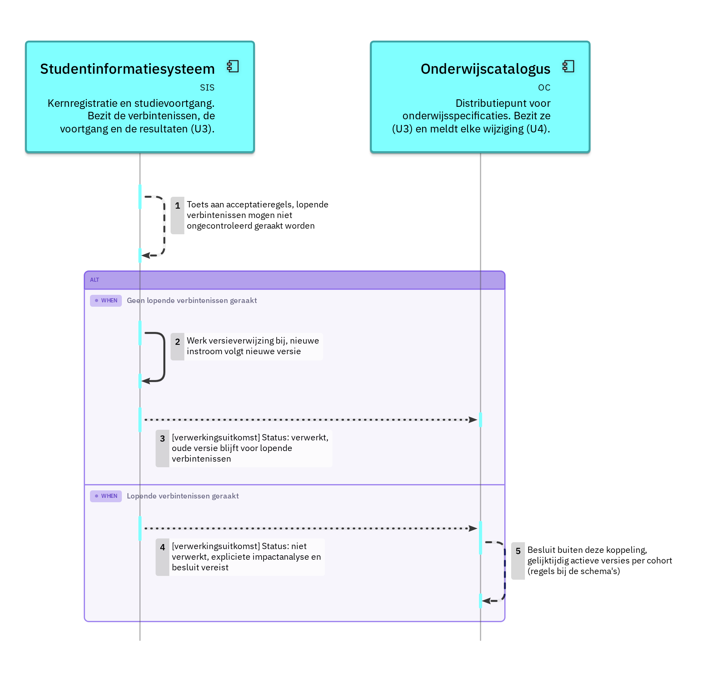

<!-- pagina-einde -->

### 4.31 Afleverabonnement registreren

Een afnemer legt bij de aanbieder van een koppeling vast op welk adres hij welke meldingen wil ontvangen, voordat die worden afgeleverd.

| Kenmerk | Waarde |
|---|---|
| Aanbieder | Het component dat de meldingen verstuurt |
| Afnemer | Het component dat de meldingen ontvangt |
| Afgeleid van | Geen: elke koppeling met meldingen steunt erop |
| Versie | `1.0` |
| Vereist | — |
| OEAPI-profiel | `okx-afleverabonnement-registreren` |

#### 4.31.1 Stories

| Story | Ingevuld door |
|---|---|
| [story-0010](#story-0010) | [Abonnement registreren](#4312-abonnement-registreren) |

#### 4.31.2 Abonnement registreren

Doel: een afnemer een callback-URL laten vastleggen voor de meldingen die hij van de aanbieder ontvangt, als voorwaarde voor de event-gedreven stromen. Trigger: inrichting van een koppeling, of wijziging van de callback-URL. Initiator: de afnemer.

| Interactiepatronen | Koppelvlakdiensten |
|---|---|
| [Subscription registration](#65-subscription-registration) | [afleverabonnement-aanbieder](#528-afleverabonnement-aanbieder), [afleverabonnement-afnemer](#529-afleverabonnement-afnemer) |

Endpoints:

- [`POST /abonnementen`](#528-afleverabonnement-aanbieder)

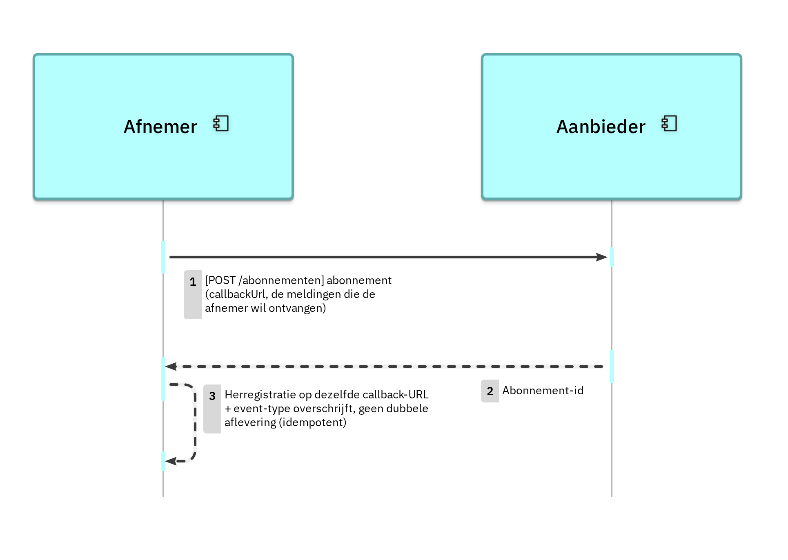

<!-- pagina-einde -->

### 4.32 Reconciliatie

Een afnemer herstelt informatie die hem door een gemiste of onverwerkbare melding is ontgaan, met een gewone opvraag bij de aanbieder van die melding.

| Kenmerk | Waarde |
|---|---|
| Aanbieder | Het component dat de gemiste melding verstuurde |
| Afnemer | Het component dat de melding miste |
| Afgeleid van | Geen: elke koppeling met meldingen steunt erop |
| Versie | `1.0` |
| Vereist | — |
| OEAPI-profiel | `okx-reconciliatie` |

#### 4.32.1 Stories

| Story | Ingevuld door |
|---|---|
| [story-0011](#story-0011) | [Reconciliatie na gemist event](#4322-reconciliatie-na-gemist-event) |

#### 4.32.2 Reconciliatie na gemist event

Doel: de gemiste informatie via een gewone opvraag herstellen na een event dat in de Dead Letter Channel is beland, zonder op een herhaalde aflevering te wachten. Trigger: een event is niet aangekomen. Initiator: de afnemer.

| Interactiepatronen | Koppelvlakdiensten |
|---|---|
| [Request-Reply](#64-request-reply) | [onderwijsspecificatiestructuur-aanbieder](#52-onderwijsspecificatiestructuur-aanbieder), [planbaar-onderwijsaanbod-aanbieder](#58-planbaar-onderwijsaanbod-aanbieder) |

Endpoints:

- [`GET /onderwijsspecificaties` (op de onderwijscatalogus)](#52-onderwijsspecificatiestructuur-aanbieder)
- [`GET /onderwijsaanbod` (op het planningssysteem)](#58-planbaar-onderwijsaanbod-aanbieder)

De opvraag hoort bij de koppelvlakdienst van de resource waarover de melding ging. Voor de onderwijscatalogus en het planningssysteem ligt zij vast; voor de andere aanbieders nog niet.

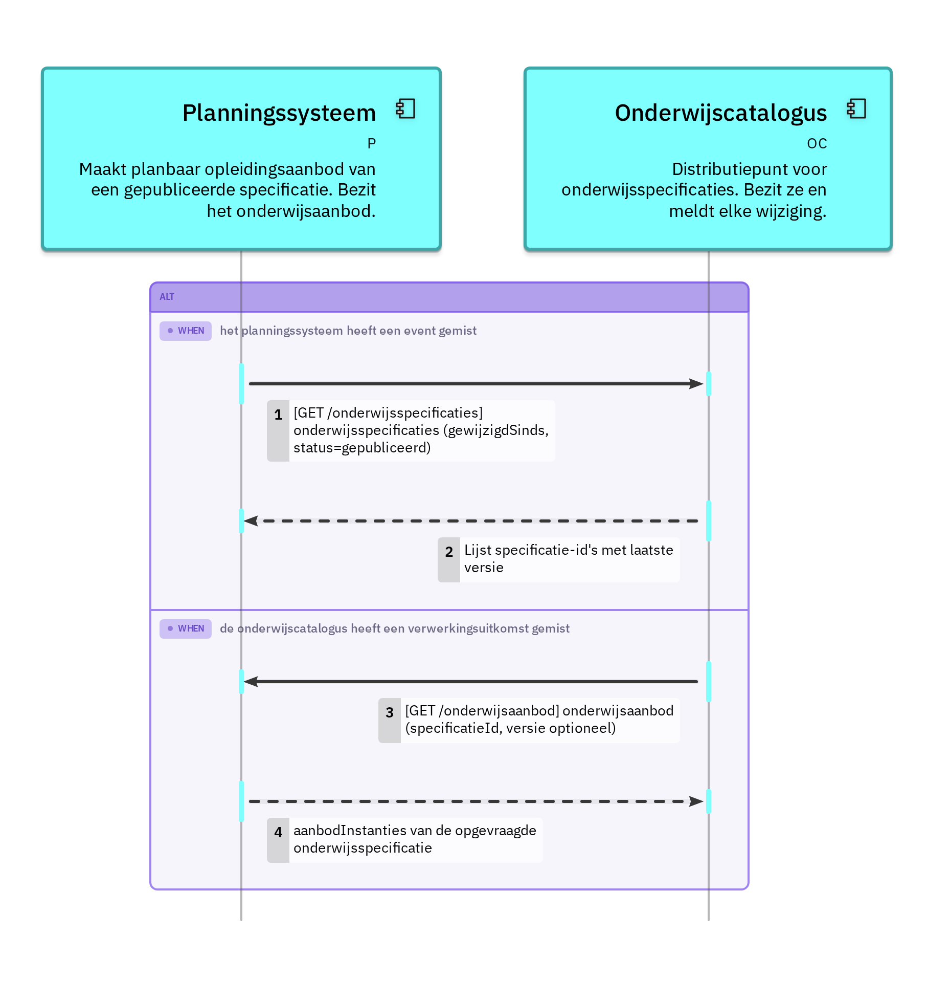

<!-- pagina-einde -->

## 5 Koppelvlakdiensten

Een koppelvlakdienst is het contract waarmee een component een deel van zijn gedrag over een koppeling aanbiedt of afneemt. Diensten zijn de bouwstenen waaruit een [koppeling](#4-koppelingen) wordt samengesteld. De dienst zegt wát er moet kunnen, niet welk systeem het doet: elk component kan hem implementeren, en een component implementeert er meestal meer dan één. Op elke dienstpagina is de handelende partij daarom het component dat de dienst implementeert, en niemand anders; waar die dienst voor dient blijkt uit de koppeling die hem inzet, onder **Gebruikt in**.

Een aanbieder zorgt dat hij een gegeven of een functionaliteit levert; een afnemer zorgt dat hij die kan afnemen. Dat zijn **twee losse diensten**, niet twee kanten van één, en op een pagina staan daarom alleen verplichtingen van één van beide richtingen. Een component dat onderwijsspecificaties publiceert implementeert `onderwijsspecificatiestructuur-aanbieder`; een component dat ze wil gebruiken implementeert `onderwijsspecificatiestructuur-afnemer`. Beide zijn zelfstandig te implementeren; een versie draagt alleen de koppeling die ze inzet ([release management §4.2](release-management.md#42-een-koppeling-draagt-haar-eigen-versie)).

Met welk patroon een dienst wordt gebruikt is een keuze van de berichtstroom die hem inzet, niet een eigenschap van de dienst.

| Aanbieder | Afnemer | Waarover |
|---|---|---|
| [onderwijsspecificatiestructuur](#52-onderwijsspecificatiestructuur-aanbieder) | [onderwijsspecificatiestructuur](#53-onderwijsspecificatiestructuur-afnemer) | De vastgestelde specificatiestructuur met haar versies |
| [onderwijsspecificatie-inname](#54-onderwijsspecificatie-inname-aanbieder) | [onderwijsspecificatie-inname](#55-onderwijsspecificatie-inname-afnemer) | Een elders ontworpen specificatie vaststellen en opnemen |
| [keuzeregelset](#56-keuzeregelset-aanbieder) | [keuzeregelset](#57-keuzeregelset-afnemer) | De regels die keuzeruimte begrenzen, los van de items |
| [planbaar-onderwijsaanbod](#58-planbaar-onderwijsaanbod-aanbieder) | [planbaar-onderwijsaanbod](#59-planbaar-onderwijsaanbod-afnemer) | Aanbod in het stadium tussen specificatie en rooster |
| [onderwijsaanbod-zoekvraag](#510-onderwijsaanbod-zoekvraag-aanbieder) | [onderwijsaanbod-zoekvraag](#511-onderwijsaanbod-zoekvraag-afnemer) | Aanbod doorzoeken op criteria uit de leervraag |
| [onderwijsaanbod-haalbaarheidstoets](#512-onderwijsaanbod-haalbaarheidstoets-aanbieder) | [onderwijsaanbod-haalbaarheidstoets](#513-onderwijsaanbod-haalbaarheidstoets-afnemer) | Een voorstel beoordelen vóór vastlegging |
| [geroosterd-onderwijsaanbod](#514-geroosterd-onderwijsaanbod-aanbieder) | [geroosterd-onderwijsaanbod](#515-geroosterd-onderwijsaanbod-afnemer) | Aanbod in het laatste stadium, per periode |
| [kiesbaarheidsbepaling](#516-kiesbaarheidsbepaling-aanbieder) | [kiesbaarheidsbepaling](#517-kiesbaarheidsbepaling-afnemer) | Wat een student op elk niveau mag kiezen |
| [verbintenistoestand](#518-verbintenistoestand-aanbieder) | [verbintenistoestand](#519-verbintenistoestand-afnemer) | De toestand van de onderwijsverbintenis per niveau |
| [resultaatstructuur](#520-resultaatstructuur-aanbieder) | [resultaatstructuur](#521-resultaatstructuur-afnemer) | Toetsonderdelen, weging en aggregatie |
| [behaalde-leeruitkomst](#522-behaalde-leeruitkomst-aanbieder) | [behaalde-leeruitkomst](#523-behaalde-leeruitkomst-afnemer) | Wat een student heeft behaald, met bewijsvoering |
| [leermiddelkoppeling](#524-leermiddelkoppeling-aanbieder) | [leermiddelkoppeling](#525-leermiddelkoppeling-afnemer) | De gelegde koppeling naar leermiddelen |
| [verwerkingsuitkomst](#526-verwerkingsuitkomst-aanbieder) | [verwerkingsuitkomst](#527-verwerkingsuitkomst-afnemer) | Wat een verwerking heeft opgeleverd, met referentie naar het aangemaakte |
| [afleverabonnement](#528-afleverabonnement-aanbieder) | [afleverabonnement](#529-afleverabonnement-afnemer) | Vastleggen waar en waarvoor een partij meldingen wil ontvangen |

### 5.1 Wat op elke dienst drukt

Deze eisen gelden voor elke dienst in de tabel:

- Betrouwbare aflevering, idempotente verwerking, dead letter-afhandeling en volgorde waar die semantisch telt ([ADR 0018](../Referentiemateriaal/adr/0018-enterprise-messaging-patronen-voor-betrouwbare-koppelvlakken.md)).
- Authenticatie via OAuth 2.0 Client Credentials, met een eigen token-endpoint per aanbieder ([auth-standaard](#7-auth-standaard-voor-koppelvlakken)).
- Hoogstens twee gelijktijdig actieve majors per koppeling, zodat een afnemer tijd heeft om over te stappen.
- Het bericht ligt vast, het kanaal niet ([U5](#85-u5-bericht-versus-kanaal)).

<!-- pagina-einde -->

### 5.2 Onderwijsspecificatiestructuur-aanbieder

Het implementerende component stelt de vastgestelde onderwijsspecificatiestructuur beschikbaar en maakt bekend wanneer die verandert. Elk component dat onderwijsspecificaties bezit kan deze dienst implementeren; aan de andere kant staat een component dat [onderwijsspecificatiestructuur-afnemer](#53-onderwijsspecificatiestructuur-afnemer) implementeert.

#### 5.2.1 Verplichtingen

Een component dat deze dienst implementeert:

- stelt de structuur beschikbaar op id, met de versie als parameter en de laatst gepubliceerde als standaard.
- stelt daarnaast de delta tussen twee versies beschikbaar, zodat de afnemer kan kiezen wat hij ophaalt ([U11](#812-u11-toekomstvaste-endpoints-volledige-structuur-en-delta)).
- stelt een lijst beschikbaar met filter op status en wijzigingsmoment, zodat een afnemer kan vaststellen wat hij mist.
- maakt bekend dat een specificatie beschikbaar is, dat hij is gewijzigd, en dat zijn status is gewijzigd zonder nieuwe versie.
- houdt een eerder afgegeven verwijzing geldig: de vorige versie blijft beschikbaar voor lopend gebruik, de nieuwe geldt voor nieuw gebruik.

##### 5.2.1.1 Endpoints

De endpoints die het component implementeert om deze dienst te leveren.

| Endpoint | Methode | Parameters | Request | Response | Statuscodes |
|---|---|---|---|---|---|
| `/onderwijsspecificaties/{id}` | GET | `versie`, optioneel, standaard laatst gepubliceerd | — | [education-specification.json](https://github.com/Npuls-OKx/Public/blob/informatie-en-gegevensmodellen-v0.1.0/Informatie-en-gegevensmodellen/schemas/education-specification.json) | 200, 400, 404 |
| `/onderwijsspecificaties/{id}/delta` | GET | `van` en `naar`, beide verplicht | — | JSON Patch (RFC 6902), [education-specification-delta.json](https://github.com/Npuls-OKx/Public/blob/informatie-en-gegevensmodellen-v0.1.0/Informatie-en-gegevensmodellen/schemas/education-specification-delta.json) | 200, 400, 404 |
| `/onderwijsspecificaties` | GET | `status`, optioneel, standaard `gepubliceerd`; `gewijzigdSinds`, optioneel | — | Lijst van [specification-reference.json](https://github.com/Npuls-OKx/Public/blob/informatie-en-gegevensmodellen-v0.1.0/Informatie-en-gegevensmodellen/schemas/specification-reference.json) | 200, 400 |

Het bekendmaken van een wijziging vraagt geen endpoint van de aanbieder: waar die melding landt hangt af van hoe de koppeling is ingericht.

#### 5.2.2 Gebruikt in

- [Onderwijsspecificatie ophalen](#43-onderwijsspecificatie-ophalen)
- [Reconciliatie](#432-reconciliatie)

<!-- pagina-einde -->

### 5.3 Onderwijsspecificatiestructuur-afnemer

Het implementerende component neemt de onderwijsspecificatiestructuur af en houdt die actueel. Eén contract, ongeacht waarvoor het de specificatie gebruikt. Aan de andere kant staat een component dat [onderwijsspecificatiestructuur-aanbieder](#52-onderwijsspecificatiestructuur-aanbieder) implementeert.

#### 5.3.1 Verplichtingen

Een component dat deze dienst implementeert:

- neemt de meldingen aan dat een specificatie beschikbaar is, is gewijzigd, of van status is veranderd.
- haalt de structuur of de delta op wanneer het hem uitkomt; de melding legt geen termijn op.
- verwerkt dezelfde melding tweemaal zonder effect.
- stelt na een gemiste of onverwerkbare melding alsnog vast wat ontbreekt, via de lijst, en haalt dat op.
- werkt op de versie die de melding noemt, en niet ongevraagd op een nieuwere.

##### 5.3.1.1 Endpoints

De endpoints die het component implementeert om deze dienst te leveren.

| Endpoint | Methode | Parameters | Request | Response | Statuscodes |
|---|---|---|---|---|---|
| `specificatie-beschikbaar` | POST | — | [specification-reference.json](https://github.com/Npuls-OKx/Public/blob/informatie-en-gegevensmodellen-v0.1.0/Informatie-en-gegevensmodellen/schemas/specification-reference.json) | — | 200 |
| `specificatie-gewijzigd` | POST | — | [specification-changed.json](https://github.com/Npuls-OKx/Public/blob/informatie-en-gegevensmodellen-v0.1.0/Informatie-en-gegevensmodellen/schemas/specification-changed.json) | — | 200 |
| `specificatie-status-gewijzigd` | POST | — | [specification-status-changed.json](https://github.com/Npuls-OKx/Public/blob/informatie-en-gegevensmodellen-v0.1.0/Informatie-en-gegevensmodellen/schemas/specification-status-changed.json) | — | 200 |

#### 5.3.2 Gebruikt in

- [Onderwijsspecificatie ophalen](#43-onderwijsspecificatie-ophalen)
- [Specificatiestatus volgen](#44-specificatiestatus-volgen)

<!-- pagina-einde -->

### 5.4 Onderwijsspecificatie-inname-aanbieder

Het implementerende component neemt een elders ontworpen onderwijsspecificatie aan, stelt hem vast en bevestigt de opname. Dit is de enige inkomende dienst: de specificatie stroomt hier naar het implementerende component toe. Het aanleverende component implementeert [onderwijsspecificatie-inname-afnemer](#55-onderwijsspecificatie-inname-afnemer).

#### 5.4.1 Verplichtingen

Een component dat deze dienst implementeert:

- neemt een aangeleverde specificatiestructuur aan en valideert haar vorm.
- valideert bij opname dat de studielast van onderliggende delen optelt naar het bovenliggende niveau, en wijst af wanneer dat niet klopt.
- bevestigt de opname, of keur af met een reden die de aanleverende partij kan verwerken.
- kent de opgenomen specificatie een eigen identiteit en versie toe.

##### 5.4.1.1 Endpoints

De endpoints die het component implementeert om deze dienst te leveren.

Dit contract is nog niet uitgewerkt. De dienst volgt uit de requirements; welke endpoints hem dragen ligt nog niet vast.

#### 5.4.2 Gebruikt in

- [Specificatie ter vaststelling aanbieden](#49-specificatie-ter-vaststelling-aanbieden)

<!-- pagina-einde -->

### 5.5 Onderwijsspecificatie-inname-afnemer

Het implementerende component levert een ontworpen onderwijsspecificatie aan en verwerkt de uitkomst. Afnemer betekent hier gebruiker van de dienst; de gegevens bewegen de andere kant op. Het innemende component implementeert [onderwijsspecificatie-inname-aanbieder](#54-onderwijsspecificatie-inname-aanbieder).

#### 5.5.1 Verplichtingen

Een component dat deze dienst implementeert:

- levert de specificatiestructuur aan in de vorm die de aanbieder vastlegt.
- verwerkt de bevestiging of de afkeuring, inclusief de reden.
- neemt de identiteit en versie over die de aanbieder toekent, en gebruikt die voortaan als verwijzing.

##### 5.5.1.1 Endpoints

De endpoints die het component implementeert om deze dienst te leveren.

Dit contract is nog niet uitgewerkt. De dienst volgt uit de requirements; welke endpoints hem dragen ligt nog niet vast.

#### 5.5.2 Gebruikt in

- [Specificatie ter vaststelling aanbieden](#49-specificatie-ter-vaststelling-aanbieden)

<!-- pagina-einde -->

### 5.6 Keuzeregelset-aanbieder

Het implementerende component publiceert de regelsets waarmee keuzeruimte wordt begrensd, los van de items waarop ze van toepassing zijn. Aan de andere kant staat een component dat [keuzeregelset-afnemer](#57-keuzeregelset-afnemer) implementeert.

#### 5.6.1 Verplichtingen

Een component dat deze dienst implementeert:

- serveert regelsets als eigen resource, los opvraagbaar van de items waarop ze slaan.
- drukt keuzeregels uit als minimum en maximum per benoemd bereik.
- versioneert elke regelset zelfstandig, en houdt een eerder gebruikte versie opvraagbaar voor verantwoording achteraf.
- gebruikt leeruitkomst-id's als verbindende sleutel, zonder de inhoud van de leeruitkomst mee te leveren.
- meldt een wijziging aan wie zich heeft geabonneerd.

##### 5.6.1.1 Endpoints

De endpoints die het component implementeert om deze dienst te leveren.

Dit contract is nog niet uitgewerkt. De dienst volgt uit de requirements; welke endpoints hem dragen ligt nog niet vast.

#### 5.6.2 Gebruikt in

- [Keuzeaanbod ontsluiten](#47-keuzeaanbod-ontsluiten)

<!-- pagina-einde -->

### 5.7 Keuzeregelset-afnemer

Het implementerende component haalt de geldende regelsets op en past ze toe, zodat zijn uitkomst gelijk is aan die van elk ander component dat dezelfde regel toepast. Aan de andere kant staat een component dat [keuzeregelset-aanbieder](#56-keuzeregelset-aanbieder) implementeert.

#### 5.7.1 Verplichtingen

Een component dat deze dienst implementeert:

- haalt de regelset op in de versie die op het beoordeelde moment gold, niet altijd de laatste.
- evalueert de regel zonder eigen interpretatie toe te voegen.
- legt vast welke regelversie is toegepast, zodat de uitkomst herleidbaar blijft.

##### 5.7.1.1 Endpoints

De endpoints die het component implementeert om deze dienst te leveren.

Dit contract is nog niet uitgewerkt. De dienst volgt uit de requirements; welke endpoints hem dragen ligt nog niet vast.

#### 5.7.2 Gebruikt in

- [Keuzeaanbod ontsluiten](#47-keuzeaanbod-ontsluiten)

<!-- pagina-einde -->

### 5.8 Planbaar-onderwijsaanbod-aanbieder

Het implementerende component stelt het planbare onderwijsaanbod beschikbaar: het stadium tussen specificatie en rooster. Aan de andere kant staat een component dat [planbaar-onderwijsaanbod-afnemer](#59-planbaar-onderwijsaanbod-afnemer) implementeert.

#### 5.8.1 Verplichtingen

Een component dat deze dienst implementeert:

- stelt een aanbod-instantie beschikbaar op id, met haar onderliggende structuur.
- stelt een opvraag op specificatie-id beschikbaar, die de instanties teruggeeft die die specificatie instantiëren.
- draagt in het aanbodobject een referentie naar specificatie en versie, en geen gekopieerde specificatie-inhoud.
- blijft eigenaar van de instantie: de referentie gaat over de koppeling, de inhoud alleen op verzoek ([U3](#83-u3-resource-eigenaarschap)).

##### 5.8.1.1 Endpoints

De endpoints die het component implementeert om deze dienst te leveren.

| Endpoint | Methode | Parameters | Request | Response | Statuscodes |
|---|---|---|---|---|---|
| `/onderwijsaanbod/{id}` | GET | `status`, optioneel filter op onderliggende instanties | — | [education-offering.json](https://github.com/Npuls-OKx/Public/blob/informatie-en-gegevensmodellen-v0.1.0/Informatie-en-gegevensmodellen/schemas/education-offering.json): de instantie plus haar subtree via `bovenliggendAanbodId` | 200, 400, 404 |
| `/onderwijsaanbod` | GET | `specificatieId`, verplicht; `versie`, optioneel, standaard alle versies | — | [education-offering.json](https://github.com/Npuls-OKx/Public/blob/informatie-en-gegevensmodellen-v0.1.0/Informatie-en-gegevensmodellen/schemas/education-offering.json) als lijst | 200, 400 |

#### 5.8.2 Gebruikt in

- [Opleidingsaanbod aanmaken](#410-opleidingsaanbod-aanmaken)
- [Geplande leergelegenheden ontsluiten](#414-geplande-leergelegenheden-ontsluiten)
- [Reconciliatie](#432-reconciliatie)

<!-- pagina-einde -->

### 5.9 Planbaar-onderwijsaanbod-afnemer

Het implementerende component neemt het planbare onderwijsaanbod af op de referentie die het heeft gekregen. Aan de andere kant staat een component dat [planbaar-onderwijsaanbod-aanbieder](#58-planbaar-onderwijsaanbod-aanbieder) implementeert.

#### 5.9.1 Verplichtingen

Een component dat deze dienst implementeert:

- haalt een aanbod-instantie op via een referentie wanneer hij haar wil inzien.
- stelt via de opvraag op specificatie-id vast welke instanties bij een specificatie horen.
- werkt met de referentie waar dat kan, en haalt de instantie alleen op wanneer de inhoud nodig is.

##### 5.9.1.1 Endpoints

De endpoints die het component implementeert om deze dienst te leveren.

Geen. Deze dienst vraagt geen eigen endpoints: de afnemer haalt op bij de aanbieder en stelt zelf niets beschikbaar. Dat er aanbod is, blijkt uit [verwerkingsuitkomst-afnemer](#527-verwerkingsuitkomst-afnemer).

#### 5.9.2 Gebruikt in

- [Opleidingsaanbod aanmaken](#410-opleidingsaanbod-aanmaken)
- [Geplande leergelegenheden ontsluiten](#414-geplande-leergelegenheden-ontsluiten)

<!-- pagina-einde -->

### 5.10 Onderwijsaanbod-zoekvraag-aanbieder

Het implementerende component beantwoordt zoekvragen op het onderwijsaanbod met criteria die rechtstreeks uit de leervraag volgen: het ontsluit geen resource maar berekent een selectie. Aan de andere kant staat een component dat [onderwijsaanbod-zoekvraag-afnemer](#511-onderwijsaanbod-zoekvraag-afnemer) implementeert.

#### 5.10.1 Verplichtingen

Een component dat deze dienst implementeert:

- accepteert de keuzecriteria als queryparameters, niet als vrije zoektekst.
- geeft terug welk aanbod aan alle opgegeven criteria voldoet, als verwijzingen.
- geeft dezelfde uitkomst op dezelfde vraag: de zoekvraag heeft geen neveneffect en is herhaalbaar.
- ondersteunt ten minste de criteria die uit locatie en periode volgen, zodat onhaalbaar aanbod niet in de uitkomst valt.

##### 5.10.1.1 Endpoints

De endpoints die het component implementeert om deze dienst te leveren.

Dit contract is nog niet uitgewerkt. De dienst volgt uit de requirements; welke endpoints hem dragen ligt nog niet vast.

#### 5.10.2 Gebruikt in

Nog niet gebruikt in een koppeling in dit pakket.

<!-- pagina-einde -->

### 5.11 Onderwijsaanbod-zoekvraag-afnemer

Het implementerende component stelt een zoekvraag op het onderwijsaanbod en gebruikt de uitkomst, bijvoorbeeld om een student te tonen wat hij kan kiezen. Aan de andere kant staat een component dat [onderwijsaanbod-zoekvraag-aanbieder](#510-onderwijsaanbod-zoekvraag-aanbieder) implementeert.

#### 5.11.1 Verplichtingen

Een component dat deze dienst implementeert:

- drukt de leervraag uit in de criteria die de aanbieder vastlegt.
- verwerkt een lege uitkomst als geldig antwoord, niet als fout.
- haalt het gevonden aanbod op wanneer meer nodig is dan de verwijzing.

##### 5.11.1.1 Endpoints

De endpoints die het component implementeert om deze dienst te leveren.

Dit contract is nog niet uitgewerkt. De dienst volgt uit de requirements; welke endpoints hem dragen ligt nog niet vast.

#### 5.11.2 Gebruikt in

Nog niet gebruikt in een koppeling in dit pakket.

<!-- pagina-einde -->

### 5.12 Onderwijsaanbod-haalbaarheidstoets-aanbieder

Het implementerende component beoordeelt een voorgelegd programma of een voorgenomen keuze op realiseerbaarheid en antwoordt met acceptatie, afwijzing of een alternatief: het berekent een oordeel in plaats van een resource te ontsluiten. Aan de andere kant staat een component dat [onderwijsaanbod-haalbaarheidstoets-afnemer](#513-onderwijsaanbod-haalbaarheidstoets-afnemer) implementeert.

#### 5.12.1 Verplichtingen

Een component dat deze dienst implementeert:

- accepteert een voorstel dat nog niet is vastgelegd, en verandert er niets aan.
- antwoordt met acceptatie, afwijzing met reden, of een alternatief dat wel haalbaar is.
- laat het oordeel geen verplichting zijn: de afnemer bepaalt wat hij ermee doet.

##### 5.12.1.1 Endpoints

De endpoints die het component implementeert om deze dienst te leveren.

Dit contract is nog niet uitgewerkt. De dienst volgt uit de requirements; welke endpoints hem dragen ligt nog niet vast.

#### 5.12.2 Gebruikt in

Nog niet gebruikt in een koppeling in dit pakket.

<!-- pagina-einde -->

### 5.13 Onderwijsaanbod-haalbaarheidstoets-afnemer

Het implementerende component legt een programma of een voorgenomen keuze ter toetsing voor en verwerkt het oordeel voordat het vastlegt. Aan de andere kant staat een component dat [onderwijsaanbod-haalbaarheidstoets-aanbieder](#512-onderwijsaanbod-haalbaarheidstoets-aanbieder) implementeert.

#### 5.13.1 Verplichtingen

Een component dat deze dienst implementeert:

- legt het voorstel voor voordat het wordt vastgelegd, niet erna.
- verwerkt alle drie de uitkomsten: acceptatie, afwijzing en alternatief.

##### 5.13.1.1 Endpoints

De endpoints die het component implementeert om deze dienst te leveren.

Dit contract is nog niet uitgewerkt. De dienst volgt uit de requirements; welke endpoints hem dragen ligt nog niet vast.

#### 5.13.2 Gebruikt in

Nog niet gebruikt in een koppeling in dit pakket.

<!-- pagina-einde -->

### 5.14 Geroosterd-onderwijsaanbod-aanbieder

Het implementerende component publiceert geroosterd onderwijsaanbod per periode: het derde en laatste stadium van aanbod. Aan de andere kant staat een component dat [geroosterd-onderwijsaanbod-afnemer](#515-geroosterd-onderwijsaanbod-afnemer) implementeert.

#### 5.14.1 Verplichtingen

Een component dat deze dienst implementeert:

- serveert het geroosterde aanbod per periode, met een referentie naar het planbare aanbod waaruit het volgt.
- meldt dat het rooster voor een periode bekend is.
- houdt de referentie naar aanbod en specificatie intact, zodat de keten van rooster tot specificatie herleidbaar blijft.

##### 5.14.1.1 Endpoints

De endpoints die het component implementeert om deze dienst te leveren.

Dit contract is nog niet uitgewerkt. De dienst volgt uit de requirements; welke endpoints hem dragen ligt nog niet vast.

#### 5.14.2 Gebruikt in

- [Leergelegenheden roosteren](#423-leergelegenheden-roosteren)
- [Geroosterde leergelegenheden ontsluiten](#424-geroosterde-leergelegenheden-ontsluiten)

<!-- pagina-einde -->

### 5.15 Geroosterd-onderwijsaanbod-afnemer

Het implementerende component volgt het geroosterde aanbod en haalt het op om het aan student of docent te tonen, of om er zijn eigen planning op af te stemmen. Aan de andere kant staat een component dat [geroosterd-onderwijsaanbod-aanbieder](#514-geroosterd-onderwijsaanbod-aanbieder) implementeert.

#### 5.15.1 Verplichtingen

Een component dat deze dienst implementeert:

- ontvangt de melding dat het rooster voor een periode bekend is.
- haalt het rooster op via de referentie uit die melding.

##### 5.15.1.1 Endpoints

De endpoints die het component implementeert om deze dienst te leveren.

Dit contract is nog niet uitgewerkt. De dienst volgt uit de requirements; welke endpoints hem dragen ligt nog niet vast.

#### 5.15.2 Gebruikt in

- [Leergelegenheden roosteren](#423-leergelegenheden-roosteren)
- [Geroosterde leergelegenheden ontsluiten](#424-geroosterde-leergelegenheden-ontsluiten)

<!-- pagina-einde -->

### 5.16 Kiesbaarheidsbepaling-aanbieder

Het implementerende component bepaalt voor een student welke onderwijsspecificaties hij mag kiezen: het berekent een oordeel uit regelsets en behaalde leeruitkomsten in plaats van een resource te ontsluiten. Aan de andere kant staat een component dat [kiesbaarheidsbepaling-afnemer](#517-kiesbaarheidsbepaling-afnemer) implementeert.

#### 5.16.1 Verplichtingen

Een component dat deze dienst implementeert:

- beoordeelt kiesbaarheid op elk specificatieniveau en op leeruitkomsten van elke orde, met dezelfde regelvorm.
- betrekt voorwaarden vooraf, uitgedrukt in behaalde leeruitkomsten en niet in doorlopen specificaties.
- geeft bij niet-kiesbaar de reden terug, zodat de afnemer die kan tonen.
- geeft dezelfde uitkomst op dezelfde vraag met dezelfde regelversie.

##### 5.16.1.1 Endpoints

De endpoints die het component implementeert om deze dienst te leveren.

Dit contract is nog niet uitgewerkt. De dienst volgt uit de requirements; welke endpoints hem dragen ligt nog niet vast.

#### 5.16.2 Gebruikt in

Nog niet gebruikt in een koppeling in dit pakket.

<!-- pagina-einde -->

### 5.17 Kiesbaarheidsbepaling-afnemer

Het implementerende component vraagt op wat een student mag kiezen en gebruikt de uitkomst, bijvoorbeeld om alleen kiesbaar aanbod te tonen. Aan de andere kant staat een component dat [kiesbaarheidsbepaling-aanbieder](#516-kiesbaarheidsbepaling-aanbieder) implementeert.

#### 5.17.1 Verplichtingen

Een component dat deze dienst implementeert:

- vraagt de kiesbaarheid op in plaats van de regels zelf te interpreteren.
- toont of gebruik de reden bij een niet-kiesbare uitkomst.

##### 5.17.1.1 Endpoints

De endpoints die het component implementeert om deze dienst te leveren.

Dit contract is nog niet uitgewerkt. De dienst volgt uit de requirements; welke endpoints hem dragen ligt nog niet vast.

#### 5.17.2 Gebruikt in

Nog niet gebruikt in een koppeling in dit pakket.

<!-- pagina-einde -->

### 5.18 Verbintenistoestand-aanbieder

Het implementerende component houdt de toestand van de onderwijsverbintenis bij, per niveau van programma tot toets, en meldt de overgangen. Aan de andere kant staat een component dat [verbintenistoestand-afnemer](#519-verbintenistoestand-afnemer) implementeert.

#### 5.18.1 Verplichtingen

Een component dat deze dienst implementeert:

- houdt de toestand per niveau bij, zodat een student in totaal op tempo kan zijn en per werkproces uit ritme.
- meldt een toestandsovergang met de oude en de nieuwe waarde, zodat de afnemer zijn afgeleide beeld bijwerkt zonder op te halen.
- ondersteunt onderbreken en hervatten als geldige overgangen.
- houdt keuze, inschrijving en resultaat gescheiden: deze dienst draagt de verbintenis, niet de keuze en niet het resultaat.

##### 5.18.1.1 Endpoints

De endpoints die het component implementeert om deze dienst te leveren.

Dit contract is nog niet uitgewerkt. De dienst volgt uit de requirements; welke endpoints hem dragen ligt nog niet vast.

#### 5.18.2 Gebruikt in

- [Opleidingsprogrammaverbintenis ontsluiten](#417-opleidingsprogrammaverbintenis-ontsluiten)

<!-- pagina-einde -->

### 5.19 Verbintenistoestand-afnemer

Het implementerende component volgt de toestandsovergangen van een verbintenis en werkt zijn eigen afgeleide beeld daarop bij. Aan de andere kant staat een component dat [verbintenistoestand-aanbieder](#518-verbintenistoestand-aanbieder) implementeert.

#### 5.19.1 Verplichtingen

Een component dat deze dienst implementeert:

- ontvangt de overgang met oude en nieuwe waarde en werkt het afgeleide beeld bij zonder op te halen.
- verwerkt de overgangen in volgorde per verbintenis; een verloren of omgedraaide overgang is hier niet met een opvraag te herstellen.

##### 5.19.1.1 Endpoints

De endpoints die het component implementeert om deze dienst te leveren.

Dit contract is nog niet uitgewerkt. De dienst volgt uit de requirements; welke endpoints hem dragen ligt nog niet vast.

#### 5.19.2 Gebruikt in

- [Opleidingsprogrammaverbintenis ontsluiten](#417-opleidingsprogrammaverbintenis-ontsluiten)

<!-- pagina-einde -->

### 5.20 Resultaatstructuur-aanbieder

Het implementerende component stelt de resultaatstructuur beschikbaar: welke toetsonderdelen er zijn, hoe zij wegen en hoe zij aggregeren naar het bovenliggende niveau. Aan de andere kant staat een component dat [resultaatstructuur-afnemer](#521-resultaatstructuur-afnemer) implementeert.

#### 5.20.1 Verplichtingen

Een component dat deze dienst implementeert:

- stelt de resultaatstructuur beschikbaar op id, met versie.
- maakt bekend dat de structuur beschikbaar is en dat zij is gewijzigd.
- draagt bij een wijziging de wijzigingsklasse mee, zodat de afnemer kan bepalen of hij hem kan doorvoeren.
- houdt een eerdere versie beschikbaar, zodat een afnemer die op lopende verbintenissen kan blijven toepassen.

##### 5.20.1.1 Endpoints

De endpoints die het component implementeert om deze dienst te leveren.

| Endpoint | Methode | Parameters | Request | Response | Statuscodes |
|---|---|---|---|---|---|
| `/examenplanspecificaties/{id}` | GET | `versie`, optioneel, standaard laatst gepubliceerd | — | [result-structure.json](https://github.com/Npuls-OKx/Public/blob/informatie-en-gegevensmodellen-v0.1.0/Informatie-en-gegevensmodellen/schemas/result-structure.json): toetsonderdelen, weging en aggregatie | 200, 400, 404 |

Het endpoint heet naar de resource, `examenplanspecificaties`, en levert de resultaatstructuur. Welke van de twee namen leidend is, is nog niet vastgelegd.

#### 5.20.2 Gebruikt in

- [Resultaatstructuur ophalen](#45-resultaatstructuur-ophalen)

<!-- pagina-einde -->

### 5.21 Resultaatstructuur-afnemer

Het implementerende component neemt de resultaatstructuur af, richt zijn beoordeling erop in, en beoordeelt een gemelde wijziging voordat het die doorvoert. Aan de andere kant staat een component dat [resultaatstructuur-aanbieder](#520-resultaatstructuur-aanbieder) implementeert.

#### 5.21.1 Verplichtingen

Een component dat deze dienst implementeert:

- neemt de melding aan dat de resultaatstructuur beschikbaar is, en haalt haar op om het nominale template in te richten.
- neemt een wijzigingsmelding aan en toetst die aan zijn acceptatieregels voordat hij hem doorvoert.
- houdt de oude versie geldig voor lopende verbintenissen wanneer de nieuwe alleen op nieuwe instroom wordt toegepast.

##### 5.21.1.1 Endpoints

De endpoints die het component implementeert om deze dienst te leveren.

| Endpoint | Methode | Parameters | Request | Response | Statuscodes |
|---|---|---|---|---|---|
| `resultaatstructuur-beschikbaar` | POST | — | Specificatie-id en versie, examenplan-id en versie. Payloadschema nog niet uitgewerkt | — | 200 |
| `examenplanspecificatie-gewijzigd` | POST | — | [specification-changed.json](https://github.com/Npuls-OKx/Public/blob/informatie-en-gegevensmodellen-v0.1.0/Informatie-en-gegevensmodellen/schemas/specification-changed.json), met wijzigingsklasse | — | 200 |

#### 5.21.2 Gebruikt in

- [Resultaatstructuur ophalen](#45-resultaatstructuur-ophalen)

<!-- pagina-einde -->

### 5.22 Behaalde-leeruitkomst-aanbieder

Het implementerende component publiceert welke leeruitkomsten een student heeft behaald, met de bewijsvoering die daarbij hoort. Aan de andere kant staat een component dat [behaalde-leeruitkomst-afnemer](#523-behaalde-leeruitkomst-afnemer) implementeert.

#### 5.22.1 Verplichtingen

Een component dat deze dienst implementeert:

- serveert behaalde leeruitkomsten per student, gewogen en herleidbaar naar het resultaat waaruit zij volgen.
- levert de bewijsvoering mee of als opvraagbare referentie, zodat een afnemer meer heeft dan een status.
- gebruikt het leeruitkomst-id als verbindende sleutel, zonder de inhoud van de leeruitkomst te hoeven delen.

##### 5.22.1.1 Endpoints

De endpoints die het component implementeert om deze dienst te leveren.

Dit contract is nog niet uitgewerkt. De dienst volgt uit de requirements; welke endpoints hem dragen ligt nog niet vast.

#### 5.22.2 Gebruikt in

Nog niet gebruikt in een koppeling in dit pakket.

<!-- pagina-einde -->

### 5.23 Behaalde-leeruitkomst-afnemer

Het implementerende component haalt de behaalde leeruitkomsten van een student op om er voorwaarden vooraf, vrijstelling of toetsbaarheid op te bepalen. Aan de andere kant staat een component dat [behaalde-leeruitkomst-aanbieder](#522-behaalde-leeruitkomst-aanbieder) implementeert.

#### 5.23.1 Verplichtingen

Een component dat deze dienst implementeert:

- toetst voorwaarden vooraf op behaalde leeruitkomsten en niet op doorlopen specificaties.
- behandelt een leeruitkomst die elders is behaald gelijk aan een die binnen de eigen instelling is behaald.
- gebruikt het leeruitkomst-id als sleutel, zonder de inhoud nodig te hebben.

##### 5.23.1.1 Endpoints

De endpoints die het component implementeert om deze dienst te leveren.

Dit contract is nog niet uitgewerkt. De dienst volgt uit de requirements; welke endpoints hem dragen ligt nog niet vast.

#### 5.23.2 Gebruikt in

Nog niet gebruikt in een koppeling in dit pakket.

<!-- pagina-einde -->

### 5.24 Leermiddelkoppeling-aanbieder

Het implementerende component publiceert de leermiddelkoppeling die het zelf heeft gelegd, als eigen resource met een eigen identiteit. Aan de andere kant staat een component dat [leermiddelkoppeling-afnemer](#525-leermiddelkoppeling-afnemer) implementeert.

#### 5.24.1 Verplichtingen

Een component dat deze dienst implementeert:

- kent de gelegde koppeling een eigen identiteit toe en serveert haar op die identiteit.
- meldt dat de koppeling beschikbaar is, met de referentie en de specificatie waarop zij slaat.
- blijft eigenaar: levert de referentie, niet de inhoud, in de melding ([U3](#83-u3-resource-eigenaarschap)).

##### 5.24.1.1 Endpoints

De endpoints die het component implementeert om deze dienst te leveren.

| Endpoint | Methode | Parameters | Request | Response | Statuscodes |
|---|---|---|---|---|---|
| `/leermiddelkoppelingen/{id}` | GET | — | — | Leermiddelkoppeling-instantie: leermiddelgroepen per specificatie. Payloadschema nog niet uitgewerkt | 200, 400, 404 |

#### 5.24.2 Gebruikt in

- [Leeromgeving inrichten](#426-leeromgeving-inrichten)

<!-- pagina-einde -->

### 5.25 Leermiddelkoppeling-afnemer

Het implementerende component volgt de gelegde leermiddelkoppelingen en haalt ze op om ze bij het aanbod te tonen. Aan de andere kant staat een component dat [leermiddelkoppeling-aanbieder](#524-leermiddelkoppeling-aanbieder) implementeert.

#### 5.25.1 Verplichtingen

Een component dat deze dienst implementeert:

- ontvangt de melding dat een koppeling beschikbaar is.
- haalt de koppeling op via de referentie, en toont of gebruikt haar zonder een eigen kopie aan te leggen.

##### 5.25.1.1 Endpoints

De endpoints die het component implementeert om deze dienst te leveren.

| Endpoint | Methode | Parameters | Request | Response | Statuscodes |
|---|---|---|---|---|---|
| `leermiddelkoppeling-beschikbaar` | POST | — | Referentie naar de koppeling, specificatie-id en versie. Payloadschema nog niet uitgewerkt | — | 200 |

#### 5.25.2 Gebruikt in

- [Leeromgeving inrichten](#426-leeromgeving-inrichten)

<!-- pagina-einde -->

### 5.26 Verwerkingsuitkomst-aanbieder

Het implementerende component maakt bekend wat zijn verwerking van een aangeleverde structuur heeft opgeleverd, met een referentie naar wat daarbij is aangemaakt. Aan de andere kant staat een component dat [verwerkingsuitkomst-afnemer](#527-verwerkingsuitkomst-afnemer) implementeert.

#### 5.26.1 Verplichtingen

Een component dat deze dienst implementeert:

- stelt de uitkomst beschikbaar: ontvangen, gestart, gelukt, niet gelukt of afgekeurd.
- onderscheidt niet-terminale van terminale uitkomsten, zodat de afnemer weet wanneer hij zijn eigen status mag bijstellen.
- draagt bij een geslaagde verwerking een referentie naar wat is aangemaakt, en niet de instantie zelf ([U3](#83-u3-resource-eigenaarschap)).
- draagt bij afkeuring of falen de reden, in een vorm die de afnemer kan verwerken.
- behandelt afkeuring als geldige uitkomst: niet kunnen of niet willen verwerken is een antwoord, geen fout.

##### 5.26.1.1 Endpoints

De endpoints die het component implementeert om deze dienst te leveren.

Geen. De uitkomst wordt gemeld, niet aangeboden op een eigen endpoint; waar zij landt is een inrichtingskeuze van de koppeling. Het endpoint dat haar aanneemt staat bij [verwerkingsuitkomst-afnemer](#527-verwerkingsuitkomst-afnemer).

#### 5.26.2 Gebruikt in

- [Opleidingsaanbod aanmaken](#410-opleidingsaanbod-aanmaken)
- [Opleidingsaanbod herplannen](#411-opleidingsaanbod-herplannen)
- [Late wijziging toetsen](#412-late-wijziging-toetsen)
- [Leeromgeving inrichten](#426-leeromgeving-inrichten)
- [Leeromgeving bijwerken](#427-leeromgeving-bijwerken)
- [Nominaal template inrichten](#429-nominaal-template-inrichten)
- [Examenplanwijziging toetsen](#430-examenplanwijziging-toetsen)

<!-- pagina-einde -->

### 5.27 Verwerkingsuitkomst-afnemer

Het implementerende component neemt de uitkomst van een verwerking af en stelt zijn eigen beeld daarop bij. Aan de andere kant staat een component dat [verwerkingsuitkomst-aanbieder](#526-verwerkingsuitkomst-aanbieder) implementeert.

#### 5.27.1 Verplichtingen

Een component dat deze dienst implementeert:

- neemt elke uitkomst aan, ook een niet-terminale, en bevestigt de ontvangst.
- stelt de eigen afgeleide status alleen bij op een terminale uitkomst.
- behandelt afkeuring als geldige uitkomst en niet als fout van het kanaal.
- haalt het aangemaakte op via de meegeleverde referentie wanneer hij het wil inzien.

##### 5.27.1.1 Endpoints

De endpoints die het component implementeert om deze dienst te leveren.

| Endpoint | Methode | Parameters | Request | Response | Statuscodes |
|---|---|---|---|---|---|
| `verwerkingsuitkomst` | POST | — | [processing-status.json](https://github.com/Npuls-OKx/Public/blob/informatie-en-gegevensmodellen-v0.1.0/Informatie-en-gegevensmodellen/schemas/processing-status.json) | — | 200 |

#### 5.27.2 Gebruikt in

- [Opleidingsaanbod aanmaken](#410-opleidingsaanbod-aanmaken)
- [Opleidingsaanbod herplannen](#411-opleidingsaanbod-herplannen)
- [Late wijziging toetsen](#412-late-wijziging-toetsen)
- [Leeromgeving inrichten](#426-leeromgeving-inrichten)
- [Leeromgeving bijwerken](#427-leeromgeving-bijwerken)
- [Nominaal template inrichten](#429-nominaal-template-inrichten)
- [Examenplanwijziging toetsen](#430-examenplanwijziging-toetsen)

<!-- pagina-einde -->

### 5.28 Afleverabonnement-aanbieder

Het implementerende component stelt de mogelijkheid beschikbaar om vast te leggen waar en waarvoor een ander component meldingen wil ontvangen. Elk component dat meldingen doet kan deze dienst implementeren; aan de andere kant staat een component dat [afleverabonnement-afnemer](#529-afleverabonnement-afnemer) implementeert.

#### 5.28.1 Verplichtingen

Een component dat deze dienst implementeert:

- neemt een registratie aan met een afleveradres en de soorten meldingen waarvoor die geldt.
- maakt herregistratie idempotent op de combinatie van adres en soort: de vorige wordt overschreven, er ontstaat geen dubbele aflevering.
- bevestigt met een identiteit waarmee de registratie later te wijzigen of in te trekken is.

##### 5.28.1.1 Endpoints

De endpoints die het component implementeert om deze dienst te leveren.

| Endpoint | Methode | Parameters | Request | Response | Statuscodes |
|---|---|---|---|---|---|
| `/abonnementen` | POST | — | [subscription.json](https://github.com/Npuls-OKx/Public/blob/informatie-en-gegevensmodellen-v0.1.0/Informatie-en-gegevensmodellen/schemas/subscription.json): `callbackUrl` en de soorten meldingen | Abonnement-id | 201, 400 |

#### 5.28.2 Gebruikt in

- [Afleverabonnement registreren](#431-afleverabonnement-registreren)

<!-- pagina-einde -->

### 5.29 Afleverabonnement-afnemer

Het implementerende component legt zijn afleveradres vast bij het component waarvan het meldingen wil ontvangen. Dat andere component implementeert [afleverabonnement-aanbieder](#528-afleverabonnement-aanbieder).

#### 5.29.1 Verplichtingen

Een component dat deze dienst implementeert:

- legt afleveradres en soorten meldingen vast voordat er meldingen worden verwacht.
- verwerkt een herregistratie als vervanging van de vorige, niet als een extra.
- houdt de bevestigde identiteit vast, zodat de registratie te wijzigen of in te trekken is.

##### 5.29.1.1 Endpoints

De endpoints die het component implementeert om deze dienst te leveren.

Geen. Deze dienst vraagt geen eigen endpoints: de afnemer registreert zich bij de aanbieder en stelt zelf niets beschikbaar.

#### 5.29.2 Gebruikt in

- [Afleverabonnement registreren](#431-afleverabonnement-registreren)

<!-- pagina-einde -->

## 6 Interactiepatronen

Een interactiepatroon beschrijft hoe twee partijen informatie uitwisselen, los van welke partijen dat zijn en welke informatie het betreft. De [koppelingen](#4-koppelingen) kiezen per berichtstroom een patroon en vullen het in met de systemen, de berichten en de payloads van die koppeling; het patroon zelf staat hier één keer, in rollen in plaats van systeemnamen.

Die rollen worden vervuld door [applicatiecomponenten](Applicatiecomponenten). Welke component welke rol heeft volgt uit resource-eigenaarschap ([U3](#83-u3-resource-eigenaarschap)): het component dat de resource bezit is de **bezitter**, het component dat hem afneemt de **consument**. Dat wisselt per resource, ook voor één component: de onderwijscatalogus is bezitter van de onderwijsspecificaties in [Onderwijsspecificatie ophalen](#43-onderwijsspecificatie-ophalen), en consument van het opleidingsaanbod dat planning bezit in [Opleidingsaanbod aanmaken](#410-opleidingsaanbod-aanmaken).

Alle vijf komen uit bestaande catalogi en dragen de naam die daar geldt; per patroon staat de keuze om het te gebruiken en de beperking die OKx eroverheen legt. De eisen aan aflevering, idempotentie, foutafhandeling en volgorde gelden voor elk asynchroon bericht in dit pakket en staan in [ADR 0018](../Referentiemateriaal/adr/0018-enterprise-messaging-patronen-voor-betrouwbare-koppelvlakken.md); hoe een bericht bij de ontvanger komt is een inrichtingskeuze ([U5](#85-u5-bericht-versus-kanaal)).

| Patroon | Waarvoor | Naam uit |
|---|---|---|
| [Event Notification](#61-event-notification) | De bezitter meldt dat er iets is, de consument haalt het op wanneer het hem uitkomt | Fowler |
| [Event-Carried State Transfer](#62-event-carried-state-transfer) | Het event draagt de wijziging zelf, de ontvanger hoeft niets op te halen | Fowler |
| [Asynchronous Request-Reply](#63-asynchronous-request-reply) | De verwerking duurt; de uitkomst komt terug als apart bericht | Azure Cloud Design Patterns, AIP-151 |
| [Request-Reply](#64-request-reply) | De afnemer vraagt zelf op, zonder voorafgaand event | Enterprise Integration Patterns |
| [Subscription registration](#65-subscription-registration) | Vastleggen waar events afgeleverd mogen worden | WebSub (W3C Recommendation); CloudEvents Subscriptions (0.1-wip) |

Twee onderscheidingen bepalen de keuze. Of het event genoeg draagt om zonder opvraag te handelen scheidt de eerste twee. Wie begint scheidt de derde van de vierde: bij Asynchronous Request-Reply komt de uitkomst ongevraagd terug op iets dat de ander startte, bij Request-Reply vraagt de afnemer zelf.

<!-- pagina-einde -->

### 6.1 Event Notification

De bezitter meldt met een dun bericht dát er iets is veranderd, met een verwijzing naar de resource; de consument haalt die op wanneer het hem uitkomt. De naam en de afbakening komen van [Martin Fowler](https://martinfowler.com/articles/201701-event-driven.html); dat het bericht een verwijzing draagt in plaats van de inhoud is [Claim Check](https://www.enterpriseintegrationpatterns.com/patterns/messaging/StoreInLibrary.html), in CloudEvents het attribuut `dataref`. Binnen OKx ligt de keuze voor dit patroon vast als [uitgangspunt U4](#84-u4-event-notification).

#### 6.1.1 Wanneer

De bezitter weet wanneer iets wijzigt, de consument niet. Hem laten pollen kost verkeer en loopt altijd achter op de wijziging. Hem de volledige inhoud toesturen levert het omgekeerde probleem op: de bezitter wordt afhankelijk van de verwerkingssnelheid van de consument, en verstuurt inhoud aan partijen die er maar een deel van gebruiken.

Event Notification haalt die twee uit elkaar. Het event draagt de aanleiding, de opvraag draagt de inhoud.

#### 6.1.2 Verloop

| Bericht | Richting | Synchroniciteit | Draagt | Draagt niet |
|---|---|---|---|---|
| Event | bezitter naar consument | Asynchroon | Resource-id, versie, de aanleiding | De inhoud van de resource |
| Opvraag | consument naar bezitter | Synchroon | Id, gevraagde versie of versiebereik | — |
| Antwoord | bezitter naar consument | Synchroon | De resource of de delta | — |

#### 6.1.3 Eigenschappen

Het event legt geen termijn op en verplicht niet tot ophalen. Er is geen bevestiging dat de consument de resource heeft opgehaald, en de bezitter wacht daar niet op; wil hij weten wat de verwerking opleverde, dan is dat [Asynchronous Request-Reply](#63-asynchronous-request-reply).

De consument kiest de vorm van wat hij ophaalt: de volledige structuur of de delta tussen twee versies ([U11](#812-u11-toekomstvaste-endpoints-volledige-structuur-en-delta)).

Omdat de inhoud bij de bezitter blijft staan, is een gemist event herstelbaar: de consument haalt alsnog op met [Request-Reply](#64-request-reply). Dat is het verschil met [Event-Carried State Transfer](#62-event-carried-state-transfer), waar een verloren bericht verloren informatie is.

Het event is idempotent op event-id en de volgorde blijft behouden per resource-id, niet daarbuiten. De opvraag is alleen-lezen en zonder neveneffect.

#### 6.1.4 Toegepast in

| Koppeling | Wat gemeld wordt | Wat opgehaald wordt |
|---|---|---|
| [Onderwijsspecificatie ophalen](#43-onderwijsspecificatie-ophalen) | Specificatie beschikbaar; specificatie gewijzigd | Onderwijsspecificatiestructuur of delta |
| [Resultaatstructuur ophalen](#45-resultaatstructuur-ophalen) | Resultaatstructuur beschikbaar; examenplanspecificatie gewijzigd | Resultaatstructuur |
| [Leeromgeving inrichten](#426-leeromgeving-inrichten) | Leermiddelkoppeling beschikbaar, met referentie | De leermiddelkoppeling, op die referentie |

<!-- pagina-einde -->

### 6.2 Event-Carried State Transfer

Het event draagt de gewijzigde waarde zelf, zodat de ontvanger zijn afgeleide beeld bijwerkt zonder iets op te halen. De naam en het onderscheid met [Event Notification](#61-event-notification) komen van [Martin Fowler](https://martinfowler.com/articles/201701-event-driven.html).

#### 6.2.1 Wanneer

De wijziging is volledig in het event uit te drukken en er valt niets zinnigs op te halen. Dat is het geval bij een toestandsovergang die los staat van een nieuwe versie van de resource: de resource zelf is niet veranderd, alleen zijn status. Een opvraag zou dezelfde structuur teruggeven als de ontvanger al heeft.

#### 6.2.2 Verloop

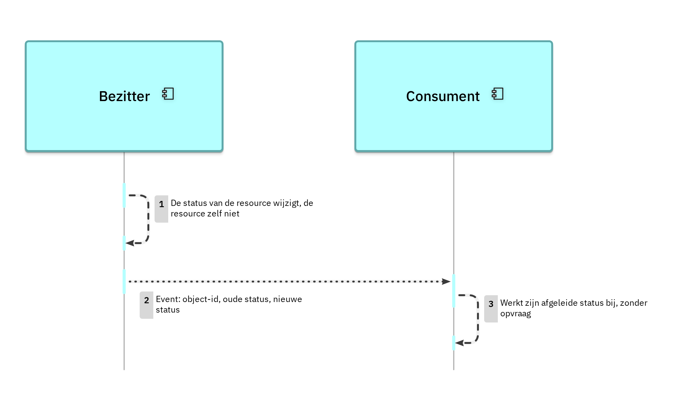

| Bericht | Richting | Synchroniciteit | Draagt | Draagt niet |
|---|---|---|---|---|
| Event | bezitter naar consument | Asynchroon | Object-id, oude waarde, nieuwe waarde | Een verwijzing die tot opvragen uitnodigt |

#### 6.2.3 Eigenschappen

**Een verloren bericht is verloren informatie.** Bij [Event Notification](#61-event-notification) staat de inhoud nog bij de bezitter en haalt de consument hem alsnog op; hier is het event de enige drager. Volgorde per object-id is daarom niet comfortabel maar noodzakelijk: twee overgangen in de verkeerde volgorde laten de ontvanger achter met een verkeerde status en zonder bron om op terug te vallen.

Het event draagt inhoud en niet alleen een verwijzing. Dataminimalisatie weegt hier dus zwaarder dan bij de andere patronen: het event draagt wat de ontvanger nodig heeft om zijn afgeleide status te bepalen, en niet meer.

Wat de ontvanger met de overgang doet is applicatiefunctionaliteit en valt buiten de koppeling.

#### 6.2.4 Toegepast in

| Koppeling | Wat gemeld wordt |
|---|---|
| [Specificatiestatus volgen](#44-specificatiestatus-volgen) | Specificatiestatus gewijzigd buiten een versiewijziging om, bijvoorbeeld van `gepubliceerd` naar `gedeactiveerd` |

<!-- pagina-einde -->

### 6.3 Asynchronous Request-Reply

De verwerking duurt langer dan een aanroep mag duren, dus de uitkomst komt terug als een apart bericht met een referentie naar wat de verwerker heeft aangemaakt. De naam komt uit de [Azure Cloud Design Patterns](https://learn.microsoft.com/en-us/azure/architecture/patterns/asynchronous-request-reply); wie de verwerking als opvraagbare resource modelleert volgt [AIP-151, Long-running operations](https://google.aip.dev/151).

#### 6.3.1 Wanneer

De consument kan niet in dezelfde aanroep antwoorden. Zijn verwerking duurt te lang, kan gedeeltelijk slagen, en kan stuklopen op gronden die alleen hij kent: een structuur die niet valide is, regels waarbinnen geen geldige uitkomst bestaat, of een uitkomst die lopende afspraken zou raken. De aanroep openhouden tot dat rond is bindt de bezitter aan de doorlooptijd van de consument.

#### 6.3.2 Verloop

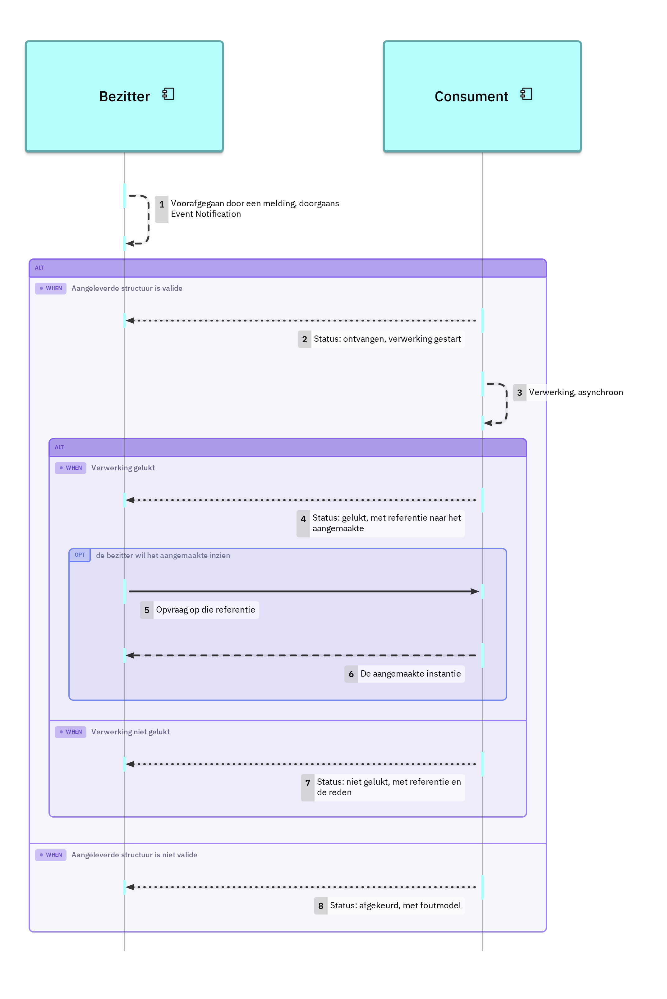

| Bericht | Richting | Synchroniciteit | Draagt | Draagt niet |
|---|---|---|---|---|
| Statusmelding | consument naar bezitter | Asynchroon | Status, referentie naar het aangemaakte, bij falen de reden | De aangemaakte instantie zelf |
| Opvraag | bezitter naar consument | Synchroon | De referentie uit de statusmelding | — |

#### 6.3.3 Eigenschappen

**De consument wordt bezitter van wat hij aanmaakt** ([U3](#83-u3-resource-eigenaarschap)). Daarom draagt de statusmelding een referentie en niet de instantie: wie hem wil inzien haalt hem op bij de nieuwe bezitter. De terugweg is daarmee opnieuw [Event Notification](#61-event-notification), met de rollen omgedraaid.

Eén verwerking levert meer dan één statusmelding op. `Ontvangen` en `gestart` zijn niet-terminaal en zeggen alleen dat het bericht is aangekomen en het proces loopt; `gelukt`, `niet gelukt` en `afgekeurd` sluiten de verwerking af. Alleen op een terminale status stelt de bezitter zijn eigen afgeleide status bij.

**De uitkomst zit in de statuswaarde, niet in het patroon.** Of de verwerking slaagt, afketst op een validatiefout, of vraagt om een besluit dat buiten de koppeling valt: het is in alle gevallen dezelfde uitwisseling met een andere waarde in het statusveld. Dat een bericht niet aankomt is iets anders — dat is een aflevervraagstuk.

OKx duwt de status terug als event. Het alternatief uit AIP-151, de verwerking als opvraagbare resource waar de bezitter zelf naar kijkt, vraagt geen afleveradres bij de tegenpartij en dus geen [Subscription registration](#65-subscription-registration).

#### 6.3.4 Toegepast in

| Koppeling | Wat teruggemeld wordt | Referentie naar |
|---|---|---|
| [Opleidingsaanbod aanmaken](#410-opleidingsaanbod-aanmaken) | Uitkomst van het planproces | Het opleidingsaanbod |
| [Opleidingsaanbod herplannen](#411-opleidingsaanbod-herplannen) | Uitkomst van het herplanproces | Het opleidingsaanbod |
| [Late wijziging toetsen](#412-late-wijziging-toetsen) | Uitkomst van de acceptatietoets | — |
| [Leeromgeving inrichten](#426-leeromgeving-inrichten) | Uitkomst van de inrichting | De inrichting |
| [Leeromgeving bijwerken](#427-leeromgeving-bijwerken) | Uitkomst van het bijwerken | — |
| [Nominaal template inrichten](#429-nominaal-template-inrichten) | Uitkomst van de inrichting | De inrichting |
| [Examenplanwijziging toetsen](#430-examenplanwijziging-toetsen) | Uitkomst van de acceptatietoets | — |

<!-- pagina-einde -->

### 6.4 Request-Reply

De afnemer vraagt op en krijgt antwoord, op een moment dat hij zelf kiest en zonder voorafgaand event. De naam komt uit [Enterprise Integration Patterns](https://www.enterpriseintegrationpatterns.com/patterns/messaging/RequestReply.html).

#### 6.4.1 Wanneer

Er is geen aanleiding van de andere kant, of de aanleiding is er wel geweest maar niet aangekomen. Twee gevallen: de afnemer richt zich in en heeft de huidige stand nodig, of hij herstelt nadat een event in de dead letter channel is beland en haalt op wat hij gemist heeft.

#### 6.4.2 Verloop

| Bericht | Richting | Synchroniciteit | Draagt | Draagt niet |
|---|---|---|---|---|
| Opvraag | consument naar bezitter | Synchroon | Id en versie, of een filter op status en wijzigingsmoment | — |
| Antwoord | bezitter naar consument | Synchroon | De resource, of een lijst van id's met hun laatste versie | De inhoud van elk item in een lijstantwoord |

#### 6.4.3 Eigenschappen

De opvraag is alleen-lezen en zonder neveneffect: herhaald aanroepen geeft hetzelfde resultaat, en dubbele ontvangst is onschadelijk.

**De lijst- of queryvariant is de herstelroute, niet de reguliere route.** Hij bestaat om te herstellen na een verloren event; de reguliere stroom blijft event-gedreven. Wie hem als polling-mechanisme gebruikt draait het model om dat [Event Notification](#61-event-notification) vastlegt.

Een lijstantwoord draagt verwijzingen, geen inhoud: id's met hun laatste versie, waarna de afnemer ophaalt wat hij nodig heeft.

#### 6.4.4 Toegepast in

| Koppeling | Waarvoor |
|---|---|
| [Reconciliatie](#432-reconciliatie) | Gepubliceerde specificaties of aanbod-instanties opnieuw opvragen na een gemist event |
| [Resultaatstructuur ophalen](#45-resultaatstructuur-ophalen) | Resultaatstructuur ophalen bij inrichting |

<!-- pagina-einde -->

### 6.5 Subscription registration

Een partij legt bij de ander vast waar events afgeleverd mogen worden, en voor welke soorten. De enige vastgestelde standaard voor dit patroon is [WebSub](https://www.w3.org/TR/websub/), een W3C Recommendation. De [CloudEvents Subscriptions API](https://github.com/cloudevents/spec/blob/main/subscriptions/spec.md) beschrijft hetzelfde patroon uitgebreider, maar draagt versie 0.1-wip en is nooit vrijgegeven; die is een richting om te volgen, geen grond om op te bouwen. Een Nederlandse abonneerstandaard is er niet: het [NL GOV profiel voor CloudEvents](https://gitdocumentatie.logius.nl/publicatie/notificatieservices/CloudEvents-NL/) legt het formaat van een event vast en houdt abonneren buiten scope.

#### 6.5.1 Wanneer

Voorwaarde onder elk push-patroon. Zolang de bezitter geen afleveradres kent, kan hij niets melden en valt [Event Notification](#61-event-notification) terug op opvragen. Beide partijen registreren over en weer, elk voor de events die de ander van hem ontvangt.

#### 6.5.2 Verloop

| Bericht | Richting | Synchroniciteit | Draagt | Draagt niet |
|---|---|---|---|---|
| Registratie | abonnee naar bron | Synchroon | Afleveradres en de event-soorten | Inhoudelijke gegevens |
| Bevestiging | bron naar abonnee | Synchroon | Abonnement-id | — |

#### 6.5.3 Eigenschappen

Registratie is idempotent op de combinatie van afleveradres en event-soort: herregistratie overschrijft de vorige en levert geen dubbele aflevering op.

**Het abonnement hoort bij het kanaal, niet bij het bericht** ([U5](#85-u5-bericht-versus-kanaal)). Het bestaat omdat aflevering via webhooks loopt, en vervalt zodra die via een bus of broker gaat. De berichten zelf veranderen daar niet van.

WebSub voegt twee dingen toe die OKx nu niet vastlegt: een verificatiehandshake waarmee de bron controleert of het opgegeven adres de registratie werkelijk wil, en ondertekening van elk afgeleverd bericht zodat de ontvanger de herkomst kan vaststellen. Zonder die twee kan een derde een afleveradres laten registreren, en kan een ontvanger niet vaststellen dat een binnengekomen event van de bron komt.

#### 6.5.4 Toegepast in

| Koppeling | Waarvoor |
|---|---|
| [Afleverabonnement registreren](#431-afleverabonnement-registreren) | Afleveradres vastleggen voor de meldingen die een afnemer van een aanbieder ontvangt |

<!-- pagina-einde -->

## 7 Auth-standaard voor koppelvlakken

**Aanleiding.** Geen enkele koppeling in dit pakket legt vast hoe een consument zich bij een endpoint authenticeert. Zonder een gedeelde standaard verzint elke koppeling dat opnieuw, en twee leveranciers die beide "aan de koppeling voldoen" kunnen alsnog niet verbinden omdat de een OAuth2 verwacht en de ander een API-sleutel. Dit document legt één mechanisme vast voor alle koppelvlakken in dit pakket.

Dit is, net als de uitgangspunten, een repo-brede keuze, geen keuze per koppeling: elke koppeling verwijst hierheen in plaats van authenticatie opnieuw te beschrijven.

### 7.1 Mechanisme: OAuth 2.0 Client Credentials

Consument en leverancier wisselen vooraf, buiten de koppeling om, een `client_id` en `client_secret` uit (onboarding/registratie, bilateraal per koppeling). Een consument vraagt daarmee een access token op bij de token-endpoint van het systeem dat hij aanroept, via de **Client Credentials grant** ([RFC 6749 §4.4](https://www.rfc-editor.org/rfc/rfc6749#section-4.4)): geen gebruiker in de lus, puur systeem-naar-systeem.

Elk systeem dat endpoints serveert is verantwoordelijk voor zijn eigen token-endpoint (of een eigen identity provider erachter); er is geen centrale OKx-brede autorisatieserver. Dat sluit aan bij [U3, resource-eigenaarschap](#83-u3-resource-eigenaarschap): wie de resource bezit, bezit ook de toegang ertoe.

### 7.2 Toepassing op webhook-aflevering

Een webhook-event is zelf ook een HTTP-aanroep, van de bezitter naar de callback-URL die de ontvanger bij het registreren van zijn abonnement heeft opgegeven. Dezelfde regel geldt dan omgekeerd: de afzender authenticeert zich bij het afleveren met een Bearer-token, opgehaald bij de token-endpoint van de ontvanger, met de credentials die bij de abonnementregistratie zijn afgesproken.

### 7.3 Wat dit niet regelt

- **Scopes en autorisatieclaims** binnen het token: welke velden of operaties een token precies mag, is nog niet uitgewerkt.
- **Tokenlevensduur en vernieuwing**: Client Credentials kent geen refresh token; een consument vraagt bij verval opnieuw een token op. De concrete geldigheidsduur is een inrichtingskeuze van de leverancier.
- **Sleutelbeheer**: rotatie en intrekking van `client_secret` zijn een operationele afspraak tussen de partijen, geen onderdeel van deze standaard.
- **Gebruikersauthenticatie**: alle koppelingen in dit pakket zijn systeem-naar-systeem; een leerling of medewerker komt nergens in de lus voor. Delegated auth (authorization code grant) valt daarmee buiten scope.

<!-- pagina-einde -->

## 8 Uitgangspunten voor koppelingen

**Aanleiding.** Bij het uitwerken van de eerste koppelingen bleek dat elk document dezelfde aannames opnieuw uitlegde: wat een beschrijving vastlegt en wat niet, wie welke resource bezit, waarom een event dun blijft. Die herhaling maakte de documenten langer dan nodig en, erger, liet de redenering op meerdere plekken uit elkaar lopen zodra er iets wijzigde. Daarom staan de gedeelde aannames hier eenmaal.

Deze uitgangspunten gelden voor **elke** koppeling in dit pakket en voor de payloads die zij uitwisselt. Een individueel document noemt het uitgangspunt in één regel en verwijst hierheen; het herhaalt de motivering niet. Zo hoeft een wijziging in de redenering maar op één plek te gebeuren.

De uitgangspunten zijn genummerd (U1 tot en met U11) zodat je er in een document of een review naar kunt verwijzen: "conform U5".

Herkomst: de [OKx-architectuurprincipes](../Referentiemateriaal/principes/principes.md) en [OKx-uitgangspunten](../Referentiemateriaal/principes/uitgangspunten.md), plus de architectuurbesluiten in [`Referentiemateriaal/adr/`](../Referentiemateriaal/adr). Waar een uitgangspunt op een besluit steunt, staat dat erbij. Alle aangehaalde besluiten hebben op dit moment de status voorstel.

### 8.1 U1. Bouwblokken liggen vast, de keuze van koppelingen is vrij

De **bouwblokken** zijn normatief: de koppelvlakdiensten met hun endpoints en payloads, en de interactiepatronen. Wie een bouwblok implementeert, implementeert het zoals het beschreven staat. Daardoor sluiten twee partijen die dezelfde berichtstroom implementeren op elkaar aan zonder aanvullende afspraak. Hoe een partij een bouwblok intern realiseert, blijft haar eigen keuze.

De **keuze van koppelingen** is vrij. Een partij implementeert de koppelingen die zij nodig heeft; OKx verplicht niemand tot een koppeling en legt niet op wie met wie koppelt. Binnen een koppeling is niets vrij: wie haar implementeert, implementeert in zijn rol elke berichtstroom ervan. Voor twee partijen die dezelfde koppeling implementeren, staat daarmee vast welke stromen er tussen hen lopen.

De afweging is die tussen vrijheid en aansluiting. Een vrije keuze per stroom laat elke partij precies bouwen wat zij nodig heeft, maar garandeert niet dat twee partijen dezelfde stromen hebben. Een koppeling legt de verplichting op het niveau van één doel. De prijs is dat een partij een stroom implementeert die zij binnen die koppeling zelf niet nodig heeft.

De scenario's waarmee een stroom wordt toegelicht zijn illustratief: ze onderbouwen waarom een bouwblok bestaat, maar leggen zelf niets vast.

De bouwblokken komen voort uit die scenario's. We hebben nog beperkt zicht op de werking van het ecosysteem; door koppeling voor koppeling en scenario voor scenario de interacties te bestuderen, ontdekken we welke operaties, endpoints en data nodig zijn. De **som** van de koppelingbeschrijvingen levert de koppelvlakspecificatie per referentiecomponent op: de endpoints en operaties die dat component kan bieden, elk gegrond in een beschreven interactie.

De beschreven koppelingen zijn **niet uitputtend**. Nieuwe functionaliteit kan operaties vragen die niet uit de huidige scenario's naar voren komen. Voorbeeld: een studentkeuzesysteem dat namens een student onderwijs aanvraagt dat nog niet bestaat. Zo'n behoefte komt binnen als nieuw scenario met een eigen koppelingbeschrijving, en onderbouwt daarmee een nieuwe operatie op het koppelvlak. Het koppelvlak houdt die ruimte.

Sluit aan op [OKx-AP04 — Koppelvlakken als open, gestandaardiseerde contracten](../Referentiemateriaal/principes/principes.md#okx-ap04--koppelvlakken-als-open-gestandaardiseerde-contracten) (het externe contract ligt vast, de interne realisatie niet), [OKx-AP02 — Semantiek vóór techniek](../Referentiemateriaal/principes/principes.md#okx-ap02--semantiek-vóór-techniek) (geen API-first zonder voorafgaande keten- en informatiemodelcontext) en [OKx-AP06 — Contracten zijn versieerbaar en evolueerbaar](../Referentiemateriaal/principes/principes.md#okx-ap06--contracten-zijn-versieerbaar-en-evolueerbaar).

### 8.2 U2. Koppeling versus koppelvlak

Een **koppeling** is één of meer endpoint-interacties met één doel, tussen een aanbieder en een afnemer. Zij is afgeleid van een applicatiedienst uit de domeinarchitectuur en komt één op één overeen met een OEAPI-profiel; de opbouw en de ontwerpregels staan bij [Koppelingen](#4-koppelingen). Een **koppelvlak** is de verzameling van alle koppelingen die één component raken, als aanbieder of als afnemer; de koppelvlakspecificatie is de optelsom per component.

Dit verfijnt [ADR 0021](../Referentiemateriaal/adr/0021-koppeling-versus-koppelvlak-terminologie.md), waarin een koppeling de volledige informatiestroom tussen twee referentiecomponenten was. Wat dat besluit één koppeling noemt, zoals onderwijscatalogus naar planning en roostering, bestaat hier uit meerdere koppelingen met elk een eigen doel.

### 8.3 U3. Resource-eigenaarschap

Elk systeem bezit zijn eigen resource en is er de enige bron van. De onderwijscatalogus bezit de onderwijsspecificaties, planning bezit het onderwijsaanbod, roostering bezit het rooster, het studentinformatiesysteem bezit de verbintenissen en resultaten. Niemand kopieert de resource van een ander.

Over de koppeling gaan daarom **referenties** (uuid) en niet de resource zelf, tenzij die expliciet wordt opgevraagd. Dat voorkomt dat dezelfde gegevens op meerdere plekken een eigen leven gaan leiden.

### 8.4 U4. Event notification

Een melding over een koppeling is dun: zij draagt de aanleiding en een verwijzing, niet de inhoud, en de afnemer haalt de resource zelf op. Het patroon staat uitgewerkt bij [Event Notification](#61-event-notification).

Dit uitgangspunt legt de keuze vast en niet het patroon: elke koppeling in dit pakket gebruikt het, en het is geen afweging per koppeling. Vastgelegd in [ADR 0020](../Referentiemateriaal/adr/0020-curriculumontwerp-onderwijscatalogus-happy-flow-synchronisatie-en-federatie-adopt-klonen.md).

### 8.5 U5. Bericht versus kanaal

Een koppeling legt het **bericht** vast: wat erin staat, wanneer het wordt verstuurd, hoe een ontvanger een herhaling herkent, en in welke volgorde berichten over dezelfde sleutel aankomen.

Hoe dat bericht bij de ontvanger komt, het **kanaal**, is een inrichtingskeuze van instelling en leverancier: een webhook, een bus, een broker of een cloud-pubsubdienst. OKx schrijft dat product niet voor.

Het kanaal is daarmee niet volledig vrij. [ADR 0018](../Referentiemateriaal/adr/0018-enterprise-messaging-patronen-voor-betrouwbare-koppelvlakken.md) is technologie-agnostisch maar niet vrijblijvend: welk kanaal je ook kiest, het moet aantoonbaar vier eigenschappen leveren.

| Eigenschap | Wat het betekent | Waarom het niet vrij is |
|---|---|---|
| Gegarandeerde aflevering | Een bericht raakt niet stil zoek | Zonder deze eigenschap merkt de keten een gemiste mutatie pas veel later |
| Idempotente verwerking | Een herhaald bericht heeft geen extra effect | Vereist een stabiel event-id in het bericht; dat is dus wel onze zorg |
| Dead-letterpad | Onverwerkbare berichten komen ergens zichtbaar terecht | Anders verdwijnt een fout zonder spoor |
| Volgorde per sleutel | Berichten over dezelfde entiteit komen in volgorde aan | Veel cloud-pubsubdiensten garanderen dit niet standaard en vragen expliciete configuratie |

De laatste is de scherpste. Twee implementaties die allebei "een bericht sturen" maar de volgorde per entiteitsleutel niet bewaken, leveren verschillende uitkomsten op bij statusovergangen.

**Open punt.** Welk afleveringsmechanisme partijen onderling kiezen is nog niet belegd. Twee systemen die beide aan het bericht voldoen maar waarvan het ene een webhook aanbiedt en het andere op een eigen broker publiceert, kunnen zonder afspraak of adapter alsnog niet koppelen. Dat is een vraag voor het koppelvlak, niet voor een afzonderlijke koppeling.

### 8.6 U6. Semantiek uit de ankertabel

Begrippen komen uit de [ankertabel](../Referentiemateriaal/kaderscenario's/leerroute-1-regulier.md#betrokken-informatie-bij-proces): kader, beoogde leeruitkomst, specificatie, aanbod, verbintenis, resultaat. Geen verzonnen termen; subtypen voluit met backquotes.

De **leeruitkomst is de sleutel**. Specificaties verankeren erop, en onderwijsresultaten worden erop behaald ([ADR 0022](../Referentiemateriaal/adr/0022-resultaatbegrippen-conform-rosa-koi.md), conform het ROSA Kernmodel Onderwijsinformatie). Verankering gebeurt op de uuid van de leeruitkomst, niet op een tekstcode; een leesbare aanduiding mag ernaast staan.

### 8.7 U7. Payload plat met verwijzingen, en de sleutelconventie

Objecten staan in **platte arrays** met een zelfverwijzende ouder-pointer, niet fysiek genest. Daardoor is elk object los adresseerbaar en los te versioneren, en hoef je geen halve boom mee te sturen om één onderdeel te wijzigen. De prijs is dat de hiërarchie niet meer uit de JSON zelf blijkt; daarom hoort er een instantieboom bij (U8).

**Sleutelconventie.** Het eigen sleutelveld van een object binnen zijn array heet `id`. Zodra een veld naar een ander object wijst, draagt het een expliciete naam die zegt waarheen: `bovenliggendSpecificatieId`, `bovenliggendAanbodId`, `leeruitkomstId`, `locatieId`, `specificatieVerwijzing.specificatieId`. Een kaal `bovenliggendId` is context-gevoelig en dus niet toegestaan.

Dit wijkt bewust af van de Open Onderwijs API, die getypeerde sleutels hanteert zoals `educationSpecificationId`. De payloads zijn Nederlandstalig, dus die afwijking bestond al; te betrekken bij de latere binding (uitgangspunt [OEAPI, tenzij](../Referentiemateriaal/principes/uitgangspunten.md#technologie-en-standaarden)).

**Taal.** Veldnamen en waarden in het Nederlands, met de Engelse of OEAPI-term tussen haakjes waar dat helpt.

### 8.8 U8. Machine-interpreteerbaar, met leesbare weergaven

Elke payload heeft een **JSON Schema** (draft 2020-12) in de [informatie- en gegevensmodellen](https://github.com/Npuls-OKx/Public/blob/informatie-en-gegevensmodellen-v0.1.0/Informatie-en-gegevensmodellen/README.md) dat de vorm vastlegt: types, verplicht of optioneel, enums en patronen. Enumeraties horen daar, niet in een aparte tabel. De volwassenheid wordt op het schema zelf gemarkeerd (`$comment`), niet in de documenttitel of de doelstelling (zie U10).

Sluit aan op de uitgangspunten [machine-interpreteerbare formaten](../Referentiemateriaal/principes/uitgangspunten.md#technologie-en-standaarden) en [show don't tell](../Referentiemateriaal/principes/uitgangspunten.md#afstemming-en-beschrijvingswijze).

### 8.9 U9. Scenario's en persona's

Documenten werken **leerroute 1** (regulier) uit aan de hand van persona **Jochem**, opleiding Apothekersassistent (SBB-kwalificatiedossier 23450, kwalificatie 27141). Leerroute 2 (temporiseren) en 3 (versnellen) volgen als **verschil** ten opzichte daarvan: de structuur blijft gelijk, een handvol attributen wijzigt.

De route en de persona staan volledig uitgewerkt in het [kaderscenario leerroute 1 — regulier](../Referentiemateriaal/kaderscenario's/leerroute-1-regulier.md). Dat document is de kaderstellende basis waarop de koppelingen hier doorbouwen; het beschrijft per processtap wat er gebeurt en welke informatie beweegt. De overige leerroutes: [`kaderscenario's/`](../Referentiemateriaal/kaderscenario's).

### 8.10 U10. Scope- en documentdiscipline

- **Intra-instelling eerst.** Koppelingen worden eerst binnen één instelling uitgewerkt; federatie en cross-instelling volgen gefaseerd ([ADR 0008](../Referentiemateriaal/adr/0008-scope-planning-eerst-intra-instelling.md)).
- **Scope sluit af.** Een document benoemt positief wat in scope is, noemt de afbakeningen die anders verwarring geven, en sluit af met de regel dat al het overige buiten het document valt. Een lezer hoeft dan niet te raden of iets vergeten of bewust weggelaten is.
- **Doel is toetsbaar.** Een document benoemt welke vragen het beantwoordt en wanneer het geslaagd is.
- **Geen statusaanduiding in de inhoud.** Woorden als "alpha" of "een eerste versie" horen niet in een titel, doel of scope. De volwassenheid van een artefact noteer je op dat artefact (bijvoorbeeld op het schema); de status van het werk staat in de pull request en de git-historie.
- **Geen metadatakop, geen issueverwijzingen.** Auteurschap en datums komen uit de git-historie; de weg waarlangs een document tot stand kwam staat in de pull requests. Deze documenten worden gereleased en moeten leesbaar zijn voor iemand die geen toegang heeft tot het werkproces erachter. Een verwijzing naar een issuenummer zegt zo'n lezer niets en veroudert bovendien: schrijf in plaats daarvan de **aanleiding** uit in de inleiding.
- **De inleiding is zelfdragend.** Ze benoemt de **aanleiding** (welk probleem of welke waarneming aanleiding gaf tot dit document), de **context** (waar het in de keten zit), het **doel** (welke vragen het beantwoordt) en de **scope** (wat er wel en niet in staat). Wie alleen de inleiding leest, weet of dit document zijn vraag beantwoordt.
- **Verwijzingen zijn links**, ook naar besluiten en naar andere documenten in deze map.

De bredere schrijfstijl staat in [`.cursor/rules/docs-style.mdc`](https://github.com/Npuls-OKx/meta/blob/d47bb0c74ec899a4384d06331692f74b9bd1db58/.cursor/rules/docs-style.mdc).

### 8.11 Gerelateerde documenten

- [Instap voor nieuwkomers](README.md): ketenoverzicht, hoofdplaat, afkortingenlegenda en leesvolgorde.
- [OKx-architectuurprincipes](../Referentiemateriaal/principes/principes.md) en [OKx-uitgangspunten](../Referentiemateriaal/principes/uitgangspunten.md): de richting waarop deze uitgangspunten steunen.

### 8.12 U11. Toekomstvaste endpoints: volledige structuur en delta

OKx definieert endpoints die ook toekomstige scenario's mogelijk maken. Waar een resource als structuur wordt ontsloten, biedt de eigenaar daarom beide vormen aan: de volledige structuur en de wijziging (delta). Een implementatie kiest zelf wat bij haar situatie past: een eenvoudige implementatie verwerkt de volledige structuur opnieuw, een rijkere implementatie verwerkt alleen de delta.

Waarom: de keten kent implementaties van verschillende volwassenheid, en scenario's die we nog niet kennen. Eén verplichte vorm dwingt óf onnodige complexiteit af (delta-berekening voor wie die niet nodig heeft) óf onnodig zwaar verkeer (volledige structuur voor wie alleen de wijziging wil). Twee vormen op dezelfde resource houden beide routes open zonder de semantiek te splitsen.

Zichtbaar in de koppeling [Onderwijsspecificatie ophalen](#433-specificatiewijziging-melden): de wijzigingsmelding is dun (conform U4), waarna de afnemer de volledige structuur of de delta ophaalt.
