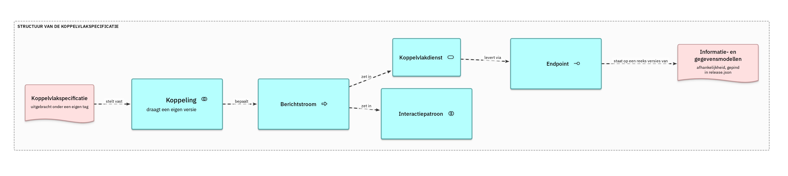
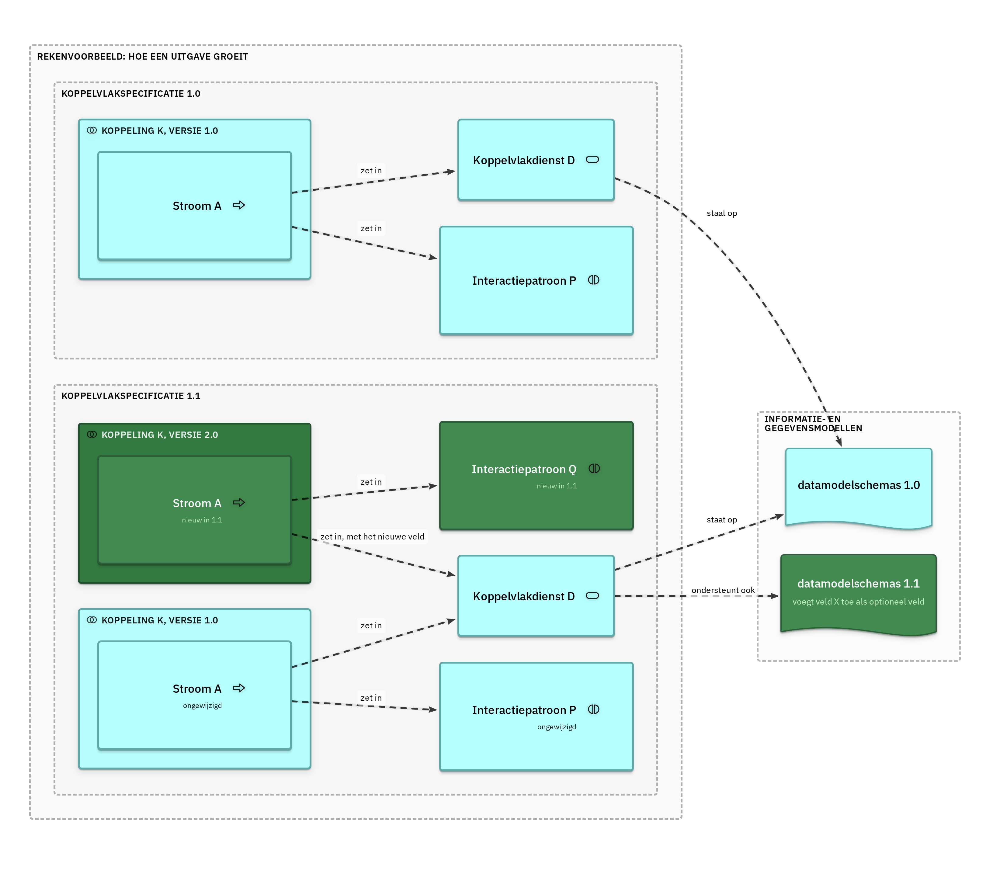

# Release management van de koppelvlakspecificatie

## 1. Inleiding

**Aanleiding.** De [algemene releaseregels](../Algemeen/release-management/Release-management-algemeen.md) definiëren een major als een niet-backward-compatibele wijziging waarna afnemers wordt geadviseerd te migreren. Die definitie gaat uit van een artifact waaraan een afnemer zich houdt. Dat is de koppelvlakspecificatie niet. Zij beschrijft hoe partijen kúnnen koppelen, niet of ze moeten koppelen, en welke koppeling een partij aangaat bepaalt die partij zelf. Het generieke schema toepassen alsof dit pakket een contract is, dwingt migraties af die niemand nodig heeft; wat dat kost is doorgerekend in het versiescenario.

**Context.** Het pakket bevat koppelingen, elk met één doel, één aanbieder en een eigen versie, en per koppeling de berichtstromen die wie haar implementeert allemaal levert. Een berichtstroom is samengesteld uit bouwblokken die los daarvan zijn vastgelegd: koppelvlakdiensten met hun endpoints en payloads, en interactiepatronen. Die bouwblokken zijn wat een implementatie deelt met andere implementaties.

**Doel.** Vastleggen wat versiebeheer voor dit pakket betekent: waar een partij zich aan houdt, wat een versienummer wel en niet zegt, en langs welke weg de inhoud wijzigt. Het beantwoordt daarmee de vraag wanneer een release een major, een minor of een patch is, en wat een afnemer bij elk van die drie moet doen.

**Scope.** Het releasepakket koppelvlakspecificatie. De [informatie- en gegevensmodellen](../Informatie-en-gegevensmodellen/README.md) vormen een eigen pakket met een eigen versie en leggen hun versiebeheer zelf vast; dit document legt alleen de verhouding met dat pakket vast. De OpenAPI-specificatie valt erbuiten, net als de vraag welke partij met welke andere partij koppelt. Al het overige valt buiten dit document.

---

## 2. Releasepakket

Het pakket bestaat uit de inleiding en de uitgangspunten, de requirementsboom, de applicatiecomponenten met hun koppelvlak, de koppelingen met de berichtstromen, de koppelvlakdiensten met hun endpoints, de interactiepatronen en de auth-standaard. Wat er in welke volgorde in het gebouwde document komt, en op welke versie van de informatie- en gegevensmodellen het bouwt, staat in [`release.json`](release.json).

---

## 3. Eigenaarschap

| Activiteit | Eigenaar-team | Review-/consulterend team | Communicatie-rol |
|------------|:---:|:---:|:---:|
| Inhoud van het artifact | R/A | C | I |
| Release (versie bepalen, publiceren) | R/A | C | I |
| Vaststellen dat een bouwblok in plaats wijzigt | A | R | C |
| Vaststellen dat een versie van een koppeling vervalt | A | R | C |
| Communicatie naar belanghebbenden | C | C | R/A |

Het eigenaar-team is het OKx-team dat in dit repository merget. De twee rijen die in het [template](../Algemeen/release-management/Release-management-template.md#3-eigenaarschap) samen één regel vormen zijn hier gesplitst, omdat dit de twee besluiten zijn die in [§4](#4-versiebeheer) een uitzondering vormen op de hoofdregel. Welke teams de kolommen invullen is nog niet belegd.

---

## 4. Versiebeheer

Dit pakket volgt het SemVer-schema en de definities uit [algemene regels §3](../Algemeen/release-management/Release-management-algemeen.md#3-versienummering). Wat hieronder staat is wat daar specifiek voor dit pakket bij komt.

Dat begint bij de structuur, want die bepaalt waar een versie aan hangt. Een uitgave stelt koppelingen vast, elk met een eigen versie; elke koppeling bepaalt berichtstromen; een berichtstroom zet interactiepatronen en koppelvlakdiensten in; een dienst levert via endpoints. Aan het einde van die keten staat de afhankelijkheid op het pakket [informatie- en gegevensmodellen](../Informatie-en-gegevensmodellen/README.md).

### 4.1 Waaraan een partij zich houdt

Een partij houdt zich aan **koppelingen**, niet aan een uitgave van dit document. Twee dingen samen maken haar implementatie OKx-conform:

1. **Zij implementeert de OKx-informatiemodellen.** De gegevens die zij uitwisselt hebben de vorm die het pakket [informatie- en gegevensmodellen](../Informatie-en-gegevensmodellen/README.md) beschrijft.
2. **Zij implementeert minimaal één [koppeling](Koppelingen/README.md)** in haar rol, met elke berichtstroom daarvan en met de koppelingen die zij vereist.

Wat een partij implementeert, noemt zij met drie gegevens: de koppeling, de versie en haar rol, aanbieder of afnemer. Een component dat in meer koppelingen optreedt, noemt er meer. Wat een partij buiten zulke koppelingen implementeert, telt niet mee voor haar conformiteit ([U1](uitgangspunten.md#u1-bouwblokken-liggen-vast-de-keuze-van-koppelingen-is-vrij)).

Samen zijn die twee precies wat een implementatie deelt met andere implementaties: dezelfde gegevensvorm, en per koppeling dezelfde stromen over dezelfde interface. Twee partijen die dezelfde versie van een koppeling in de twee rollen implementeren, sluiten zonder aanvullende afspraak op elkaar aan, en daar slaat de term OKx-conform op.

Het versienummer van het pakket doet iets anders. Het is een **vindmiddel**: het wijst de weg naar de uitgave waarin een koppeling beschreven staat. Daarmee dient het drie doelen — terugvinden welke uitgave een partij heeft gevolgd, de historie van wat er sindsdien bij is gekomen, en het vastleggen van de afhankelijkheid op de gegevensmodellen ([§4.6](#46-verhouding-tot-de-informatie--en-gegevensmodellen)).

De twee bewegen onafhankelijk van elkaar, en dat is de kern van dit hoofdstuk. Conformiteit verandert wanneer een partij haar eigen implementatie uitbreidt of aanpast; het versienummer van het pakket verandert wanneer dit pakket iets uitbrengt. Een uitgave die één koppeling toevoegt, laat de andere koppelingen staan en laat de componenten daarachter draaien zoals zij draaiden — terwijl het pakketnummer wel meebeweegt, want dat volgt de documentatie.

### 4.2 Een koppeling draagt haar eigen versie

Elke koppeling draagt een versie in de vorm `MAJOR.MINOR`, gelijk aan de `profileVersion` van haar OEAPI-profiel. Die versie, en niet het pakketnummer, is wat een partij noemt wanneer zij zegt wat zij implementeert. Een afnemer die zijn eigen koppelingen naast de release notes legt, ziet daardoor meteen of hij geraakt wordt.

| Ophoging | Wanneer |
|---|---|
| **MAJOR** | Wat de koppeling vraagt van wie haar implementeert, verandert: een stroom komt erbij of valt af, een stroom verloopt anders, of een endpoint of payload van een stroom breekt |
| **MINOR** | De koppeling wijzigt zonder iets nieuws te vragen van wie haar implementeert: een verduidelijking, een endpoint dat er een modelversie bij draagt ([§4.6](#46-verhouding-tot-de-informatie--en-gegevensmodellen)), of een extra OEAPI-basisversie |

Een gepubliceerde versie van een koppeling wijzigt niet; een nieuwe major komt naast de vorige te staan ([§4.3](#43-toevoegen-is-de-hoofdregel)). Een tekstcorrectie zonder betekenisverschil laat de versie ongemoeid. Een koppeling krijgt haar eerste versie, `1.0`, zodra elke stroom ervan endpoints heeft; tot die tijd is zij niet te implementeren.

**Vereiste koppelingen.** Een koppeling die een andere vereist, vereist die op een reeks majors, zoals een endpoint een reeks modelversies draagt. Krijgt de vereiste koppeling een nieuwe major die de afhankelijke koppeling ook aankan, dan krijgt de afhankelijke koppeling een minor waarin zij beide accepteert. Kan zij dat niet, dan krijgt ook zij een nieuwe major.

**Aanduiding.** Een koppeling wordt aangeduid met haar naam zoals in de bestandsnaam, gelijk aan de naam van haar OEAPI-profiel zonder het voorvoegsel `okx-`. Een berichtstroom wordt aangeduid met koppeling en stroom samen, bijvoorbeeld `opleidingsaanbod-aanmaken/planuitkomst-melden`. Beide bewegen niet mee met een versie.

### 4.3 Toevoegen is de hoofdregel

Een uitgave **voegt toe en wijzigt niet**. Nieuwe koppelingen, nieuwe versies van koppelingen, nieuwe koppelvlakdiensten, nieuwe endpoints en nieuwe optionele velden komen erbij; wat er is blijft zoals het is. Een bestaande implementatie blijft daarmee werken zonder dat iemand iets doet.

Moet een koppeling anders, dan komt er een **nieuwe major naast**: naast versie `1.0` verschijnt `2.0`, en de vorige blijft gepubliceerd zolang er partijen op draaien. Wie de nieuwe wil gebruiken stapt over wanneer het hem uitkomt; wie dat niet wil doet niets. Hetzelfde geldt een laag dieper: heeft de nieuwe major een ander interactiepatroon of een andere koppelvlakdienst nodig, dan komen ook die ernaast te staan in plaats van dat de bestaande wijzigen.

Een uitgewerkt geval. In uitgave `1.1` van het pakket willen we de stroom `A` van koppeling `K` laten verlopen met een nieuw interactiepatroon `Q` en met een veld dat alleen bestaat in versie `1.1` van de gegevensmodellen. Wat er dan in uitgave `1.1` staat:

| Bouwblok | In uitgave `1.0` | In uitgave `1.1` |
|---|---|---|
| Koppeling `K` versie `1.0` | aanwezig; stroom `A` zet `P` en `D` in | ongewijzigd aanwezig |
| Koppeling `K` versie `2.0` | — | nieuw; stroom `A` zet `Q` en `D` in, met het nieuwe veld |
| Interactiepatroon `P` | aanwezig | ongewijzigd aanwezig |
| Interactiepatroon `Q` | — | nieuw |
| Koppelvlakdienst `D` | endpoint staat op modellen `1.0` | ongewijzigd; het endpoint draagt `1.0` én `1.1` |

Koppelvlakdienst `D` wijzigt niet. Het nieuwe veld is optioneel, dus het endpoint waarmee `D` geleverd wordt draagt beide modelversies: wie tegen `1.0` bouwde valideert nog steeds, wie versie `2.0` van `K` gebruikt krijgt het veld erbij ([§4.6](#46-verhouding-tot-de-informatie--en-gegevensmodellen)). Voor het pakket is de nieuwe major van `K` een minor, want versie `1.0` blijft staan.

Wat dit voor de partijen betekent, is het punt van dit hele model. Wie `K` versie `1.0` implementeert, blijft werken en blijft conform, ongeacht het pakketnummer: er is niets aan zijn koppeling veranderd. Wie versie `2.0` wil gebruiken, implementeert die wanneer het hem uitkomt. Twee partijen spreken per koppeling één major; een aanbieder die beide majors aanbiedt, bedient afnemers op de oude en op de nieuwe tegelijk. Er is geen migratievenster en geen moment waarop iemand niet meer conform is.

Dit is de reden dat brekende wijzigingen in dit pakket zeldzaam horen te zijn. Ze bestaan alleen in de twee uitzonderingen hieronder.

### 4.4 Twee uitzonderingen

**Een bouwblok wijzigt in plaats.** Soms is het beter een koppelvlakdienst, een endpoint of een interactiepatroon te wijzigen dan er een naast te zetten: als elke partij erbij wint en een tweede variant het geheel alleen maar troebeler maakt. Dat is een besluit, geen constatering, en het hoort bij de rijen in [§3](#3-eigenaarschap) die daarvoor zijn aangewezen. Elke koppeling die het bouwblok inzet, krijgt dan een nieuwe major waarvan de vorige niet blijft staan. Dit is de enige plek waar een wijziging bestaande implementaties breekt.

**Een versie van een koppeling vervalt.** Een versie waarop niemand meer draait kan worden uitgefaseerd. Ook dat is een besluit, en het vraagt om een aankondiging vooraf, omdat de uitgever niet kan zien wie er nog op draait.

De hoofdregel en deze uitzondering volgen samen het patroon *expand–contract*, ook bekend als *parallel change*, maar niet volledig. Dat patroon wijzigt een gedeelde interface in drie stappen: het nieuwe naast het bestaande (*expand*), elke partij stapt over op haar eigen moment (*migrate*), en het oude vervalt (*contract*). Dit pakket neemt de eerste twee stappen over als hoofdregel ([§4.3](#43-toevoegen-is-de-hoofdregel)). De derde is hier de uitzondering en niet de afsluiting.

De reden is dat expand–contract ervan uitgaat dat de afnemers bekend zijn en dat de overstap kan worden aangestuurd. Een gepubliceerde specificatie weet geen van beide. De oude versie blijft daarom staan zolang er partijen op draaien, en opruimen is een besluit met aankondiging vooraf. De prijs daarvan is dat versies zich opstapelen: naast `1.0` blijft `2.0` staan, en een aanbieder die beide bedient onderhoudt beide.

### 4.5 Wanneer welke bump

Deze tabel gaat over het pakket als geheel; de versie van een koppeling volgt [§4.2](#42-een-koppeling-draagt-haar-eigen-versie).

| Bump | Wanneer | Wat een afnemer moet doen |
|---|---|---|
| **PATCH** | Tekstcorrectie, verduidelijking, hersteld voorbeeld: geen koppeling krijgt een nieuwe versie | Niets |
| **MINOR** | Er komt iets bij: een koppeling, een nieuwe versie van een koppeling naast de vorige, een koppelvlakdienst, een endpoint, een optioneel veld of een enum-waarde | Niets, tenzij hij de nieuwe mogelijkheid wil gebruiken |
| **MAJOR** | Een van de twee uitzonderingen uit [§4.4](#44-twee-uitzonderingen) | Nagaan of een koppeling die hij implementeert geraakt wordt, en zo ja: overstappen binnen de aangekondigde termijn |

Een major is daarmee zeldzaam en de norm is een minor. Dat is geen versoepeling van de algemene regels maar een gevolg van de manier waarop de inhoud wijzigt.

### 4.6 Verhouding tot de informatie- en gegevensmodellen

Dit pakket bouwt op vastgelegde versies van de informatie- en gegevensmodellen, gepind in `release.json`. De twee versienummers zijn onafhankelijk: een nieuwe uitgave van de gegevensmodellen dwingt geen uitgave van dit pakket af, en omgekeerd. Wat een uitgave van dit pakket wel doet, is vastleggen op welke versies van de gegevensmodellen de beschreven bouwblokken staan.

Meervoud, en wel om twee redenen.

**De afhankelijkheid hangt aan het endpoint.** Niet aan het pakket als geheel en niet aan de koppelvlakdienst: het endpoint is de plek waar een payload wordt uitgewisseld, dus daar hoort te staan op welke modelversies die payload staat. Twee endpoints van dezelfde dienst kunnen daardoor op verschillende versies staan, en een uitgave die één endpoint verlegt raakt de andere niet.

**Eén endpoint kan een reeks versies dragen.** Kreeg een schema er alleen optionele velden bij, dan blijft het endpoint geldig tegen de oude versie én tegen de nieuwe, en dan noteert het ze allebei. Dat is wat het voorbeeld in [§4.3](#43-toevoegen-is-de-hoofdregel) mogelijk maakt: het voorkomt dat een uitbreiding van de gegevensmodellen een nieuwe major van een koppeling afdwingt.

Waar het pakketbrede pin in `release.json` dan nog voor is: hij legt vast welke uitgaven van de gegevensmodellen bij deze uitgave horen, zodat een lezer weet in welke verzameling hij de genoemde versies moet zoeken. De precieze reeks per endpoint staat bij het endpoint.

### 4.7 Wat een component ondersteunt

Omdat conformiteit niet meer aan het versienummer van het pakket hangt, is er iets anders nodig waarmee twee partijen vaststellen of zij kunnen koppelen. Het pakketnummer vulde die rol nooit goed — het zei wat een partij had gelezen, niet wat zij had gebouwd — maar het was wel het enige wat er was.

Het voorstel is dat dit pakket een **metadata-endpoint** voorschrijft: een endpoint dat een component aanbiedt en waarmee een ander component opvraagt welke koppelingen het implementeert, in welke rol en op welke versie, en op welke versies van de gegevensmodellen. Omdat de vorm uit dit pakket komt, kan elke partij elk ander component op dezelfde manier bevragen.

Wat dat oplost is de vraag vooraf: kunnen deze twee partijen koppelen, en op welke versie van welke koppeling. Wat het niet doet is iemand tot een implementatie verplichten — het maakt alleen zichtbaar wat er is.

Dit endpoint is nog niet gespecificeerd. De aanduidingen waarnaar het verwijst liggen wel vast ([§4.2](#42-een-koppeling-draagt-haar-eigen-versie)).

### 4.8 Nog te beslissen

**Hoe een afnemer een major kiest.** Twee majors van dezelfde koppeling kunnen naast elkaar bestaan, en een aanbieder kan ze allebei bedienen. Hoe een afnemer aangeeft welke van de twee hij spreekt — in het pad, in een header of in zijn afleverabonnement — ligt nog niet vast. Bij een major die alleen een endpoint hernoemt lost het zichzelf op, omdat de twee majors verschillende paden dragen; bij een major die een payload breekt niet.

---

## 5. Communicatie

Standaard geldt [algemene regels §5](../Algemeen/release-management/Release-management-algemeen.md#5-communicatie-naar-belanghebbenden). Aanvullend geldt voor dit pakket dat de release notes **per koppeling benoemen wat er bij is gekomen**: een nieuwe koppeling, of een nieuwe versie van een bestaande met wat daarin anders is, zodat een afnemer kan zien of er iets bij zit dat hij wil gebruiken. Bij een van de twee uitzonderingen uit [§4.4](#44-twee-uitzonderingen) noemen de release notes bovendien welke koppelingen geraakt worden, welk bouwblok wijzigt of welke versie vervalt, en binnen welke termijn.

---

## 6. Releaseproces

Standaard geldt het proces uit [algemene regels §6](../Algemeen/release-management/Release-management-algemeen.md#6-releaseproces). Eén aanvulling: omdat een uitgave in de regel toevoegt en niet wijzigt, landt vrijwel alles op zowel release branch N als N-1. De tweede branch komt pas in beeld bij een van de twee uitzonderingen, en is de rest van de tijd een kopie van de eerste.
